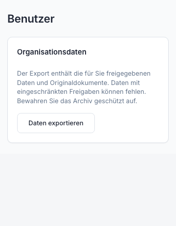
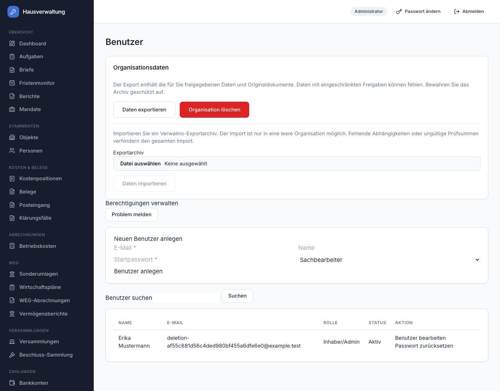
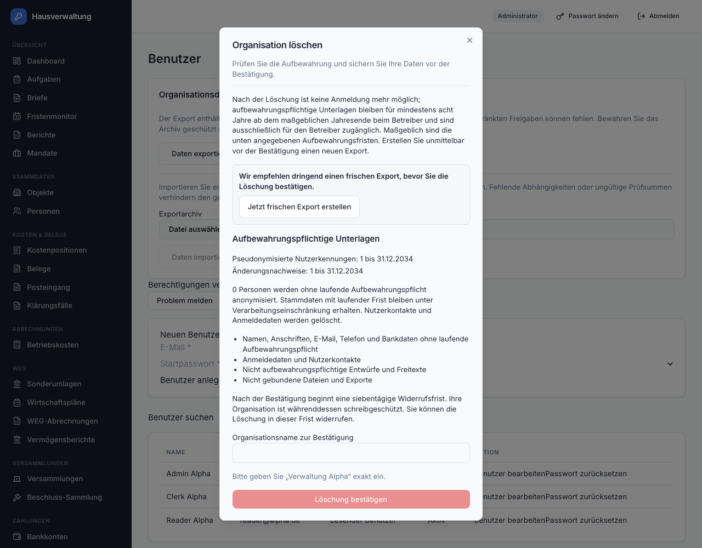
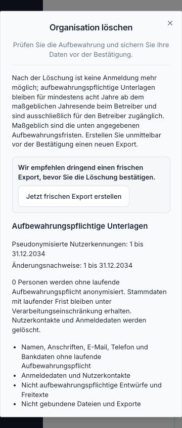
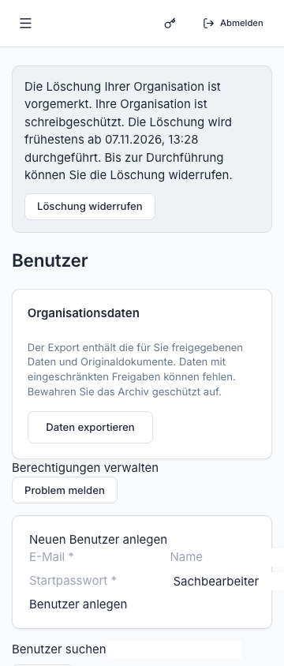
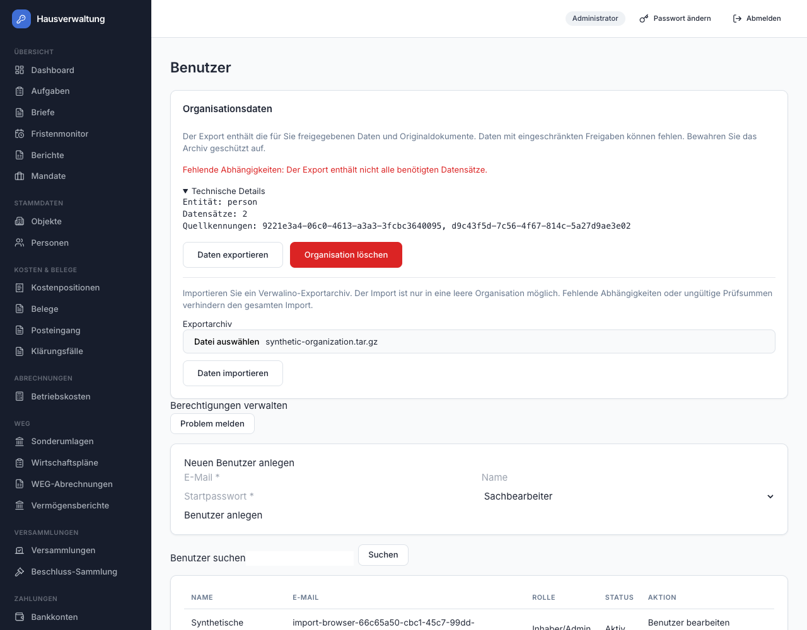
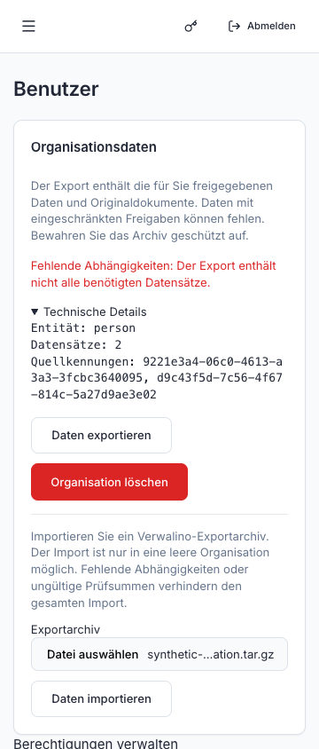
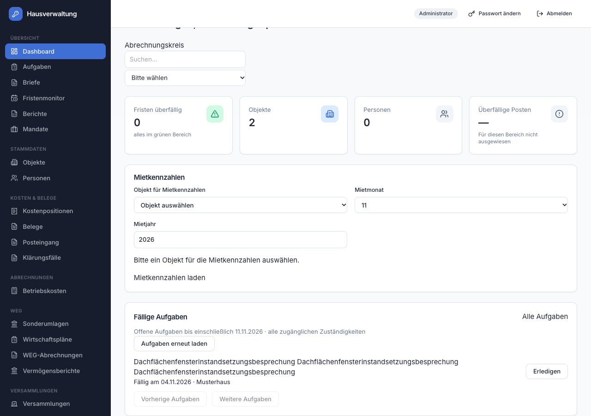
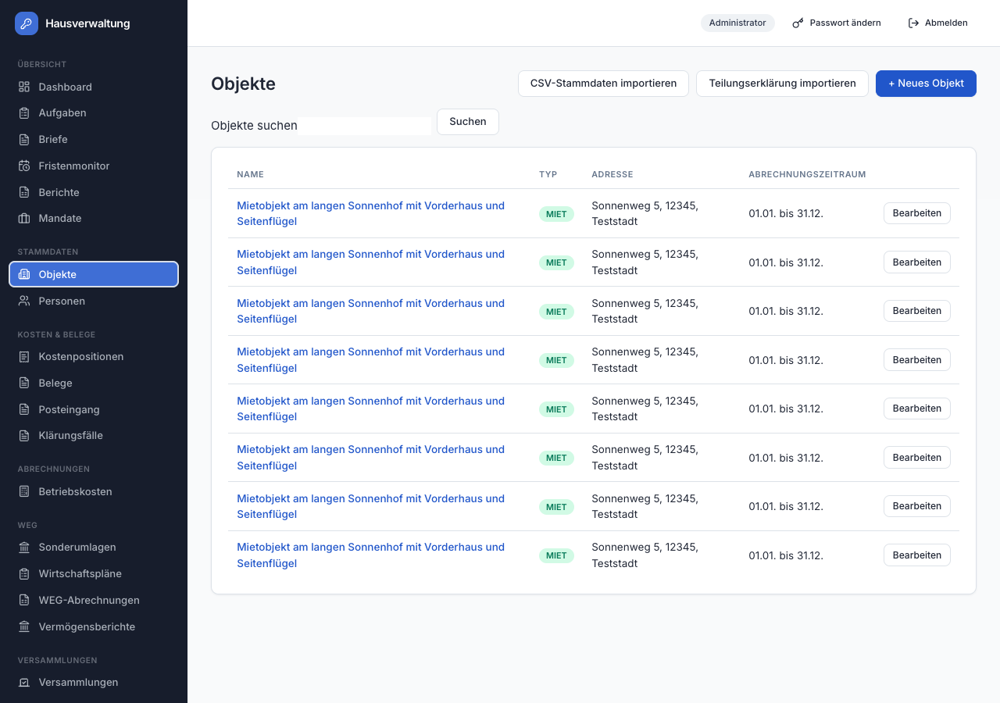
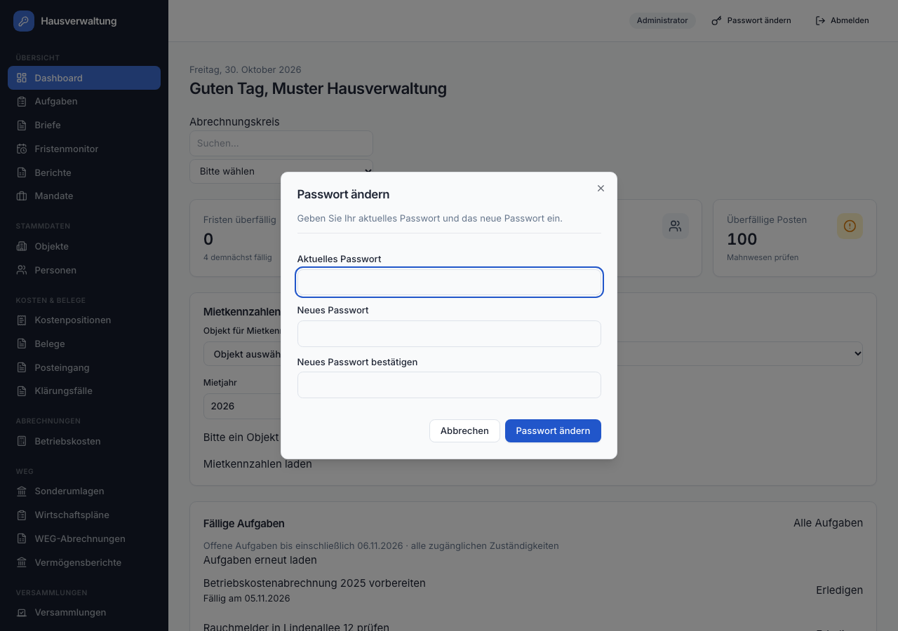

# Verwalino design contract

DESIGN.md is the authoritative frontend design contract for Verwalino: layout, tokens, UI kit
components and their behaviour, states, copy and formats. Define visual changes here before CSS
tweaks land. New screens follow this contract; changes to the look or copy update it in the same PR.
Named implementation deviations remain documented below as known debt tracked in #48, #49 and #50.
New work follows the contract.

Source files: `frontend/tailwind.config.cjs` (token mapping), `frontend/src/index.css` (tokens, global
classes), `frontend/src/components/ui/` (UI kit), `frontend/src/components/AppShell.tsx`,
`Sidebar.tsx`, `Topbar.tsx` (shell). Copy and format rules also appear in the
[frontend rule](.claude/rules/frontend-ui.md). The current theme is light; dark mode is outside this
contract.

## How to build a screen

Two styling layers coexist:

- **UI kit** (`frontend/src/components/ui/`, Tailwind utilities on the tokens below). The shell, the
  dashboard, mandates and the dialogs are written this way; their file headers call it "UI-Kit".
- **Global classes** in `index.css` (`.card`, `.btn`, `.badge`, `.data-table`, `.info-table`, `.form-grid`,
  `.error-text`, `.empty-hint`, ...). About 430 raw `<button class="btn">` and most list/detail pages use
  them. `index.css` says they were restyled to match the kit, so both layers look the same.

Follow [Components](#components) for the permitted styling layers and their source files, and
[Colour](#colour) for token use.

The property creation/edit form offers an optional native select labelled
“Bundesland”, with all sixteen states. “Nicht festgelegt – bundesweite Feiertage”
represents an empty value. The adjacent hint explains that statewide holidays
control rent due dates and municipality-only holidays are excluded. Existing
form-grid spacing and responsive behaviour apply.

| Property holiday context | Desktop | 360 px |
| --- | --- | --- |
| Before | [Desktop](docs/assets/design/rent-state-before-1280.png) | [Phone](docs/assets/design/rent-state-before-360.png) |
| After | [Desktop](docs/assets/design/form-objekt-desktop.png) | [Phone](docs/assets/design/form-objekt-360.png) |

## Foundations

### Contract ownership and verification

- One fact has one visual place: show a status, result or action on the surface that owns it.
  An equivalent hidden accessible label may repeat it.
- Enforce the contract's behaviour and copy with interaction tests in the area's
  `frontend/src/**/*.test.tsx`; browser features in `features/` verify geometry that jsdom cannot check.
- When the look changes, update this contract and the screenshots in `docs/assets/design/`
  in the same PR.

### Colour

Tokens are HSL channels on `:root` in `index.css`, exposed to Tailwind in `tailwind.config.cjs`
(`bg-primary`, `text-muted-foreground`, `border-border`, ...). Hex values are rounded renderings.

| Token (Tailwind) | HSL | Hex | Role |
|---|---|---|---|
| `background` | 210 20% 98% | `#f9fafb` | page background, inputs, dialog surface |
| `foreground` | 222 24% 17% | `#212736` | body text |
| `card` / `card-foreground` | 0 0% 100% / as foreground | `#ffffff` | cards, topbar, outline buttons |
| `primary` | 221 72% 46% | `#2156ca` | main action, links, focus ring, active hover border |
| `primary-foreground` | 0 0% 100% | `#ffffff` | text on primary |
| `secondary` | 214 24% 95% | `#eff2f5` | default badge, role chip, quiet panels (`bg-secondary/40`) |
| `muted` / `muted-foreground` | 214 24% 95% / 215 16% 47% | `#65758b` text | secondary text, hints, descriptions, table headers |
| `accent` | 214 30% 93% | `#e8ecf3` | hover on outline and ghost buttons, table row hover (50%) |
| `destructive` | 0 72% 50% | `#db2424` | error text, destructive button |
| `border` (`--ui-border`), `input` | 214 20% 89% | `#dde2e9` | all borders and input outlines |
| `ring` | 221 72% 46% | `#2156ca` | keyboard focus ring |
| `sidebar` / `sidebar-foreground` | 222 32% 13% / 214 22% 88% | `#171d2c` / `#dae0e7` | navigation rail |
| `sidebar-accent` | 221 64% 54% | `#3f6ed5` | active nav item, brand tile |

Semantic colours that are **not** tokens: `ui/badge.tsx` and `ui/stat-card.tsx` use the Tailwind palette
(blue = primary/type, emerald = success, amber = warning/attention, red = destructive, slate = info/neutral).
`success` and `warning` exist as tokens but no component uses them. Legacy `.badge--*` classes use fixed
hex pairs. `--border` (hex) and `--ui-border` (HSL) are different variables: the kit uses `--ui-border`.
Legacy variables `--color-primary` (`#2456c8`), `--bg-content`, `--text`, `--text-muted` remain for old
inline styles. Use token colours rather than hard-coded hex values: pick a role from the table;
for a new status colour reuse a `Badge` tone.

### Typography

- Family: Inter Variable, self-hosted through `@fontsource-variable/inter` (imported in `main.tsx`),
  fallback `system-ui`. In `index.css`, monospace (`--mono`) is used for `code`, declaration `pre`
  blocks (`.declaration-value-grid`, `.declaration-rule-details`) and `.candidate-decision textarea`.
  Inline styles also use it for amounts in `OpenItemsPage.tsx` and identifiers in `ResolutionRegisterPage.tsx`.
- The root font size is **15 px** (`:root`), so 1 rem = 15 px and all rem-based Tailwind sizes scale with it.
- Scale as used: page title `h1` 1.5rem / 600 / -0.01em (`index.css`; dashboard uses `text-2xl`);
  section title `h2` 1.05rem / 600; card title `text-base font-semibold`; body 15 px; form labels
  `text-sm` (kit) or 0.82rem / 500 (`.form-grid`); table header 0.72rem uppercase, tracking 0.05em;
  badges `text-xs`; nav group labels 0.68rem uppercase; stat values `text-2xl font-semibold`.
- Numbers in tables and tiles use `tabular-nums`. `-webkit-font-smoothing: antialiased` is global.

### Spacing, radius, elevation

- Spacing is the default Tailwind scale (on the 15 px rem). Page gutter `px-4 py-6`, from `md`
  `px-8 py-8`; content is centred at `max-w-6xl` (72 rem). Vertical rhythm between blocks: `space-y-5`
  or `space-y-6` (kit pages), `1.5rem` bottom margin per legacy card. Card padding `p-5` (kit) or
  `1.25rem 1.4rem` (`.card`). Grids: `gap-4` for stat tiles, `gap-6` for main panels, `.form-grid` gap
  `1rem 1.1rem`.
- Radius: `--radius` = 0.65 rem. `rounded-lg` = radius (cards, tiles), `rounded-md` = radius - 2 px
  (buttons, inputs, nav items), `rounded-sm` = radius - 4 px. Badges and the role chip are `rounded-full`.
- Elevation is flat: cards and primary buttons `shadow-sm` with a 1 px border; a linked `StatCard` gains
  `shadow-md` and `border-primary/40` on hover; dialogs `shadow-lg` over a `bg-black/50` overlay.
  Stacking: mobile nav overlay `z-30`, sidebar `z-40`, dialog and overlay `z-50`.

### Icons

`lucide-react` only; no custom SVG, no emoji. Icons accompany a text label, except the mobile menu
button (`aria-label="Navigation umschalten"`) and the topbar key button below `sm` (`title`). Sizes (rem,
so x 15 px): `h-4 w-4` inside buttons (`Button` forces `[&_svg]:h-4 [&_svg]:w-4`) and in the quick-action
tile, 1.05 rem in the nav, `h-5 w-5` in the `h-10 w-10` `StatCard` tile. Colour follows the text colour.

### Interaction

Every control has a label, and dialogs are keyboard-operable. Mark errors with `role="alert"` and
outcomes with `role="status"`.

Focus: kit controls show `ring-2 ring-ring ring-offset-2`; `.btn` shows a 3 px `ring/30` shadow; form-grid
fields a 3 px `ring/18` shadow with a primary border. Disabled controls use `opacity-50` and
`not-allowed`/`pointer-events-none`. Transitions are colour/shadow only and short (about 0.15 s). Note: `ui/dialog.tsx`
carries `animate-in`/`fade-in` classes, but the `tailwindcss-animate` plugin is not installed
(`plugins: []`), so dialogs do not animate.

## Layout

### Organization quota card

The dashboard shows a kit `Card` named “Kontingent” for the hosted free plan,
with a semantic `h2` and a responsive one/three-column definition list. It shows
“Speicher”, “Objekte” and “Einheiten” as usage / limit, with German number
formatting and MiB/GiB storage units, using the shared upload-cap formatter. At 90% or
above, a warning `Badge` says
“Fast ausgeschöpft” and the card says “Ihr Kontingent ist zu mindestens 90 %
belegt.” Errors show “Kontingent nicht verfügbar.” with retry; loading shows
“Kontingent wird geladen …”. The card waits for deployment metadata and requests
usage only in hosted mode. Selfhost renders no quota, loading or error card and
never requests the aggregate. Aggregate
usage is available to every authenticated member, independently of source grants.
The declaration-import failure `ORGANIZATION_AI_BUDGET_EXCEEDED` uses “Das
monatliche KI-Budget ist ausgeschöpft. Bitte wenden Sie sich an den Betreiber.”
Quota refusals carry a stable `detail.code` and German `detail.message`. The shared
API client reads the code for JSON and multipart refusals, exposes it on `ApiError`,
and preserves the German message in existing error surfaces.
Attachment upload errors with status 413 display the backend's German explanation,
including “Speicherkontingent erschöpft …”, while preserving the file and title.
Declaration, intake and attachment file checks, hints and validation messages read
the public metadata file cap. They and the quota card display MiB, or GiB from
1 GiB upwards, through `formatUploadLimit` in `frontend/src/lib/uploads.ts`: at
most two decimal places, trailing zeros dropped, German decimal comma and
thousands separator (`25 MiB`, `1,5 GiB`, `2 GiB`). Backend 413 upload refusals
and the storage refusal use the same format through `format_upload_limit`. The
fallback is 25 MiB while metadata is loading or unavailable.

### Organization export

The admin-only Users page starts with an “Organisationsdaten” kit card. Its muted
paragraph explains that only released data/originals are included, restricted
data may be missing, and the archive must be protected. “Daten exportieren” is a
large outline button. It makes no request on mount, disables while preparing,
and reads “Export wird vorbereitet …” while busy. Server errors appear unchanged
in a German `role="alert"`; failure keeps the button available for retry and
starts no download. Changing the organization, account or role cancels an active
request. Successful responses download `verwalino-organisation.tar.gz`; there is
no success claim about where the browser saved it. Text wraps at 360 px.
The card loads the lightweight organization/lifecycle status to offer
“Daten importieren” to owner-administrators outside cooling-off. Its copy explains
that only an empty destination is accepted; the import request checks admission.
The labelled archive input preserves the file on refusal. German error copy stays
in the alert; raw entity names, source IDs and counts appear only in a collapsed
“Technische Details” disclosure with wrapping text. Import reports the processed
archive row count.
Structured import refusal codes are read from `ApiError.code` and appear as
“Fehlercode: …” in that same disclosure, alongside any entity/source diagnostics.
The German alert text and selected archive remain available for retry.
“Organisation löschen” opens a scrollable kit dialog with retained entity
counts/deadlines, erasure categories, the German no-login/operator-retention
notice and a prominent fresh-export recommendation/button immediately before
confirmation. Exact typed organization name enables the destructive confirmation.
During the seven-day cooling-off every signed-in page shows a wrapping status
banner with the earliest execution time (“frühestens ab”); only the owner-admin
sees “Löschung widerrufen”. Cancellation remains possible until actual execution,
including when a due operator run has failed.
Import and new deletion actions are hidden during cooling-off. The export and
banner cancellation remain available. Dialog/button text wraps at 360 px.
The deletion dialog stays within 90dvh with internal scrolling and a 16 px
horizontal gutter on phones. It disables CSS transitions so viewport changes
apply the height/width bounds immediately; resizing cannot temporarily move
the fresh-export control outside the viewport.

### App shell

`AppShell.tsx`: `flex h-screen overflow-hidden` = **Sidebar** (16 rem) + a column of **Topbar**
(`h-16`, `border-b bg-card`, `px-4 md:px-8`) and `main` (the scroll container; the window itself never
scrolls) with the centred `max-w-6xl` content. Topbar right side: role chip (from `sm`), "Passwort ändern"
(opens the password dialog; label hidden below `sm`), "Abmelden". Signed out, `LoginPage` renders alone
(own `LoginPage.css`, 380 px card); while the session is probed `App.tsx` shows a centred "Lade...".

Below `md` (768 px) the sidebar is off-canvas (`fixed`, slides in via the hamburger, `bg-black/40`
overlay, closes on link click or overlay click); from `md` it is static. `AppShell.css`, `Sidebar.css`
and `Topbar.css` exist but are imported nowhere; the shell is styled with utilities only.

First-run setup opens when `GET /api/setup` reports `required: true`; the backend
owns the deployment decision. Required setup takes precedence over login and
signup without requesting deployment metadata. In `hosted` mode it reports
`required: false` and `/setup` redirects to login. While setup status loads, the
existing "Lade..." state applies; if that check fails, login and signed-in pages stay available and setup
requires a later successful app load. This changes route availability without
adding visual elements.

### Hosted registration

`/signup` and `/signup/confirm` are standalone pages, gated by confirmed hosted
metadata. Selfhost and unavailable metadata redirect to login without submitting.
A mistyped confirmation password shows “Passwort nicht korrekt. Bitte versuchen Sie es erneut.”
and keeps the live token for another attempt (422). Invalid/expired/used links and
throttling return 403 and clear it; success clears it too.
Hosted login adds the text link “Konto erstellen”; selfhost login has no signup link.
Login and signup show "Lade..." while metadata loads; metadata errors leave login available.

Registration uses the setup pattern: centred `max-w-lg` kit `Card`, `p-4 sm:p-6`,
`min-w-0`, a wrapping `h1` “Konto erstellen”, labelled `Input` controls at `h-11`,
and one full-width large primary button. Fields are “Organisation”, “Name”,
“E-Mail”, “Passwort” and “Passwort wiederholen”; passwords explain the 12–128
character requirement. The honeypot is hidden from layout, assistive technology
and keyboard focus. Busy forms retain their inputs and disable their fieldset.
Errors use `role="alert"` and preserve inputs; password mismatch is explained
before submitting. “Zur Anmeldung” remains available.

On acceptance the form is replaced by the server's generic `role="status"` receipt:
“Wenn die Adresse frei ist, haben wir eine E-Mail geschickt”. Passwords are cleared.
A muted note explains checking spam and the ten-minute resend interval. The ghost
button “Erneut senden” requests another link; it shows the same conditional receipt
without claiming delivery. Failure keeps the receipt and offers retry.

Confirmation uses the same card and heading “E-Mail bestätigen”. It asks for the
chosen “Passwort” with `current-password` autocomplete and a large full-width
“E-Mail bestätigen” button. The query token is removed immediately; no request is
sent until explicit submit. The password proves that confirmation activates the
user’s own registration, including after resend. Busy state says “Bestätigung läuft …”;
duplicate submits and StrictMode never create a second POST. The token is saved in
tab-local `sessionStorage` before removing it from the URL, preserving reloads. It
is cleared after success or a 403, and retained for retryable errors. The password
never enters browser storage. Success reloads the dashboard from the session cookie. Failure shows the German server refusal with `role="alert"`
and “Zur Registrierung”. The HTML uses a no-referrer policy. Inputs and receipt
text must wrap without horizontal scrolling at 360 px.

### Password recovery

Login shows “Passwort vergessen?” only when public metadata confirms mail is
available, in either mode. `/passwort-vergessen` uses the same centred `max-w-lg`
kit card and `h-11` labelled inputs as signup, with “E-Mail” and a honeypot hidden
from layout, keyboard and assistive technology. “Link anfordern” submits once;
busy state disables the fieldset and says “Anfrage läuft …”. The form becomes a
conditional `role="status"` receipt that does not claim an account exists or mail
was delivered. It explains the one-hour expiry and checking spam. Failed requests
preserve the address and show `role="alert"`. “Zur Anmeldung” stays available.

`/passwort-zuruecksetzen` uses the same card, with “Neues Passwort”, “Passwort
wiederholen”, a 12–128 character hint and “Passwort speichern”. Password mismatch
is explained before submitting. The query token moves to tab-local sessionStorage
and is removed from the URL; reloads keep it and no GET or effect submits it.
Success clears passwords and stored token, shows “Ihr Passwort wurde geändert.
Alle bisherigen Sitzungen wurden beendet.” and a “Zur Anmeldung” link that reloads
authentication state. There is no automatic login. A 403 clears the token; retryable
errors and policy 422 responses retain it. Password length is validated by the
backend in Unicode code points; “Das Passwort muss zwischen 12 und 128 Zeichen
lang sein.” appears in the alert without browser UTF-16 length constraints. A
malformed request address shows “Bitte geben Sie eine gültige E-Mail-Adresse ein.”
and preserves the entered address. Errors offer “Neuen Link anfordern”. Fields retain useful inputs,
use `new-password` autocomplete and remain labelled and usable at 360 px.

### Sidebar groups

Source: `GROUPS` in `Sidebar.tsx`. Active item `bg-sidebar-accent text-sidebar-accent-foreground`,
idle `text-sidebar-foreground/75`, hover `bg-white/5`; group label 0.68 rem uppercase at 40 % opacity.
Detail pages (`/objekte/:id`, `/mandate/:id`, ...) have no nav entry; the parent stays highlighted.

| Group | Entries | Visible to |
|---|---|---|
| Übersicht | Dashboard, Aufgaben, Briefe, Fristenmonitor, Berichte, Mandate | all |
| Stammdaten | Objekte, Personen | all |
| Kosten & Belege | Kostenpositionen, Belege, Posteingang, Klärungsfälle | all |
| Abrechnungen | Betriebskosten | all |
| WEG | Sonderumlagen, Wirtschaftspläne, WEG-Abrechnungen, Vermögensberichte | all |
| Versammlungen | Versammlungen, Beschluss-Sammlung | all |
| Zahlungen | Bankkonten, Zahlungen, Mietkonto, Kautionen, Offene Posten, Mahnungen | all |
| Verwaltung | Benutzer | `OWNER_ADMIN` |
| Erweitert | Altquellen, Berechtigungen, Seitenauszüge | `OWNER_ADMIN` |

Navigation entries are `NavItem`s in `GROUPS` (label = German noun, one lucide icon); their routes are in
`App.tsx`. Add a new top-level screen's nav entry to `GROUPS`; detail pages keep their parent's entry.
`FileText` is reused for document entries; the permissions area uses `KeyRound`.

### Page patterns

New screens follow these page structures and use a German noun as their `h1`.

- **Page header.** Either a date eyebrow plus optional context line and greeting `h1` (dashboard:
  date and available organization in muted `text-sm` lines, then `h1 text-2xl` “Guten Tag”), or `h1` left and actions
  right (`flex justify-between`, wraps): secondary actions
  first, the single primary action last, labelled "+ Neues Objekt" (legacy) or an icon `Button` "Neues Mandat".
- **List page** (`PropertiesPage.tsx`, `MandatePage.tsx`): header, optional import panel, `ListSearch`
  (explicit "Suchen" submit), error line, inline create/edit card, table card, "Weitere laden" for the
  next cursor page. Empty and loading text replace the table (see [States](#states)).
- **Detail page** (`PropertyDetailPage.tsx`, `MandateDetailPage.tsx`): back link ("← Alle Objekte";
  kit pages use an `ArrowLeft` icon link), `h1` (kit pages put a `Badge` beside it), action buttons, then
  stacked cards, each with an `h2` or `CardTitle`: key-value `info-table` first, then related lists and
  panels, each with its own "+ Neue ..." action. Loading replaces the page only on its first load
  (`if (loading && !data) return 
Lade...
`). The property, person and unit detail pages retain
  loaded data and mounted panels during a save refresh. These six save surfaces disable browser
  scroll anchoring so closing an inline form does not pull the view to the top. A route
  change starts a fresh detail state; a confirmed loss of access clears protected data. Refresh
  errors stay inline beside the retained data. Initial errors and not-found replace the page.
  Property details offer the MEA scale confirmation and unit MEA field for WEG, MISCH and SEV;
  MIET offers them only when an existing unit has a recorded MEA (including zero). Unset MEA
  is not a recorded share. The confirmation card appears only for writers with an unconfirmed
  scale, labelled “Skala noch nicht bestätigt”. Confirmed scales do not prompt again.
- **Form.** `.form-grid` (two columns, one below 768 px). A `<label>` wraps its control with the caption
  above it; required fields end in ` *` plus native `required`; `form-full-width` spans both columns.
  `.form-actions` at the end: submit first (`btn btn--primary`), then "Abbrechen". While saving, the form
  is wrapped in `<fieldset disabled>` and the button label changes ("Speichern..."). Create and edit forms
  open as a card above the list; small edits of master data open `MasterDataEditor` as a dialog.
  Selects, checkboxes and file inputs are the native elements.

The “Umsatz aufteilen” dialog uses the same form grid. Each split row is a
full-width card with labels above its fields, two columns from 768 px and one
column below. The lease/owner target and note span the row. Fieldsets may shrink
so long lease options cannot widen the dialog or clip its explanation. Add/remove
controls stay with the rows; submit and “Abbrechen” share the bottom action row.
The scrollable dialog keeps all fields and actions reachable at 360 px.

| Split dialog | 1280 px | 800 px | 360 px |
|---|---|---|---|
| Before | [Desktop](docs/assets/design/split-dialog/before-1280.png) | [Tablet](docs/assets/design/split-dialog/before-800.png) | [Phone](docs/assets/design/split-dialog/before-360.png) |
| After | [Desktop](docs/assets/design/split-dialog/after-1280.png) | [Tablet](docs/assets/design/split-dialog/after-800.png) | [Phone](docs/assets/design/split-dialog/after-360.png) |
| Bottom actions | [Desktop](docs/assets/design/split-dialog/after-actions-1280.png) | [Tablet](docs/assets/design/split-dialog/after-actions-800.png) | [Phone](docs/assets/design/split-dialog/after-actions-360.png) |

### Empty tenant and owner selections

In the unit's new tenancy or ownership card, an empty profile list shows a
muted `.empty-hint` above the form. A normal `.link` to “Personen” explains the
next step under “Rollen / Profile”: “Als Mieter kennzeichnen” or
“Als Eigentuemer kennzeichnen” (matching the existing person-page action).
The German copy starts “Noch keine Person als Mieter gekennzeichnet.” or
“Noch keine Person als Eigentümer gekennzeichnet.” It wraps within the card at
360 px. The hint appears only in the existing write forms and disappears when
the corresponding profile list is populated. Returning through “Objekte” to the
unit reloads the profiles; profile creation remains on the person page.

Synthetic Anna Beispiel and Bernd Test, both initially unmarked, on the shared
test database at 1280 × 900 and 360 × 900:

| Form | Desktop before / after | 360 px before / after |
| --- | --- | --- |
| New tenancy | [before](docs/assets/design/profile-hints/before-tenancy-1280.png) · [after](docs/assets/design/profile-hints/after-tenancy-1280.png) | [before](docs/assets/design/profile-hints/before-tenancy-360.png) · [after](docs/assets/design/profile-hints/after-tenancy-360.png) |
| New ownership | [before](docs/assets/design/profile-hints/before-ownership-1280.png) · [after](docs/assets/design/profile-hints/after-ownership-1280.png) | [before](docs/assets/design/profile-hints/before-ownership-360.png) · [after](docs/assets/design/profile-hints/after-ownership-360.png) |

### Separate tenant advances

Lease and rent-change forms label the two monthly amounts
“Betriebskosten-Vorauszahlung (EUR)” and “Heizkosten-Vorauszahlung (EUR)”.
Heating defaults to zero. Original contracts and full effective-dated history
show both advances; date changes prefill both from the same historical rate.
Index and stepped rent preserve both advances.

Tenant payment labels use “Betriebskosten-Vorauszahlung” and
“Heizkosten-Vorauszahlung”. Statements show both totals and their individual
MANUAL/DERIVED sources. The existing derivation action loads both components;
manual edits retain each component's own source. Computed statements and PDFs
show “Betriebskosten abzüglich Vorauszahlungen”, “Heizkosten abzüglich
Vorauszahlungen” and the overall balance. When the heating advance total is zero
and there are no allocated tenant heating cost lines, the page and PDF retain the single
block “Geleistete Vorauszahlungen” instead; heating cost lines in any fiscal allocation
window require both blocks, even if their amount is zero. Non-apportionable heating
positions do not require both blocks. Both snapshot keys remain present.
Statement totals start unknown (empty fields); “Aus Zahlungen ableiten” derives both.
The create form and detail editor share `parseGermanAmount` in `lib/germanAmount.ts`:
both advance fields accept German amounts such as `1.080,00` and API decimals such as
`1080.00`, sent as cent-exact decimal strings. Invalid input (for example `1,080.00`
or `abc`) stays in the field and prevents submission, with the linked German error
“Bitte geben Sie die Betriebskosten-Vorauszahlung als gültigen EUR-Betrag ein.” or
“Bitte geben Sie die Heizkosten-Vorauszahlung als gültigen EUR-Betrag ein.”
The detail page retains its existing decimal-string `EUR` amounts; the advance
proposal retains its existing German decimal-string `EUR` format. The advance proposal
uses its own payload, including the lease's advances valid on the acceptance date, and shows the previous amounts.

Screenshots (test database, synthetic data; before = main, after = this change):
lease form [1280 before](docs/assets/advance-split/lease-before-1280.png) /
[after](docs/assets/advance-split/lease-after-1280.png), [360 before](docs/assets/advance-split/lease-before-360.png) /
[after](docs/assets/advance-split/lease-after-360.png); rent account [1280 before](docs/assets/advance-split/rent-account-before-1280.png) /
[after](docs/assets/advance-split/rent-account-after-1280.png), [360 before](docs/assets/advance-split/rent-account-before-360.png) /
[after](docs/assets/advance-split/rent-account-after-360.png); statement with two blocks [1280 before](docs/assets/advance-split/statement-before-1280.png) /
[after](docs/assets/advance-split/round2-anna-1280.png), [360 before](docs/assets/advance-split/statement-before-360.png) /
[after](docs/assets/advance-split/round2-anna-360.png); statement with the single block
[1280](docs/assets/advance-split/round2-bernd-1280.png) / [360](docs/assets/advance-split/round2-bernd-360.png);
proposal for a lease without heating [1280 before](docs/assets/advance-split/round3-bernd-before-1280.png) /
[after](docs/assets/advance-split/round3-bernd-after-1280.png), [360 before](docs/assets/advance-split/round3-bernd-before-360.png) /
[after](docs/assets/advance-split/round3-bernd-after-360.png).
The date defaults to the day after the settlement period ends. Changing it refetches the
proposal; acceptance stays disabled until the returned `accept_from` matches the selected date.
Only when the proposed and current heating advances are both zero does it show just the
operating advance and basis with “Nur die Betriebskosten-Vorauszahlung wird geändert.”
Otherwise it shows both monthly amounts and bases with “Beide Vorauszahlungen werden geändert.”,
including a heating reduction to zero and legacy statements with a single advance block.
Acceptance creates one rent change and the success message names both written advances,
including heating zero. Existing form grids,
wrapping labels and horizontally scrollable tables apply at 360 px. Lease and
rent-account form controls stay within their grid cells with long tenant names.

### Property settlement periods

Statement summaries display non-financial notice lines across both columns,
without a second amount. Booked NK payments wholly outside the lease show
“Nicht angerechnet: Zahlungen außerhalb des Mietverhältnisses: X €”, with German
money formatting. Drafts and finalized statements use their persisted lines;
the PDF carries the same notice. Before-start payments appear on the statement
containing the lease start; after-end payments appear on the statement containing
the lease end, once each. Long notices wrap at 360 px.
Captures show the open-tenancy draft before entering the lease end and a newly
created lease-clipped statement afterwards at
[1280 px before](docs/assets/settlement-period/statement-notice-before-1280.png),
[1280 px after](docs/assets/settlement-period/statement-notice-after-1280.png),
[360 px before](docs/assets/settlement-period/statement-notice-before-360.png) and
[360 px after](docs/assets/settlement-period/statement-notice-after-360.png).

Property forms and details call the existing start-month setting "Beginn des
Abrechnungszeitraums". The adjacent recurring bounds use `01.04. bis 31.03.`;
concrete dates remain in labelled date controls. Statement and batch forms offer
backend period labels (`2025`, `2025/2026`) and prefill both dates while retaining
free date entry. Statement and batch defaults use the backend's most recent
completed property period; offers never include a period that has not ended.
Automatic prefill requires both date fields to be empty, so a
delayed offer never replaces user-entered dates. Explicitly choosing an offer sets
both dates. Single-statement offers intersect the property's dates with the
selected lease's inclusive dates, omit empty intersections and show the actual
span beside the label (e.g. `2025 · 01.01.2025 – 30.09.2025`). Changing the lease
resets both date fields and loads its clipped offers. Batch offers retain the
property dates; creation clips each lease separately. Changing the property
resets the period selection. Plan forms
use a start year and the same offers; their prefilled date controls remain editable
for mid-year accounting scopes and gap-closing transition plans.
Batch results show per-lease straddling errors with unit and tenant labels alongside
the created and already-existing counts.
The WEG statement form adopts the selected plan's persisted dates. The previous-
actuals dialog accepts the property's prior period and does not predict calendar-
year dates. Forms constrain long selects to their grid cells at 360 px.

Before/after property, statement and plan form captures, plus batch and WEG captures,
are in [docs/assets/settlement-period/](docs/assets/settlement-period/), taken on
the disposable database with synthetic records in "Test Hausverwaltung" and
"Verwaltung Alpha" (lease-clipped statements).
The `*-before-review-*` files preserve the prior statement and plan captures;
their refreshed `*-after-*` files show completed November periods and editable
plan dates. Batch captures show per-lease errors beside the actual result counts.
The `statement-before-clipping-*` captures preserve the checked-in November-period
baseline; refreshed `statement-after-*` captures show the selected lease's clipped
span at 1280 px and 360 px.

### Permissions area

`/berechtigungen` has one admin sidebar entry, a kit card overview and wrapping section
navigation: **Übersicht**, **Teamrechte**, **Bestand prüfen**, **Offene Prüfungen**.
Contact and building-data permissions are text links from the area. Altquellen and
Seitenauszüge retain their existing navigation.

The overview reads the confirmed source-security status separately from the inventory.
One shared label map supplies **Vorbereitung**, **Zugriffsregeln aktiv**, **Aktionen pausiert**;
raw state codes are never visible. Each state explains staff access and the next action.
Unavailable status hides the advice; unavailable inventory hides its counts. Reload clears
previous results. Counts use German grouping, may overlap and never certify readiness.

Teamrechte contains the existing accounting scopes and grants. Bestand prüfen retains the
inventory, runtime budget, versioned coverage, retention decision and guarded activation/pause
control. Offene Prüfungen groups the existing source-review and two quarantine lists; each
labels its page count as **N geladen** and, while a continuation exists,
**weitere verfügbar**. Quarantine lists explicitly include already-reviewed observations;
loaded counts are not open-review totals. Existing grant forms and immutable receipts
keep their own confirmation/retry rules.
The legacy-source page and declaration publication dialog read the same live admin
status and shared state descriptions as the overview, with loading and unavailable states.
Clerks see no admin review link; the combined reviews list omits its self-link.
Section navigation wraps at 360 px; tables scroll inside their cards, identifiers wrap.
Old source-review, preparation, quarantine and scope-detail routes redirect with their detail
references preserved. See [the operations guide](docs/operations/accounting-scope-setup.md).

### Manual problem reports

`UsersPage.tsx` places an outline kit Button **Problem melden** above the administrator's
user form. It opens the existing kit Dialog, titled **Problem melden**, with German
Sie-form disclosure of metadata/counts and excluded personal data. It states **Es wird
nichts automatisch gesendet** and asks the user to review and attach the package manually.
The disclosure limits error records to the organization's live API workers in one
container and explains that a worker restart can make its records unavailable.
The support link **Problem im Issue-Tracker melden** comes from `HV_SUPPORT_URL`; the
last remembered server-error request ID appears separately, wraps long IDs, and is never
added to the URL. A failed link lookup is an inline alert; reopening retries it.

**Diagnosepaket herunterladen** is the primary action. During collection it reads
**Diagnosepaket wird erstellt…** and disables duplicate downloads. Failure remains an
inline `role="alert"` and permits retry. Success says only that the download started
(`role="status"`). The dialog remains keyboard-operable and dismissible; completing a
request after dismissal or session replacement cannot initiate a download. Content
scrolls inside 90vh and fits the existing narrow-screen dialog. No new tokens or CSS
components are introduced. See [reporting instructions](DEPLOY.md#diagnostics-and-reporting-a-problem).

### Responsive behaviour (down to 360 px)

Verify screens at 360 px with long German names, four-digit amounts and many rows. The page must not
scroll sideways; wide tables stay within their own horizontal scroll container.

| Width | Behaviour |
|---|---|
| < 640 (`sm`) | stat tiles 1 column; role chip and "Passwort ändern" label hidden; `DialogFooter` stacks (Cancel under primary) |
| < 768 (`md`) | sidebar off-canvas; page padding 1 rem; `.form-grid` 1 column; `.data-table` 0.82 rem |
| 640-1023 | stat tiles 2 columns |
| >= 1024 (`lg`) | stat tiles 4 columns; "Handlungsbedarf" and "Schnellzugriff" side by side (2:1) |

Wide tables use `overflow-x-auto` (`MandatePage.tsx`) or `.paged-list .paged-table` (`index.css`). Long
content uses `min-w-0` plus `truncate` (`DashboardPage.tsx`) or `overflow-wrap: anywhere`
(`.settlement-detail`). Property details keep the units table in an `overflow-x-auto`
container, wrap the unit actions, and allow upload fields to shrink; the upload action
fits the card below 480 px. Dashboard due tasks wrap long text and pagination actions
and use the existing `.btn` style for reload, completion and pagination.
The dashboard's rent KPI form allows its labels to shrink so long property options
stay within the card, including before a property is selected.

The dunning notice detail puts `Hauptforderung` and `Zinsen` first in its frozen
interest table, and `Offen`, `Soll`, `Ist` before period and type in its arrears
table. Monetary cells stay unbroken; principal, interest and open amounts are
readable in the initial table viewport at 360 px. Remaining descriptive columns
use the existing horizontal scroll containers. Desktop keeps the complete tables.
New rent and operating-advance interest rows show their frozen `Zinsbeginn` as
`TT.MM.JJJJ` beneath the principal, visible without horizontal scrolling at
360 px. Legacy rows without that stored date show no inferred start date.
Both `Ausgestellt am` locations show the persisted instant as `TT.MM.JJJJ, HH:MM`
in `Europe/Berlin`, using the existing German `toLocaleString` options pattern
with two-digit day, month, hour and minute. The API supplies ISO with a timezone.
Existing frozen values and issued PDFs retain their stored contents. New rent
and operating-advance PDFs also name the stored interest start explicitly.

Synthetic April notices from the shared test database; the captures show actual
issue times on 5 November 2026 and the explicitly stored 8 April interest start:

| Dunning notice detail | 1280 px | 360 px |
|---|---|---|
| Before | [View](docs/assets/design/dunning-notice/before-1280.png) | [View](docs/assets/design/dunning-notice/before-360.png) |
| After | [View](docs/assets/design/dunning-notice/after-1280.png) | [View](docs/assets/design/dunning-notice/after-360.png) |

The WEG settlement detail follows this contract: `settlement-detail` wraps long owner
names and the complete snapshot SHA-256. Each individual statement uses its own
`overflow-x-auto` container, natural column widths and unbroken monetary values;
the table scrolls within the card at 360 px. The owner balance above it keeps its
wrapping labels and fully visible amounts without horizontal scrolling.

Synthetic long-owner statements from the test database, at 1280 px and 360 px wide
(the capture height fits the entire owner card):

| State | 1280 px | 360 px |
| --- | --- | --- |
| Computed before / after | [before](docs/assets/design/weg-statements/computed-before-1280.png) · [after](docs/assets/design/weg-statements/computed-after-1280.png) | [before](docs/assets/design/weg-statements/computed-before-360.png) · [after](docs/assets/design/weg-statements/computed-after-360.png) |
| Finalized before / after | [before](docs/assets/design/weg-statements/finalized-before-1280.png) · [after](docs/assets/design/weg-statements/finalized-after-1280.png) | [before](docs/assets/design/weg-statements/finalized-before-360.png) · [after](docs/assets/design/weg-statements/finalized-after-360.png) |
| Snapshot hash before / after | [before](docs/assets/design/weg-statements/hash-before-1280.png) · [after](docs/assets/design/weg-statements/hash-after-1280.png) | [before](docs/assets/design/weg-statements/hash-before-360.png) · [after](docs/assets/design/weg-statements/hash-after-360.png) |
| Table scrolled to complete amounts | — | [computed](docs/assets/design/weg-statements/computed-amount-after-360.png) · [finalized](docs/assets/design/weg-statements/finalized-amount-after-360.png) |

## Components

New screens use the kit components and tokens. Reuse global classes only for what has no kit
counterpart yet (tables, key-value tables, form grid, error and empty text). Do not add new global
classes or inline `style={{}}`; the existing inline styles (about 470) are known debt.

### UI kit (`frontend/src/components/ui/`)

| File | Exports | Variants | Use when |
|---|---|---|---|
| `button.tsx` | `Button` (forwardRef) | variant `primary` (default), `secondary`, `outline`, `ghost`, `destructive`; size `sm` (h-8), `md` (h-9, default), `lg` (h-11), `icon` (h-9 w-9) | `primary`: the main action of a view or form (with the deviation below). `outline`: cancel and secondary actions. `ghost`: topbar and toolbars. `destructive`: confirm of an irreversible action. `secondary`, `lg`, `icon` and `destructive` have no call site yet. Legacy twin: `.btn`, `.btn--primary`, `.btn--danger`, `.btn--small`, `.btn--wrap` (wrapping label). |
| `badge.tsx` | `Badge`, `BadgeTone` | tone `default`, `primary`, `success`, `warning`, `destructive`, `info`, `outline` | A short status or type label. `primary` = category/type (WEG), `success` = done/confirmed, `warning` = needs attention/due, `destructive` = overdue/rejected, `info` = neutral note, `default` = neutral, `outline` = unmapped raw value. Legacy twin: `.badge` + modifier. |
| `card.tsx` | `Card`, `CardHeader`, `CardTitle`, `CardDescription`, `CardContent`, `CardFooter` | none; compose | Every panel. A table card uses `CardContent className="p-0"` with edge cells `pl-5`/`pr-5`. Legacy twin: `.card` with an `h2`. |
| `dialog.tsx` | `Dialog`, `DialogContent`, `DialogHeader`, `DialogTitle`, `DialogDescription`, `DialogFooter` (+ `DialogPortal`, `DialogOverlay`) | none | Short focused tasks and confirmations on Radix: focus trap, Esc, built-in close "Schließen". Max width 32 rem, full width on phones. |
| `input.tsx` | `Input` (forwardRef) | none; `h-10`, `text-sm`, ring on focus | Inside kit dialogs and cards, always with a `Label`. In `.form-grid` forms the native input is styled by the grid instead. |
| `label.tsx` | `Label` (forwardRef) | none; `text-sm font-medium` | `Label htmlFor` + `Input id` in a `grid gap-2`. |
| `stat-card.tsx` | `StatCard` | props `label`, `value`, `icon`, `tone` (`default`, `primary`, `success`, `warning`, `destructive`), `hint`, `to` | One headline number with an icon tile; with `to` the whole tile is a link. Value `…` while loading, `—` when unavailable (with hint "Nicht verfügbar"). |

Kit adoption today, counted as non-test files with runtime imports (excluding type-only
imports): `Badge` 8, `Dialog` 9, `Card` 7, `Button` 6, `Input` 3, `Label` 2, `StatCard` 1.
The remaining UI uses the global classes below.

Deviation: the archive form's "Abbrechen" in `MandateDetailPage.tsx` uses the default `primary` variant.
The create form's "Abbrechen" in `MandatePage.tsx` explicitly uses `outline`.

### Global classes (`index.css`)

| Class | Purpose |
|---|---|
| `.card` | panel surface, `h2` heading |
| `.btn`, `.btn--primary`, `.btn--danger`, `.btn--small`, `.btn--wrap` | button, main action, destructive, compact (table rows), wrapping label |
| `.badge` + `--weg`/`--primary` (blue), `--miet`/`--confirmed`/`--finalized`/`--booked`/`--success` (green), `--sev`/`--review` (amber), `--misch`/`--superseded` (violet), `--draft` (grey), `--rejected`/`--storno`/`--danger` (red) | status pill |
| `.data-table`, `.info-table` | list table; key-value table (label column 180 px, muted) |
| `.form-grid`, `.form-full-width`, `.form-actions` | form layout |
| `.error-text`, `.empty-hint` | error line (destructive), empty-state line (muted) |
| `.link`, `.link-button` | text link; button that looks like a link |
| `.paged-list`, `.paged-list .paged-table` | list page wrapper; horizontally scrollable table wrapper only inside `.paged-list` |

Referenced in components but defined nowhere, so they do nothing: `muted` (5 files: `MasterImport.tsx`,
`DepositsPage.tsx`, `MietkontoPage.tsx`, `PropertiesPage.tsx`, `SpecialLeviesPage.tsx`), `btn-primary` (3,
typo of `btn--primary`), `badge--warning`, `form-hint`, `table-responsive`.

### Recurring composites

- **Lease documents.** Each lease in unit detail offers “Mietvertrag erstellen” and a retained
  document history. The kit dialog displays “Vorlage; rechtliche Prüfung erforderlich”, an issue
  date, handover date and a clearly labelled free-text agreement block before saving. The PDF link
  appears only after issuance succeeds. Inputs remain available after failure; readers see history
  without creation actions. Labels and long names wrap inside the available width.
  The “Übergabeprotokoll” kit dialog captures move-in/out, date, present parties, latest unit-meter
  readings, repeatable key type/count rows, defects/notes and signature names. It explains that names
  are not an electronic signature. Decimal inputs share the meter panel parser, including German
  grouping (`1.234,5`). Prefills follow the selected handover date; explicit edits survive date changes.
  Unchanged prefilled values reuse existing readings without adding duplicates.
  Meter-load errors block saving with an explicit retry; a failed
  save keeps inputs, and success reveals the retained PDF and refreshes the unit meter history.
  Network and access failures use German feedback and preserve the draft.
  “Briefe” lists the additional landlord/unit/lease placeholders and explains the single selected
  original lease used for a recipient with multiple leases.

- **Tables.** Legacy: `
<table class="data-table">`. Kit:
  `Card > CardContent p-0 > div.overflow-x-auto > table.data-table` (`MandatePage.tsx`). First column is
  the `.link` to the detail page, last column holds row actions as `btn btn--small` ("Bearbeiten",
  "Öffnen"), numeric columns `tabular-nums`. Cursor paging through `hooks/usePagedList.ts` and
  `MoreResults` in `ListSearch.tsx`. Export previews (`DatevExport`, `SepaExport`, `ReportsPage`) use
  unclassed tables inside `overflow-x-auto`.
- **Status badges.** One label-and-tone map per domain next to the page, never the raw enum:
  `STATUS_META` in `DashboardPage.tsx` (OVERDUE "Überfällig" destructive, DUE "Fällig" warning, UPCOMING
  "Anstehend" primary, INFO "Info" info, OK "Erledigt" success); mandate types in `MandatePage.tsx`
  (WEG primary, MIET success, SEV warning); `components/SourceBadge.tsx` (E-Rechnung primary, PDF-Import
  info, Manuell default, unknown outline); legacy maps `STATUS_CSS` in `CostEntriesPage.tsx` and
  `SettlementsPage.tsx`. `InvoiceProcessingStatus.tsx` and the rule pill in `knowledge/RuleCard.tsx` are
  plain `role="status"` text/pills, not `Badge`. Management types are still shown as raw codes (MIET, WEG).
- **Stat cards.** `StatCard` grid `grid-cols-1 gap-4 sm:grid-cols-2 lg:grid-cols-4` (`DashboardPage.tsx`);
  "Fristen überfällig" uses `destructive` above 0, while "Überfällige Posten" uses `warning` above 0.
  Both use `success` at 0 and `default` when their data is unavailable. The three rent figures in
  `DashboardKpis.tsx` are bordered boxes, not `StatCard`.
- **Panels.** `<section class="card" aria-labelledby>` with an `h2`, a sentence saying what the action does
  and what it does not do, the form, then outcome lines: `role="status"` for the receipt, `role="alert"`
  for errors, `
` for history. Examples: `AttachmentsPanel.tsx`, `MeterPanel.tsx`, `DsgvoPanel.tsx`,
  and the `components/intake/*Panel.tsx` family.
  Additional panel files: `MailDispatch.tsx`, `FinancialCoverageReview.tsx`, `SourceSecurityPanel.tsx`,
  `FinancialCorrectionControls.tsx`; source links use `knowledge/KnowledgeSourceButton.tsx`.
- **Dialogs.** Default is `ui/dialog.tsx`: `MasterDataEditor.tsx` (edit fields), `MasterDataDelete.tsx`
  (confirm: title, description naming the consequence, "Löschen bestätigen", "Abbrechen"; Esc and outside
  click are blocked while the request runs), `AttachmentsPanel.tsx` (archive with reason), `Topbar.tsx`
  (password; the only dialog fully in kit components). Other mechanisms exist: native `<dialog>`
  (`declarations/ApprovalSummary.tsx`, knowledge viewer), inline `role="dialog"` cards (`PreviousPlan.tsx`,
  `DunningBatch.tsx`), and `window.confirm` (22 calls in 11 files) for one-line irreversible confirmations.
  New code uses `ui/dialog.tsx`.
- **Selectors.** `PropertySelector.tsx`, `SearchChoice.tsx` (generic, any paged endpoint),
  `AccountingScopeSelector.tsx` (wraps `SearchChoice`): `fieldset` + `legend`, a search input above a native
  `select` with an empty option ("Alle Objekte", "Bitte wählen"), the current selection survives new
  searches, errors as `role="alert"`, "Weitere laden" for more pages.
- **Upload.** Native `<input type="file">` (the browser's own button text is visible) in a `.form-grid`
  form: `AttachmentsPanel.tsx` (documents, metadata upload limit stated in the copy), `MasterImport.tsx` (CSV with
  preview table and row errors), the mandate upload in `MandateDetailPage.tsx`. These forms have no drag
  and drop or progress bar; controls are disabled while requests run. CSV import and attachments report
  outcomes in `role="status"` lines. `DeclarationImportPage.tsx` renders a `<progress>` for processing,
  styled by `.declaration-import-section progress` in `index.css`.
- **Money and date fields.** Date: `<input type="date">` (63 uses), value ISO `YYYY-MM-DD`, the browser
  shows its locale format. Money: `<input type="text" inputMode="decimal">` (62 uses) with placeholder
  `0.00`; the user may type a comma, helpers turn it into a dot (`moneyInput` in `SpecialLeviesPage.tsx`,
  `decimal()` in `lib/heatingInputs.ts`, `normalizePlanAmount` in `api/previousPlan.ts`, `exactCents` in
  `api/allocationProposals.ts`). The API carries money as decimal strings: no floats.

## States

The property year overview at `/berichte` appends an "Anlage V" section using
`Card`, `CardHeader`, `CardTitle`, `CardDescription` and `CardContent`. Its two
section tables show German mapping labels, judgement notes and money as
`1.234,56 €` from decimal strings. Tables scroll within their panel on narrow
screens; notes wrap. "Nicht zugeordnet" lists source labels, codes, amounts and
reasons, including explicit exclusions. The reconciliation table shows assigned,
unassigned, original overview totals and differences without client arithmetic.
The panel always states "Zuordnungshilfe, keine Steuerberatung"; zero mapped rows
do not assert tax completeness. A real CSV link uses the same displayed selection
and reports export errors inline. Loading and retry belong to the panel, leaving
the overview visible; changing property, year or scope removes the old panel and
suppresses late responses/downloads. The existing year-overview CSV stays separate.
The income table labels deposits "Kaution (durchlaufend)" and tenant backpayments
"Nachzahlung (Mieter)". The server's income total excludes trust deposits while
retaining their original row amounts. The unassigned list retains these amounts;
its reconciliation total excludes non-income rows, as the server note explains.

Every async region provides loading, empty, error and success copy using the patterns below.
Failed requests preserve the user's input.

Loading, error and success are inline text, there is no toast, spinner or skeleton component.

| State | Markup | Copy patterns (German text verbatim; `{...}` is a value) |
|---|---|---|
| Loading | `
`, often `role="status"`; page-level `if (loading) return` | "Lade...", "Lade…" (28 and 6 uses), "Aufgaben werden geladen…", "Mietkennzahlen werden geladen…". Buttons: "Laden..." / "Lade…". |
| Busy (saving) | button label swaps, form `fieldset disabled` | "Speichern..." (about 15), "Speichern…", "Löschung läuft…" |
| Empty | `
` or muted `
`; kit pages a `Card` with centred text | "Keine Objekte vorhanden.", "Keine Zahlungen vorhanden." (about 27 "Keine X vorhanden."); "Noch keine Mandate angelegt." (16 "Noch keine ..."); "Keine fälligen Aufgaben in diesem Zeitraum." Mostly a bare sentence; a next step only for admins ("Legen Sie oben mit der Schaltfläche Neues Mandat Ihren ersten Verwaltungsauftrag an."). An empty result is reported as empty, never as success. |
| Error | `
` (116 uses), sometimes a red bordered box; a retry button in the same line | "Die Eingänge konnten nicht geladen werden. Bitte erneut versuchen.", "Klärungsfälle derzeit nicht verfügbar. Bitte erneut laden.", "Nicht authentifiziert. Bitte erneut anmelden." (401), "Keine bestätigte Antwort erhalten. Wiederholen Sie denselben Auftrag; Ihre Angaben bleiben erhalten.", fallback "Eingaben unvollständig oder ungültig. Bitte die angegebenen Felder prüfen." (`api/client.ts`). Server `detail` strings are shown as they arrive. Failed requests keep the user's input ("bleiben erhalten"). |
| Success | `
` below the action (62 files), receipt style | "<Objekt> gespeichert." plus what it does not do: "Prüfvermerk gespeichert · <Zeitpunkt> · Offene Punkte bleiben bestehen."; "Dokument archiviert."; "{n} Mahnentwürfe angelegt."; "Passwort erfolgreich geändert. Sie werden abgemeldet." |
| Permission denied | hidden, not disabled: `{canWrite && ...}` (25 uses) | Role model `OWNER_ADMIN`, `CLERK` (write), `READ_ONLY` (`api/types.ts`); `canWrite` = admin or clerk. Page block: "Zugriff nur für Inhaber/Admin." (`error-text`); notices: "Hinweis: Sie sind im Nur-Lesen-Modus angemeldet.", "Nur Lesezugriff. Vorlagen und bereits erstellte Briefe können eingesehen werden."; 403 mapped to "Keine Berechtigung für diese Dokumentaktion."; 401/403/404 on detail pages: "Dieser Fall ist nicht mehr zugänglich."; the declaration-import routes redirect silently to `/objekte` for `READ_ONLY` (`App.tsx`). |
| Confirm | `ui/dialog.tsx` or `window.confirm` | Question plus consequence: "Dokument wirklich löschen?", "WEG-Jahresabrechnung finalisieren? Danach unveränderbar (GoBD).", "„{Name}“ unwiderruflich löschen? Bestehende Referenzen oder Quellschutz können das Löschen verhindern." |

Principle from [AGENTS.md](AGENTS.md#design-rules): report real outcomes only, no placeholder text and no
"everything OK" when there is nothing to report. Unavailable data shows `—` or "Nicht verfügbar", not zero.

Hide write actions for `READ_ONLY`. Admin-only pages say "Zugriff nur für Inhaber/Admin." or sit in an
admin-only nav group.

## Copy and formats

### Tone and wording

- Use German UI text with real umlauts and formal **Sie**: 47 files address the user as Sie/Ihr, none
  uses du ("Geben Sie Ihr aktuelles Passwort und das neue Passwort ein."). Instructions are otherwise
  impersonal ("Bitte erneut versuchen.", "Bitte ein Objekt auswählen.").
- Headings and nav entries are nouns ("Objekte", "Offene Posten"); buttons are verbs or verb phrases:
  "Speichern", "Abbrechen", "Bearbeiten", "Anlegen" (create: "Mandat anlegen", "Benutzer anlegen"),
  "Hochladen", "Löschen", "Schließen", "Erneut laden". Cancel is always "Abbrechen". "Archivieren" means
  keep-and-hide, "Löschen" means remove; copy says which.
- Separators and punctuation: middle dot ` · ` between facts in one line; German quotes „..."; "z. B." and
  "z.B." both occur; ellipsis `…` and `...` both occur. Technical labels may stay English-derived codes
  (MEA, GoBD, SEPA, DATEV).
- Page titles: each page renders its own `h1`; `document.title` is the static "Hausverwaltung".
- Deviation: about 60 strings are written without umlauts ("Strasse", "waehlen", "Ruecklage",
  "Mietvertraege", "FLAECHE").

### Lease and manual cost amount validation

Lease create/edit and manual cost entry reuse the rent-change amount parser
without floating-point conversion. Inputs accept decimal comma or dot and
strict German grouping with a decimal comma (“2.250,00” → “2250.00”).
Malformed grouping, negative values, non-finite values, more than two decimal
places and amounts beyond twelve integer digits are refused before sending.
The cost VAT percentage uses the same separators within its three-integer-digit
storage bound. Both valid advances remain independent, including zero heating.
Optional empty amounts stay absent/null; entered zero remains zero.

A failed amount check keeps all inputs. The form shows a German alert naming
the first invalid field, marks that input with `aria-invalid` and connects it to
the alert with `aria-describedby`. For example, the lease says “Bitte geben Sie
die Kaltmiete als gültigen EUR-Betrag ein.” and the cost form says “Bitte geben
Sie den Bruttobetrag als gültigen EUR-Betrag ein.”. VAT rate uses “gültigen
Prozentsatz”. Correcting and submitting revalidates the form.

For a residential deposit above three net base rents, the server returns the
existing form alert with “Die Kaution darf höchstens drei Nettokaltmieten betragen
(2.250,00 €).” at 750 EUR rent. The form retains the entered 2,400 EUR so it can be
corrected to the permitted 2,250 EUR and saved. This business refusal uses the
existing server-error surface; commercial units are exempt.

The running test stack supplies the synthetic money-input evidence below.
“Before” is the failed save on main; “after” shows the reloaded lease form or
saved cost list. Error images show the retained “abc” and its associated alert.

| State | Lease 1280 / 360 px | Cost 1280 / 360 px |
|---|---|---|
| Before | [1280](docs/assets/design/money-inputs-lease-1280-before.png) / [360](docs/assets/design/money-inputs-lease-360-before.png) | [1280](docs/assets/design/money-inputs-cost-1280-before.png) / [360](docs/assets/design/money-inputs-cost-360-before.png) |
| After | [1280](docs/assets/design/money-inputs-lease-1280.png) / [360](docs/assets/design/money-inputs-lease-360.png) | [1280](docs/assets/design/money-inputs-cost-1280.png) / [360](docs/assets/design/money-inputs-cost-360.png) |
| Invalid | [1280](docs/assets/design/money-inputs-lease-invalid-1280.png) / [360](docs/assets/design/money-inputs-lease-invalid-360.png) | [1280](docs/assets/design/money-inputs-cost-invalid-1280.png) / [360](docs/assets/design/money-inputs-cost-invalid-360.png) |

### Number, money, date and size formats

Use the money and date contracts below; carry amounts as decimal strings.

In the asset report's “Vermögensaufstellung”, the four reserve development rows
appear under “Erhaltungsrücklage” as “Anfangsbestand”, “Zuführungen”, “Entnahmen”
and “Endbestand”, without repeating the stored internal labels. Every amount in
the holdings table uses the same shared German currency formatter as the
reserve ledger (`3.000,00 €`), including bank balances, receivables, payables and
signed reserve adjustments.
The closing row remains bold and retains its calculation explanation. Other
report positions retain their existing labels, notes, order and values.
The four reserve notes display the legacy word `Zufuehrungen` as `Zuführungen`,
preserving all other stored wording, including shorter historical closing formulas.

Synthetic finalized report from the test database (1280 and 360 px):

| | Desktop | 360 px |
|---|---|---|
| Before | [View](docs/assets/design/asset-report-reserve/before-1280.png) | [View](docs/assets/design/asset-report-reserve/before-360.png) |
| After | [View](docs/assets/design/asset-report-reserve/asset-report-1280.png) | [View](docs/assets/design/asset-report-reserve/asset-report-360.png) |

`frontend/src/lib/utils.ts` provides `formatEuro()` for the reserve ledger and
asset-report holdings table. Other readers still use file-local functions or
inline expressions, with the variants below. The inconsistencies are tracked in #48.

| What | Contract | Implemented by |
|---|---|---|
| Money | `1.234,56 €`: `.` thousands, `,` decimals, always two, sign first (`-1.234,56 €`), no float arithmetic | Shared `formatEuro()` in `lib/utils.ts` for `ReserveLedgerPanel` and `AssetReportDetailPage`; file-local `euros()` in `components/DashboardKpis.tsx`, `money()` in `pages/BankTransactionsPage.tsx` |
| Money, deviating | same grouping but suffix ` EUR`; `OpenItemsPage.tsx` uses ungrouped `toFixed(2)` plus ` EUR` (`1234.56 EUR`) | `money()` in `pages/ReportsPage.tsx`, `formatCents()` in `pages/PaymentsPage.tsx` and `pages/CostEntriesPage.tsx`, `formatProposalMoney()` in `pages/SettlementDetailPage.tsx`; ` EUR` appears 93 times in 30 files, `€` in 2. `displayCents()` in `api/allocationProposals.ts` prints `1234,56` without grouping or suffix. |
| Date | `TT.MM.JJJJ`, e.g. `05.03.2026`, from the ISO API value | `formatDate()` in `pages/DashboardPage.tsx`, `FristenmonitorPage.tsx`, `MandatePage.tsx`; `date()` in `BankTransactionsPage.tsx`; `dateLabel()` in `DashboardKpis.tsx` |
| Date, deviating | `toLocaleDateString("de-DE")` or `Intl.DateTimeFormat("de-DE")` prints `5.3.2026` (no zero padding) | `MandateDetailPage.tsx`, `AttachmentsPanel.tsx`; `components/knowledge/PropertyDocuments.tsx` uses `Intl.DateTimeFormat` |
| Date and time | `new Date(x).toLocaleString("de-DE")` gives `5.3.2026, 15:03:09` (no zero padding, with seconds) | 45 `toLocaleString` calls, all `de-DE`; used for receipts and history |
| Long date | weekday and month in words ("Freitag, 30. Oktober 2026") | `dateLabel` in `DashboardPage.tsx` |
| Plain numbers | `Intl.NumberFormat("de-DE")` / `toLocaleString("de-DE")` (`1.234.567`) | `PropertyDetailPage.tsx`, `AttachmentsPanel.tsx`, `IntakeBatchPage.tsx` |
| File size | `1.5 KB` / `1.0 MB` with a dot (`toFixed(1)`); mandates use whole KB (`12 KB`, `toFixed(0)`). Attachments show `1.234 Bytes` (`Intl.NumberFormat("de-DE")`); intake shows `1,5 KiB` (`toLocaleString("de-DE")`) | `formatBytes()` in `InvoiceDocumentsPage.tsx`, `formatSize()` in `MandateDetailPage.tsx`, `AttachmentsPanel.tsx`, `IntakeBatchPage.tsx` |
| IBAN | shown as stored; SEPA confirmation input removes whitespace and upper-cases it | `normalizedIban` in `components/SepaExport.tsx`; `BankAccountsPage.tsx` prints `iban` raw. There is no IBAN display grouping in the frontend. |
| Empty value | `—` (kit, newer pages), `-` (older tables), `–` (`BankTransactionsPage.tsx`) | `MandatePage.tsx`, `InvoiceDocumentsPage.tsx`, `BankTransactionsPage.tsx`, respectively |
| Money input | accept `1234,56` and `1234.56`, send `1234.56` | `moneyInput`, `exactCents`, `normalizePlanAmount` (see above) |

### Tenant rent account due-date split

“Mietkonto” retains the full reporting period and adds the labelled date input
“Fällig am *” for the tenant view, defaulting to the local current date. Changing
it clears the previous result until “Abrufen” loads the selected cutoff.
The legacy summary table keeps “Soll gesamt”, “Ist gesamt” and “Saldo”; a positive
tenant Saldo has no arrears suffix or warning colour. Two rows follow:
“davon fällig” (positive: “Rückstand”, destructive token; negative: “Guthaben”,
emerald) and “noch nicht fällig” (neutral). Signed amounts retain the page's
existing decimal-string `EUR` notation. The detail rows keep the same amounts
and show the backend due classification
below the period: “fällig” or “noch nicht fällig” for nonzero signed amounts,
“ausgeglichen” for zero. Positive tenant open amounts remain neutral; credits
never carry an arrears label.
Owner view retains its existing summary and colours and has no cutoff input.

The existing form grid wraps the date input at 360 px. Synthetic full-year
900 EUR rent, 100 EUR unpaid in April, cutoff 01.11.2026:

| | 1280 px | 360 px |
|---|---|---|
| Before | [View](docs/assets/design/rent-account-due/before-1280.png) | [View](docs/assets/design/rent-account-due/before-360.png) |
| After | [View](docs/assets/design/rent-account-due/after-1280.png) | [View](docs/assets/design/rent-account-due/after-360.png) |
| Future rows | [View](docs/assets/design/rent-account-due/future-1280.png) | [View](docs/assets/design/rent-account-due/future-360.png) |

## E-Mail

Transactional mail uses `backend/app/mail/` and the website brand. The shared
HTML5 layout is a centred presentation table, at most 600 px wide, with inline
styles, square corners and an Outlook conditional 600 px wrapper. The dark
header carries the lowercase text wordmark **verwalino** and a subtle 3 px accent
rule. A hidden preheader repeats the opening sentence for inbox previews.

| Role | Light | Dark |
| --- | --- | --- |
| Outer background | `#F3F4F2` | `#1C2420` |
| Content card | `#FFFFFF` | `#26312A` |
| Card border / fact separators | `#D2D6D0` | `#435047` |
| Main text | `#232724` | `#EFF1E9` |
| Secondary text | `#555F57` | `#B4BFB4` |
| Header band | `#17211B` | `#111A15` |
| Wordmark | `#EFF1E9` | `#EFF1E9` |
| Accent / button | `#B62930` | `#F18280` |
| Button text | `#FFFFFF` | `#1C2420` |
| Note box | `#E7EBE4` | `#2C382F` |
| Note left border | `#7E8980` | `#7E8980` |

Body type is `'IBM Plex Sans', Arial, Helvetica, sans-serif`, 16 px / 1.6;
headings are 24 px / 1.25, weight 700, in normal case. The uppercase eyebrow
uses `'IBM Plex Mono', Consolas, 'Courier New', monospace`, 12 px, letter spacing
`.065em`, in the accent colour. Fact rows use a two-column table, body type and tabular
numbers. Header padding is 24 × 32 px, card padding 32 px, footer padding
24 × 32 px. Below 480 px the outer and inner padding shrink and the button
fills the available width. Dark mode uses `prefers-color-scheme` overrides;
base inline styles also work without stylesheet support.

Each action is one table button with 14 × 24 px padding on its anchor, 16 px
type, weight 600, and square corners. Directly underneath, the full wrapping
URL follows “Falls die Schaltfläche nicht funktioniert, öffnen Sie diesen Link:”.
Validity and security hints use a 14 px note box with a 3 px left border.
Text/background pairs meet 4.5:1 contrast in both schemes.

The 13 px / 1.5 footer sits outside the card. Every kind explains why the
recipient receives it (“Sie erhalten diese E-Mail, weil …”). Hosted mail names
“fogu UG (haftungsbeschränkt), Im Großenbruch 34, 66583 Spiesen-Elversberg”,
`hallo@verwalino.de`, and the imprint/privacy links. Self-hosted mail says
“Diese E-Mail wurde von einer selbst betriebenen Verwalino-Installation versendet.”
and directs questions to the administration that provided access. It includes no
fogu details or product-site links; deletion questions also go to that administration.
The internal operator alert identifies automatic alerts of hosted operations.

Subjects start with `Verwalino: ` and state the event or requested action.
Use formal “Sie”, “Guten Tag,” or “Guten Tag <Name>,”, short concrete sentences,
no marketing, exclamation marks or emoji, and no sign-off. Unverified-address
mail contains no names, organization names or other free text. The new address
in a change notice is masked, for example `m•••@example.de`.

Every mail has a separately written plain-text alternative: `VERWALINO`, heading,
body wrapped around 72 columns, links on their own line, `Label: Wert` facts and
a `-- ` footer separator. It is never extracted from HTML. Dates use `31.10.2026`,
times use Europe/Berlin (`31.10.2026, 14:05 Uhr`), binary sizes use `1,6 GiB`,
and percentages use a normal space (`80 %`).

There are no images, webfonts, remote stylesheets or other fetched resources.
This avoids sending recipient IP addresses to a third party when a mail is
opened, works offline and keeps self-hosted installations independent of the
product website. Fonts fall back to the locally available stack.

Run `make mail-previews` for the synthetic HTML/plain-text gallery and full-page
600/375 px light/dark PNGs under `backend/build/mail-previews/`, without a database
or SMTP. See the [preview workflow](docs/operations/mail-previews.md).
Representative captures are listed below, including the
[confirmation](docs/assets/design/mail/signup_confirmation-600-light.png),
[reset in dark mode](docs/assets/design/mail/password_reset-600-dark.png), and
[self-hosted footer](docs/assets/design/mail/signup_confirmation-selfhost-600-light.png).

### Missing financial records

The payment, economic-plan and WEG settlement detail views display exactly
“Zahlung nicht gefunden.”, “Wirtschaftsplan nicht gefunden.” and
“WEG-Abrechnung nicht gefunden.” for missing records. The WEG input-owner
companion read uses the same missing-run text. These six detail/list pages render
API failures through `ApiError.message`, without the “ApiError:” class prefix.
The existing German 401 notices, inline error styles and non-API fallbacks remain.

The following before/after captures use the running local API and frontend with
the disposable test database and synthetic organizations. Detail requests use
the genuinely absent all-zero UUID. To exercise list-load failures, the browser
replays that detail endpoint's actual 404 response for the corresponding list GET;
this is a presentation check, not a claim that a normal list request returns 404.
Desktop is 1280 px and phone is 360 px. No production data is used.

| View | Desktop before / after | 360 px before / after |
|---|---|---|
| Missing payment | [before](docs/assets/design/missing-weg-objects/before-zahlungen-missing-1280.png) · [after](docs/assets/design/missing-weg-objects/after-zahlungen-missing-1280.png) | [before](docs/assets/design/missing-weg-objects/before-zahlungen-missing-360.png) · [after](docs/assets/design/missing-weg-objects/after-zahlungen-missing-360.png) |
| Missing economic plan | [before](docs/assets/design/missing-weg-objects/before-wirtschaftsplaene-missing-1280.png) · [after](docs/assets/design/missing-weg-objects/after-wirtschaftsplaene-missing-1280.png) | [before](docs/assets/design/missing-weg-objects/before-wirtschaftsplaene-missing-360.png) · [after](docs/assets/design/missing-weg-objects/after-wirtschaftsplaene-missing-360.png) |
| Missing WEG settlement | [before](docs/assets/design/missing-weg-objects/before-weg-abrechnungen-missing-1280.png) · [after](docs/assets/design/missing-weg-objects/after-weg-abrechnungen-missing-1280.png) | [before](docs/assets/design/missing-weg-objects/before-weg-abrechnungen-missing-360.png) · [after](docs/assets/design/missing-weg-objects/after-weg-abrechnungen-missing-360.png) |
| Payment list load failure | [before](docs/assets/design/missing-weg-objects/before-zahlungen-list-1280.png) · [after](docs/assets/design/missing-weg-objects/after-zahlungen-list-1280.png) | [before](docs/assets/design/missing-weg-objects/before-zahlungen-list-360.png) · [after](docs/assets/design/missing-weg-objects/after-zahlungen-list-360.png) |
| Economic-plan list load failure | [before](docs/assets/design/missing-weg-objects/before-wirtschaftsplaene-list-1280.png) · [after](docs/assets/design/missing-weg-objects/after-wirtschaftsplaene-list-1280.png) | [before](docs/assets/design/missing-weg-objects/before-wirtschaftsplaene-list-360.png) · [after](docs/assets/design/missing-weg-objects/after-wirtschaftsplaene-list-360.png) |
| WEG list load failure | [before](docs/assets/design/missing-weg-objects/before-weg-abrechnungen-list-1280.png) · [after](docs/assets/design/missing-weg-objects/after-weg-abrechnungen-list-1280.png) | [before](docs/assets/design/missing-weg-objects/before-weg-abrechnungen-list-360.png) · [after](docs/assets/design/missing-weg-objects/after-weg-abrechnungen-list-360.png) |

### Master-data save lifecycle

Property units, person creation/editing and profile designation, unit ownership/lease saves,
and bank account creation/editing confirm only successful write responses with inline
`role="status"` receipts that stay at the top of the scrolling content while their page is open (for example “Einheit gespeichert.”, “Person gespeichert.”,
“Mieterprofil gespeichert.”, “Mietvertrag gespeichert.” and “Bankkonto gespeichert.”).
A failed write retains useful form inputs and its error; it does not create a receipt.
The persons and bank account lists stay mounted during save refreshes. Search/filter changes
start a new list. Transaction assignment retains the table during refresh and applies the
server-confirmed status immediately, disabling the completed row's actions; the existing
“Umsatz zugeordnet.” receipt and draft-only reserve receipt keep their meanings.
The transaction receipt sits outside the import card, including on `?import=1`, so it remains
visible while assigning a receipt further down a long imported statement. Confirmed access loss
also closes the persons inline editor and transaction split dialog, discards their private state
and invalidates late work; transient failures keep useful inputs. Bank account edits update their
canonical row from the successful response before the next edit can open.

Before/after captures use the real local browser and shared disposable test database with
synthetic rental records at 1280 and 360 px. After captures follow the saves without a manual reload.

| View | Desktop before / after | 360 px before / after |
|---|---|---|
| Property units | [before](docs/assets/design/save-lifecycle/before-property-1280.png) · [after](docs/assets/design/save-lifecycle/after-property-1280.png) | [before](docs/assets/design/save-lifecycle/before-property-360.png) · [after](docs/assets/design/save-lifecycle/after-property-360.png) |
| Persons | [before](docs/assets/design/save-lifecycle/before-persons-1280.png) · [after](docs/assets/design/save-lifecycle/after-persons-1280.png) | [before](docs/assets/design/save-lifecycle/before-persons-360.png) · [after](docs/assets/design/save-lifecycle/after-persons-360.png) |
| Person profiles | [before](docs/assets/design/save-lifecycle/before-person-1280.png) · [after](docs/assets/design/save-lifecycle/after-person-1280.png) | [before](docs/assets/design/save-lifecycle/before-person-360.png) · [after](docs/assets/design/save-lifecycle/after-person-360.png) |
| Unit leases | [before](docs/assets/design/save-lifecycle/before-unit-1280.png) · [after](docs/assets/design/save-lifecycle/after-unit-1280.png) | [before](docs/assets/design/save-lifecycle/before-unit-360.png) · [after](docs/assets/design/save-lifecycle/after-unit-360.png) |
| Bank accounts | [before](docs/assets/design/save-lifecycle/before-accounts-1280.png) · [after](docs/assets/design/save-lifecycle/after-accounts-1280.png) | [before](docs/assets/design/save-lifecycle/before-accounts-360.png) · [after](docs/assets/design/save-lifecycle/after-accounts-360.png) |
| Transaction assignment | [before](docs/assets/design/save-lifecycle/before-assignment-1280.png) · [after](docs/assets/design/save-lifecycle/after-assignment-1280.png) | [before](docs/assets/design/save-lifecycle/before-assignment-360.png) · [after](docs/assets/design/save-lifecycle/after-assignment-360.png) |

Delayed-refresh and post-import regression captures use the same synthetic test environment.
Contact access-loss captures inject a synthetic HTTP 401 response into the delayed list read;
they verify frontend invalidation, not a server-side permission change. Account follow-up edits
and the sixty-receipt import/assignment use the real API. Each pair is desktop/360 px.

| Case | Desktop before / after | 360 px before / after |
|---|---|---|
| Contact editor after access loss | [before](docs/assets/design/save-lifecycle/r1-before-persons-access-loss-1280.png) · [after](docs/assets/design/save-lifecycle/r1-after-persons-access-loss-1280.png) | [before](docs/assets/design/save-lifecycle/r1-before-persons-access-loss-360.png) · [after](docs/assets/design/save-lifecycle/r1-after-persons-access-loss-360.png) |
| Account follow-up edit | [before](docs/assets/design/save-lifecycle/r1-before-accounts-followup-1280.png) · [after](docs/assets/design/save-lifecycle/r1-after-accounts-followup-1280.png) | [before](docs/assets/design/save-lifecycle/r1-before-accounts-followup-360.png) · [after](docs/assets/design/save-lifecycle/r1-after-accounts-followup-360.png) |
| Assignment after importing a long statement | [before](docs/assets/design/save-lifecycle/r1-before-assignment-after-import-1280.png) · [after](docs/assets/design/save-lifecycle/r1-after-assignment-after-import-1280.png) | [before](docs/assets/design/save-lifecycle/r1-before-assignment-after-import-360.png) · [after](docs/assets/design/save-lifecycle/r1-after-assignment-after-import-360.png) |

## Screenshots

Property MEA guidance uses new synthetic MIET and WEG properties on the disposable test
database, showing the page top and new-unit card at 1280 and 360 CSS px. MIET has neither the scale
confirmation nor the unit MEA field; WEG retains both and shows a German scale status.

| MEA guidance | Desktop | 360 px |
|---|---|---|
| MIET before | [Desktop](docs/assets/design/mea-miet-before-1280.png) | [Phone](docs/assets/design/mea-miet-before-360.png) |
| MIET after | [Desktop](docs/assets/design/mea-miet-1280.png) | [Phone](docs/assets/design/mea-miet-360.png) |
| WEG before | [Desktop](docs/assets/design/mea-weg-before-1280.png) | [Phone](docs/assets/design/mea-weg-before-360.png) |
| WEG after | [Desktop](docs/assets/design/mea-weg-1280.png) | [Phone](docs/assets/design/mea-weg-360.png) |
| MIET unit before | [Desktop](docs/assets/design/mea-miet-unit-before-1280.png) | [Phone](docs/assets/design/mea-miet-unit-before-360.png) |
| MIET unit after | [Desktop](docs/assets/design/mea-miet-unit-1280.png) | [Phone](docs/assets/design/mea-miet-unit-360.png) |
| WEG unit before | [Desktop](docs/assets/design/mea-weg-unit-before-1280.png) | [Phone](docs/assets/design/mea-weg-unit-before-360.png) |
| WEG unit after | [Desktop](docs/assets/design/mea-weg-unit-1280.png) | [Phone](docs/assets/design/mea-weg-unit-360.png) |

The person privacy panel labels a `BOOKED_PAYMENT` binding as
“Empfänger einer gebuchten Zahlung” in both the erasure preview and the
on-screen disclosure. A retained outgoing repayment leaves the recipient's name
readable after requesting erasure and reports processing restriction. The
screenshots below use only synthetic test records; the before images show the
untranslated category on the fixed backend, and the after images show its German
label after the same request/disclosure flow. The existing layout is unchanged.

| Person privacy | Desktop | 360 px |
|---|---|---|
| Before label | [Desktop](docs/assets/design/dsgvo-payment-before-desktop.png) | [Phone](docs/assets/design/dsgvo-payment-before-360.png) |
| After label | [Desktop](docs/assets/design/dsgvo-payment-after-desktop.png) | [Phone](docs/assets/design/dsgvo-payment-after-360.png) |

Settlement structured inputs state that manual consumption refers to the entire
property settlement year, including for clipped lease statements. Draft persons-key
statements link to each unit household editor; they do not offer per-run count overrides.
Consumption suggestions display a day-fallback reason beside the actual reading
basis when an interim measurement is missing.

Taken from the running dev stack of `scripts/dev-local.sh` (backend `:18000`, Vite `127.0.0.1:13000`) against the
disposable test database with synthetic data (organisation "Muster Hausverwaltung", fictitious addresses, persons and
amounts). Desktop is 1280 px wide at 1x; the 360 px images are 2x. File names are fixed so the table
stays valid when they are retaken. The review-list screenshots were refreshed with
synthetic browser-intercepted API responses, without starting a backend or accessing a database.

| Screen | Page | Desktop | 360 px |
|---|---|---|---|
| Permissions | `/berechtigungen` | [`after-overview-desktop.png`](docs/assets/permissions/after-overview-desktop.png) | [`after-overview-360.png`](docs/assets/permissions/after-overview-360.png) |
| Team rights | `/berechtigungen/teamrechte` | [Desktop](docs/assets/permissions/after-team-desktop.png) | [Phone](docs/assets/permissions/after-team-360.png) |
| Preparation | `/berechtigungen/bestand` | [Desktop](docs/assets/permissions/after-inventory-desktop.png) | [Phone](docs/assets/permissions/after-inventory-360.png) |
| Review lists | `/berechtigungen/pruefungen` | [Desktop](docs/assets/permissions/after-reviews-desktop.png) | [Phone](docs/assets/permissions/after-reviews-360.png) |
| Legacy source status | `/altquellen` | [Desktop](docs/assets/permissions/after-legacy-desktop.png) | [Phone](docs/assets/permissions/after-legacy-360.png) |
| Declaration publication | `/teilungserklaerung/import/:id/review`, "Übernahme vorbereiten" | [Desktop](docs/assets/permissions/after-publication-desktop.png) | [Phone](docs/assets/permissions/after-publication-360.png) |
| Emergency pause | `/berechtigungen` (paused) | [Desktop](docs/assets/permissions/paused-overview-desktop.png) | [Phone](docs/assets/permissions/paused-overview-360.png) |
| Dashboard | `/` | [`dashboard-desktop.png`](docs/assets/design/dashboard-desktop.png) | [`dashboard-360.png`](docs/assets/design/dashboard-360.png) |
| Dashboard rent KPI selector | `/`, long property option | [`dashboard-kpis-desktop.png`](docs/assets/design/dashboard-kpis-desktop.png) | [`dashboard-kpis-360.png`](docs/assets/design/dashboard-kpis-360.png) |
| Hosted dashboard quota | `/`, free plan at 90% | [`dashboard-quota-1280.png`](docs/assets/design/dashboard-quota-1280.png) | [`dashboard-quota-360.png`](docs/assets/design/dashboard-quota-360.png) |
| List | `/objekte` | [`list-objekte-desktop.png`](docs/assets/design/list-objekte-desktop.png) | [`list-objekte-360.png`](docs/assets/design/list-objekte-360.png) |
| Detail | `/objekte/:id` | [`detail-objekt-desktop.png`](docs/assets/design/detail-objekt-desktop.png) | [`detail-objekt-360.png`](docs/assets/design/detail-objekt-360.png) |
| Detail upload | `/objekte/:id`, documents card | [`detail-upload-desktop.png`](docs/assets/design/detail-upload-desktop.png) | [`detail-upload-360.png`](docs/assets/design/detail-upload-360.png) |
| Hosted signup | `/signup` | [`signup-desktop.png`](docs/assets/design/signup-desktop.png) | [`signup-360.png`](docs/assets/design/signup-360.png) |
| Signup confirmation, retryable password error | `/signup/confirm` | [`signup-confirm-desktop.png`](docs/assets/design/signup-confirm-desktop.png) | [`signup-confirm-360.png`](docs/assets/design/signup-confirm-360.png) |
| Signup receipt | `/signup`, accepted request | — | [`signup-receipt-360.png`](docs/assets/design/signup-receipt-360.png) |
| Password reset request | `/passwort-vergessen` | [`password-reset-request-1280.png`](docs/assets/design/password-reset-request-1280.png) | [`password-reset-request-360.png`](docs/assets/design/password-reset-request-360.png) |
| Password reset | `/passwort-zuruecksetzen` | [`password-reset-1280.png`](docs/assets/design/password-reset-1280.png) | [`password-reset-360.png`](docs/assets/design/password-reset-360.png) |
| Reset receipt | `/passwort-vergessen`, accepted request | — | [`password-reset-receipt-360.png`](docs/assets/design/password-reset-receipt-360.png) |
| Reset success | `/passwort-zuruecksetzen`, accepted reset | — | [`password-reset-success-360.png`](docs/assets/design/password-reset-success-360.png) |
| Form | `/objekte`, "+ Neues Objekt" | [`form-objekt-desktop.png`](docs/assets/design/form-objekt-desktop.png) | [`form-objekt-360.png`](docs/assets/design/form-objekt-360.png) |
| Dialog | "Passwort ändern" in the topbar | [`dialog-password-desktop.png`](docs/assets/design/dialog-password-desktop.png) | [`dialog-password-360.png`](docs/assets/design/dialog-password-360.png) |

The hosted quota images use the running frontend with synthetic API responses.
The signup and password recovery images use synthetic deployment metadata and
captured API responses. These are visual/360 px geometry checks, not end-to-end proof.

The dashboard images show the greeting and separate organization context for the
fresh synthetic organization “Sabine Muster Hausverwaltung” at 1280 × 900 and
360 × 900 px. The baseline captures use the dashboard source from `c8aeebe6`:
[`issue-176-before-dashboard-desktop.png`](docs/assets/design/issue-176-before-dashboard-desktop.png)
and [`issue-176-before-dashboard-360.png`](docs/assets/design/issue-176-before-dashboard-360.png).
The matching current images are `dashboard-desktop.png` and `dashboard-360.png` in
the table above. All four are unedited browser captures using the same deterministic
synthetic organization identity and data in separately started, locked local test-harness
runs. The exact “Guten Tag” heading assertion fails on the baseline; the corrected
dashboard passes at both widths.

The property-detail images focus on the units card at 360 and 1280 px, using twelve
long synthetic unit rows from `features/responsive_property_dashboard.feature`.
Earlier dashboard due-task captures from that feature remain in `issue-52-before-*`.
The upload card is captured in
`detail-upload-360.png` and `detail-upload-desktop.png`. Matching `issue-52-before-*`
images preserve the baseline on the same data. The dashboard KPI images show the
form with a long property option; its baseline captures are
[`issue-52-before-dashboard-kpis-desktop.png`](docs/assets/design/issue-52-before-dashboard-kpis-desktop.png)
and [`issue-52-before-dashboard-kpis-360.png`](docs/assets/design/issue-52-before-dashboard-kpis-360.png).
These images use 1x device scale.

The screenshots show the app as it is, including the deviations named above (legacy table, native file
button, ASCII "Strasse").

### Property year mapping aid

The report comparison uses the same synthetic property, 1,234.56 EUR rent, 150 EUR
advances, 100.03 EUR water costs and 9,876.54 EUR unassigned metering costs on the
disposable test database. These report captures use 1280 and 360 CSS px at 1x.
The after images focus the new panel; the supplemental images show unassigned
amounts, reconciliation and download. The reconciliation table scrolls horizontally
within the card on narrow screens.

| View | Before | After |
| --- | --- | --- |
| Desktop | [Year overview](docs/assets/design/reports-before-desktop.png) | [Anlage V](docs/assets/design/reports-after-desktop.png) |
| 360 px | [Year overview](docs/assets/design/reports-before-360.png) | [Anlage V](docs/assets/design/reports-after-360.png) |
| Desktop reconciliation | — | [Unassigned amounts and reconciliation](docs/assets/design/reports-after-desktop-reconciliation.png) |
| 360 px reconciliation | — | [Unassigned amounts and reconciliation](docs/assets/design/reports-after-360-reconciliation.png) |

### Transactional mail

Synthetic, database-free captures from `make mail-previews`, at 1× pixel density.

| Kind | 600 px light | 600 px dark | 375 px light | 375 px dark |
| --- | --- | --- | --- | --- |
| `ai_budget_exhausted` | [600-light](docs/assets/design/mail/ai_budget_exhausted-600-light.png) | — | — | — |
| `email_change_confirm` | [600-light](docs/assets/design/mail/email_change_confirm-600-light.png) | — | — | — |
| `email_change_notice` | [600-light](docs/assets/design/mail/email_change_notice-600-light.png) | — | — | — |
| `export_ready` | [600-light](docs/assets/design/mail/export_ready-600-light.png) | — | — | — |
| `operator_alert` | [600-light](docs/assets/design/mail/operator_alert-600-light.png) | — | — | — |
| `operator_notice` | [600-light](docs/assets/design/mail/operator_notice-600-light.png) | — | — | — |
| `organization_deleted` | [600-light](docs/assets/design/mail/organization_deleted-600-light.png) | — | — | — |
| `organization_deletion_scheduled` | [600-light](docs/assets/design/mail/organization_deletion_scheduled-600-light.png) | — | — | — |
| `password_changed` | [600-light](docs/assets/design/mail/password_changed-600-light.png) | — | — | — |
| `password_reset` | [600-light](docs/assets/design/mail/password_reset-600-light.png) | [600-dark](docs/assets/design/mail/password_reset-600-dark.png) | [375-light](docs/assets/design/mail/password_reset-375-light.png) | [375-dark](docs/assets/design/mail/password_reset-375-dark.png) |
| `quota_storage_full` | [600-light](docs/assets/design/mail/quota_storage_full-600-light.png) | — | — | — |
| `quota_storage_warning` | [600-light](docs/assets/design/mail/quota_storage_warning-600-light.png) | — | — | — |
| `signup_confirmation` | [600-light](docs/assets/design/mail/signup_confirmation-600-light.png) | [600-dark](docs/assets/design/mail/signup_confirmation-600-dark.png) | [375-light](docs/assets/design/mail/signup_confirmation-375-light.png) | [375-dark](docs/assets/design/mail/signup_confirmation-375-dark.png) |
| `signup_welcome` | [600-light](docs/assets/design/mail/signup_welcome-600-light.png) | — | — | — |
| `user_invitation` | [600-light](docs/assets/design/mail/user_invitation-600-light.png) | — | — | — |
| Self-hosted confirmation | [600-light](docs/assets/design/mail/signup_confirmation-selfhost-600-light.png) | — | — | — |

### Maintenance reserve ledger

WEG annual settlement and asset-report details share `ReserveLedgerPanel`, a
card with distinct planned (Soll) and cash (Ist) totals, opening, withdrawals,
signed adjustments and closing. Late closed-year cash has its own signed total
and “Nachträgliche Buchungen zum abgeschlossenen Jahr” rows with the original
value dates. Rows show dates, movement types, owner names and linked payment
notes, cost document numbers and resolution register numbers. Register links
open the property's collection at the referenced entry. At 360 px the table fits its card without sideways scrolling;
date and amount columns stay compact, while movement labels and reasons wrap.
Rows retain the server's date, creation timestamp and ID order across reloads.
Only a finalized run shows “Finalisierter Rücklagenstand · unveränderbarer
Snapshot.” A draft that reads a frozen sibling ledger keeps its draft wording
and keeps the ledger correction control disabled with its finalized-period reason.
Computed WEG and asset-report lines place late cash after the opening balance
and wrap long labels within their cells.
Money uses German grouping/comma decimals with `€`, dates `DD.MM.YYYY`.

“Korrektur erfassen” opens the existing accessible dialog. Staff choose a signed
component adjustment or a funded payout, supply its mandatory reason, and save.
Typed withdrawal adjustments are labelled “Entnahmekorrektur”; booked payouts
remain “Finanzierte Entnahme”. The reason for target reserve values sits inside
the two-column form grid at full width on both detail pages.
Both detail pages display contributions and withdrawals in the ledger; neither
offers editable derived-total fields. Their opening forms show “Aktueller Anfangsbestand” above the opening input
and ask for the corrected total plus a reason. The earliest draft can be
re-attested; each signed difference remains a “Korrektur Anfangsbestand” row
with its reason. The correction dialog also asks for the corrected total, prefills
the current opening and previews the read-only signed difference (for example,
“Differenz: +500,00 €”). It submits the corrected total and the opening it saw;
the server saves only the difference against the current ledger. If another
client changed the opening, the dialog retains the inputs and shows
“Der Anfangsbestand wurde inzwischen geändert. Bitte laden Sie das Rücklagenbuch neu.”
The opening option and its dialog use “Anfangsbestand korrigieren”
and explains that the difference and reason remain recorded in the ledger.
Import wording is reserved for the first-import instructions on the calculation form.
Funded payouts select the existing booking, confirmed cost and registered
resolution. Evidence groups constrain long document/resolution options to their
form width; payout capture and bank split fields stack at 360 px.
“Entnahmekorrektur” and other manual adjustments require both
“Bestätigter Kostenbeleg *” and “Beschluss-Sammlung *”; negative amounts have the
same rule. “Anfangsbestand” permits the existing first-year import. “Zuführungskorrektur”
requires “Einheit *” from the property's units, a positive amount and “Begründung *”,
without cost or resolution selectors. The selected unit shows “Noch zuordenbar: … €”
using the server's remaining booked-Hausgeld allowance. An excessive correction
shows “Sie können dieser Einheit noch höchstens … € als Zuführung zuordnen.”,
using the same remaining allowance, and retains the unit, amount and reason. There is no
“Allgemeine Zuführungskorrektur”. Payment-specific Hausgeld assignments retain
“Gebuchte Zuführung” and their existing cash proof. The dialog preserves useful inputs after refusal. A successful
change refetches the run and ledger and invalidates the displayed coverage review;
saving a corrected opening target also refreshes the ledger. Finalized ledger
snapshots keep “Korrektur erfassen” visible and disabled, with the explanation
“Die Rücklage dieses Zeitraums ist finalisiert.” The correction form uses German
application validation (`noValidate`). Its content scrolls within the viewport,
its actions stay fixed below the scrolling fields, and its close target is at
least 44 × 44 px, including at 360 px with an error visible. Negative balances and missing funding
links have explicit German feedback; unlinked cash payouts block computation.
Hausgeld without a determinable reserve ratio appears as “Ohne Planbezug” with
its full signed payment amount and blocks computation. A covering finalized plan
or a reasoned, payment-specific contribution correction resolves it. The
“Gebuchte Zuführung” form offers “Zahlung ohne Planbezug” for these entries. A payment
assignment stays between zero and the signed payment amount; structured reserve
refusals display their German message while retaining the amount and reason.

Payment capture offers “Rücklagenentnahme”, defaults its direction to “Ausgang”,
and requires a confirmed cost receipt AND an accepted resolution before booking.
Its manual form bypasses native browser constraint bubbles so the app's German
missing-evidence message and structured server refusals reach the alert surface,
with entered values retained. Other payment types retain native validation.
Payout details show the linked cost document number and resolution register
number with its wording as read-only links to the existing cost and register pages.
Loading failures identify the unavailable evidence in German and retain the links.
Evidence selectors, including the funded-payout picker, offer only confirmed, non-superseded costs and accepted
resolutions, while keeping an already-linked invalid entry visible as the current value.
Both selectors are available when editing an imported payment draft. Bank
assignment offers “Als Entwurf übernehmen” when either reference is missing,
then explains in German how to complete the evidence on the payment. Imported
drafts offer evidence editing. An unbooked reserve payout with incomplete evidence
offers “Zuordnung lösen” using the existing button and native confirmation pattern.
Confirmation explains that the draft is discarded and the bank line returns to
“Neu”; success navigates to that account's bank transactions. Bound refusals retain
the draft and show the server's German message. Complete evidence or booking hides
the release button; ledger references and other bank-split payments are checked
by the server. Imported drafts have no “Entwurf verwerfen” action. It keeps
reserve payouts neutral with no tenant or owner target. The payment
detail and bank-assignment vocabulary use the same German name. This type does
not create a tenant or owner receivable.

Draft unit contribution corrections offer “Korrektur ändern / löschen” beside
an original, including one whose remaining amount is zero. The dialog shows the unit and
remaining correction, accepts “Verbleibender Korrekturbetrag” and a mandatory
“Begründung”, and offers “Korrektur speichern” and “Korrektur löschen”. The
description explains that each change appends a new counter-entry and restoration
stays within the original amount and booked Hausgeld backing. Deletion creates a
retained counter-entry; the original and every reduction remain visible with
“Verbleibende Korrektur” and “Verringerung einer Zuführungskorrektur”. Positive
counter-entries show “Wiederherstellung einer Zuführungskorrektur”. Finalized
periods offer no change control. Refusals show
the German server message and preserve the amount and reason. If no positive
remainder can be kept, the message says “Für diese Korrektur ist kein positiver
Restbetrag mehr möglich. Bitte verwenden Sie „Korrektur löschen“.”, naming the
visible delete action; a positive limit keeps “Sie können für diese Korrektur
höchstens … € beibehalten.” The same shared
panel and scrollable dialog apply to both reserve pages at 1280 and 360 px.
Deleting an already-zero correction reports “Diese Korrektur ist bereits vollständig
aufgehoben. Es ist kein Restbetrag mehr vorhanden.” and preserves the reason.
The same dialog can restore the correction from zero with a new reason.
The opening-total payload uses `corrected_opening_balance` with the seen opening;
`amount` remains a signed difference.

Restoration and zero-remainder feedback use synthetic records on both reserve pages:

| State | Desktop | 360 px |
| --- | --- | --- |
| WEG before restoration | [view](docs/assets/design/reserve-correction-restoration/weg-before-1280.png) | [view](docs/assets/design/reserve-correction-restoration/weg-before-360.png) |
| WEG restoration cap | [view](docs/assets/design/reserve-correction-restoration/weg-after-1280.png) | [view](docs/assets/design/reserve-correction-restoration/weg-after-360.png) |
| WEG already zero | [view](docs/assets/design/reserve-correction-restoration/weg-zero-1280.png) | [view](docs/assets/design/reserve-correction-restoration/weg-zero-360.png) |
| Asset report before restoration | [view](docs/assets/design/reserve-correction-restoration/asset-before-1280.png) | [view](docs/assets/design/reserve-correction-restoration/asset-before-360.png) |
| Asset report restoration cap | [view](docs/assets/design/reserve-correction-restoration/asset-after-1280.png) | [view](docs/assets/design/reserve-correction-restoration/asset-after-360.png) |
| Asset report already zero | [view](docs/assets/design/reserve-correction-restoration/asset-zero-1280.png) | [view](docs/assets/design/reserve-correction-restoration/asset-zero-360.png) |

Each retained screenshot is linked below. WEG and asset-report before/after
captures show the next open period before and after a late 999.00 € receipt.
All records and account/owner names are synthetic and were created only on the
disposable test database.

| Screen / state | Desktop (1280 px) | Mobile (360 px) |
| --- | --- | --- |
| WEG before late cash | [before](docs/assets/reserve-ledger/weg-before-1280.png) | [before](docs/assets/reserve-ledger/weg-before-360.png) |
| WEG with late cash | [after](docs/assets/reserve-ledger/ledger-rows-after-1280.png) | [after](docs/assets/reserve-ledger/ledger-rows-after-360.png) |
| Asset report before late cash | [before](docs/assets/reserve-ledger/asset-before-1280.png) | [before](docs/assets/reserve-ledger/asset-before-360.png) |
| Asset report with late cash | [after](docs/assets/reserve-ledger/asset-after-1280.png) | [after](docs/assets/reserve-ledger/asset-after-360.png) |
| WEG reserve reason form | [form](docs/assets/reserve-ledger/weg-form-1280.png) | [form](docs/assets/reserve-ledger/weg-form-360.png) |
| Asset report reserve reason form | [form](docs/assets/reserve-ledger/asset-form-1280.png) | [form](docs/assets/reserve-ledger/asset-form-360.png) |
| Correction before evidence gate | — | [dialog](docs/assets/reserve-ledger/override-dialog-360.png) |
| Payout funding | — | [dialog](docs/assets/reserve-ledger/funding-dialog-360.png) |
| Payout evidence before filtering | [before](docs/assets/reserve-ledger/funding-options-before-1280.png) | [before](docs/assets/reserve-ledger/funding-options-before-360.png) |
| Payout evidence after filtering | [after](docs/assets/reserve-ledger/funding-options-after-1280.png) | [after](docs/assets/reserve-ledger/funding-options-after-360.png) |
| Payout detail | [detail](docs/assets/reserve-ledger/payment-detail-after-1280.png) | [detail](docs/assets/reserve-ledger/payment-detail-after-360.png) |

Evidence capture uses synthetic records at both widths. The browser
journey verifies both required references, imported-draft retention, a draft
bank assignment, and subsequent booking after evidence completion, including
field bounds and console health.

| Evidence capture | Desktop (1280 px) | Mobile (360 px) |
| --- | --- | --- |
| Withdrawal correction | [after](docs/assets/reserve-ledger/correction-1280.png) | [after](docs/assets/reserve-ledger/correction-360.png) |
| Payment draft capture | [form](docs/assets/reserve-ledger/payment-capture-1280.png) | [form](docs/assets/reserve-ledger/payment-capture-360.png) |
| Imported draft evidence editing | [form](docs/assets/reserve-ledger/imported-payment-edit-1280.png) | [form](docs/assets/reserve-ledger/imported-payment-edit-360.png) |
| Bank payout kept as draft | [dialog](docs/assets/reserve-ledger/bank-payout-draft-1280.png) | [dialog](docs/assets/reserve-ledger/bank-payout-draft-360.png) |
| WEG opening review before / after | [before](docs/assets/reserve-ledger/round10-weg-opening-before-1280.png) · [after](docs/assets/reserve-ledger/round10-weg-opening-after-1280.png) | [before](docs/assets/reserve-ledger/round10-weg-opening-before-360.png) · [after](docs/assets/reserve-ledger/round10-weg-opening-after-360.png) |
| Asset-report opening review before / after | [before](docs/assets/reserve-ledger/round10-asset-opening-before-1280.png) · [after](docs/assets/reserve-ledger/round10-asset-opening-after-1280.png) | [before](docs/assets/reserve-ledger/round10-asset-opening-before-360.png) · [after](docs/assets/reserve-ledger/round10-asset-opening-after-360.png) |
| Payout release before / after | [before](docs/assets/reserve-ledger/round10-release-before-1280.png) · [after](docs/assets/reserve-ledger/round10-release-after-1280.png) | [before](docs/assets/reserve-ledger/round10-release-before-360.png) · [after](docs/assets/reserve-ledger/round10-release-after-360.png) |
| Released bank line | [new](docs/assets/reserve-ledger/round10-released-bank-line-1280.png) | [new](docs/assets/reserve-ledger/round10-released-bank-line-360.png) |
| WEG audited opening entries | [ledger](docs/assets/reserve-ledger/round10-weg-ledger-after-1280.png) | [ledger](docs/assets/reserve-ledger/round10-weg-ledger-after-360.png) |
| Asset-report audited opening entries | [ledger](docs/assets/reserve-ledger/round10-asset-ledger-after-1280.png) | [ledger](docs/assets/reserve-ledger/round10-asset-ledger-after-360.png) |
| Unit contribution correction before / after | [before](docs/assets/reserve-ledger/round13b-contribution-before-1280.png) · [after](docs/assets/reserve-ledger/round13b-contribution-after-1280.png) | [before](docs/assets/reserve-ledger/round13b-contribution-before-360.png) · [after](docs/assets/reserve-ledger/round13b-contribution-after-360.png) |
| WEG opening-only review | [after](docs/assets/reserve-ledger/round13b-weg-after-1280.png) | [after](docs/assets/reserve-ledger/round13b-weg-after-360.png) |
| Asset-report opening-only review | [after](docs/assets/reserve-ledger/round13b-asset-after-1280.png) | [after](docs/assets/reserve-ledger/round13b-asset-after-360.png) |
| Draft caption before / after | [before](docs/assets/reserve-ledger/round13c-draft-before-1280.png) · [after](docs/assets/reserve-ledger/round13c-draft-after-1280.png) | [before](docs/assets/reserve-ledger/round13c-draft-before-360.png) · [after](docs/assets/reserve-ledger/round13c-draft-after-360.png) |
| Opening correction wording before / after | [before](docs/assets/reserve-ledger/round13c-opening-before-1280.png) · [after](docs/assets/reserve-ledger/round13c-opening-after-1280.png) | [before](docs/assets/reserve-ledger/round13c-opening-before-360.png) · [after](docs/assets/reserve-ledger/round13c-opening-after-360.png) |
| Manual payout refusal | [after](docs/assets/reserve-ledger/round13c-payout-refusal-1280.png) | [after](docs/assets/reserve-ledger/round13c-payout-refusal-360.png) |
| Booked payout evidence | [after](docs/assets/reserve-ledger/round13c-payout-detail-1280.png) | [after](docs/assets/reserve-ledger/round13c-payout-detail-360.png) |
| WEG opening total and difference | [before](docs/assets/reserve-ledger/round16-weg-opening-before-1280.png) · [after](docs/assets/reserve-ledger/round16-weg-opening-after-1280.png) | [before](docs/assets/reserve-ledger/round16-weg-opening-before-360.png) · [after](docs/assets/reserve-ledger/round16-weg-opening-after-360.png) |
| Asset-report opening total and difference | [before](docs/assets/reserve-ledger/round16-asset-opening-before-1280.png) · [after](docs/assets/reserve-ledger/round16-asset-opening-after-1280.png) | [before](docs/assets/reserve-ledger/round16-asset-opening-before-360.png) · [after](docs/assets/reserve-ledger/round16-asset-opening-after-360.png) |
| WEG correction with error | — | [before](docs/assets/reserve-ledger/round16-weg-error-before-360.png) · [after](docs/assets/reserve-ledger/round16-weg-error-after-360.png) |
| Asset-report correction with error | — | [before](docs/assets/reserve-ledger/round16-asset-error-before-360.png) · [after](docs/assets/reserve-ledger/round16-asset-error-after-360.png) |
| Withdrawal correction with scrolling fields and error | — | [after](docs/assets/reserve-ledger/round16-withdrawal-error-after-360.png) |
| WEG opening total request | [before](docs/assets/reserve-ledger/round16-weg-opening-after-1280.png) · [after](docs/assets/reserve-ledger/round17-weg-opening-after-1280.png) | [before](docs/assets/reserve-ledger/round16-weg-opening-after-360.png) · [after](docs/assets/reserve-ledger/round17-weg-opening-after-360.png) |
| Asset-report opening total request | [before](docs/assets/reserve-ledger/round16-asset-opening-after-1280.png) · [after](docs/assets/reserve-ledger/round17-asset-opening-after-1280.png) | [before](docs/assets/reserve-ledger/round16-asset-opening-after-360.png) · [after](docs/assets/reserve-ledger/round17-asset-opening-after-360.png) |
| WEG contribution reduction | [before](docs/assets/reserve-ledger/round18-weg-contribution-before-1280.png) · [after](docs/assets/reserve-ledger/round18-weg-contribution-after-1280.png) | [before](docs/assets/reserve-ledger/round18-weg-contribution-before-360.png) · [after](docs/assets/reserve-ledger/round18-weg-contribution-after-360.png) |
| Asset-report contribution reduction | [before](docs/assets/reserve-ledger/round18-asset-contribution-before-1280.png) · [after](docs/assets/reserve-ledger/round18-asset-contribution-after-1280.png) | [before](docs/assets/reserve-ledger/round18-asset-contribution-before-360.png) · [after](docs/assets/reserve-ledger/round18-asset-contribution-after-360.png) |

### Empty WEG draft deletion (#199)

WEG annual-settlement and asset-report details share `WegDraftDelete`. An empty
draft displays the destructive “Entwurf löschen” action below the title. Native
confirmation asks “Diesen leeren Entwurf endgültig löschen?”. Successful deletion
returns to the corresponding list. A draft with dependencies shows the server's
German structured refusal message in place of the action. A conflict discovered
after confirmation appears as an alert and removes the now-unavailable action;
other failures preserve the page and allow retry. Finalized pages have no delete
action. The server refreshes deletion eligibility after computation and reserve
changes. Existing card and danger-button styles wrap at 360 px.

Synthetic records on the shared test database, 1280 × 900 and 360 × 900:

| State | Desktop | 360 px |
| --- | --- | --- |
| Asset draft before | [view](docs/assets/design/draft-deletion/asset-before-1280.png) | [view](docs/assets/design/draft-deletion/asset-before-360.png) |
| Asset draft after | [view](docs/assets/design/draft-deletion/asset-after-1280.png) | [view](docs/assets/design/draft-deletion/asset-after-360.png) |
| WEG draft before | [view](docs/assets/design/draft-deletion/weg-before-1280.png) | [view](docs/assets/design/draft-deletion/weg-before-360.png) |
| WEG draft after | [view](docs/assets/design/draft-deletion/weg-after-1280.png) | [view](docs/assets/design/draft-deletion/weg-after-360.png) |
| Opening import of 12,500 euros and ledger refusal | [view](docs/assets/design/draft-deletion/asset-imported-1280.png) | [view](docs/assets/design/draft-deletion/asset-imported-360.png) |
| Booked 2024 Hausgeld refusal | [view](docs/assets/design/draft-deletion/asset-booking-refusal-1280.png) | [view](docs/assets/design/draft-deletion/asset-booking-refusal-360.png) |

Saving the input-coverage declaration on either reserve detail page refreshes
its run metadata as well as the ledger, replacing the delete action immediately
when the saved opening creates protected evidence. Delete-control keys are
namespaced per run, separate from the reserve panel; repeated monthly plan rows
use distinct rendered identities even when they share a source row ID.

Same-screen coverage-save verification after the deletion rework: each pair uses
a fresh synthetic report. The opening import uses the report's input fields and
“Datengrundlage speichern”; the after image is captured without reloading or
navigating. All four cases have no console errors or horizontal overflow.

| State | Desktop | 360 px |
| --- | --- | --- |
| Asset eligible before saving coverage | [view](docs/assets/design/draft-deletion/rework/asset-eligible-1280.png) | [view](docs/assets/design/draft-deletion/rework/asset-eligible-360.png) |
| Asset protected immediately after import | [view](docs/assets/design/draft-deletion/rework/asset-imported-1280.png) | [view](docs/assets/design/draft-deletion/rework/asset-imported-360.png) |
| WEG eligible before saving coverage | [view](docs/assets/design/draft-deletion/rework/weg-eligible-1280.png) | [view](docs/assets/design/draft-deletion/rework/weg-eligible-360.png) |
| WEG protected immediately after import | [view](docs/assets/design/draft-deletion/rework/weg-imported-1280.png) | [view](docs/assets/design/draft-deletion/rework/weg-imported-360.png) |

### Contribution correction without remaining backing

The refusal keeps the entered 100,00 € and reason while directing the manager to
“Korrektur löschen”. These captures use a synthetic 300,00 € correction after
its backing Hausgeld was reversed, on both pages and at both viewport widths.

| Page | Desktop (1280 px) | 360 px |
| --- | --- | --- |
| WEG settlement | [before](docs/assets/design/reserve-correction-deletion/weg-before-1280.png) · [after](docs/assets/design/reserve-correction-deletion/weg-after-1280.png) | [before](docs/assets/design/reserve-correction-deletion/weg-before-360.png) · [after](docs/assets/design/reserve-correction-deletion/weg-after-360.png) |
| Asset report | [before](docs/assets/design/reserve-correction-deletion/asset-before-1280.png) · [after](docs/assets/design/reserve-correction-deletion/asset-after-1280.png) | [before](docs/assets/design/reserve-correction-deletion/asset-before-360.png) · [after](docs/assets/design/reserve-correction-deletion/asset-after-360.png) |

### WEG annual statement: Spitze and Hausgeld (#204)

Each owner block starts with its actual cost share and a wrapping definition list:
“Abrechnungsspitze (beschlossen, § 28 Abs. 2 WEG)”, “Hausgeld-Soll laut Wirtschaftsplan”,
“Hausgeld gezahlt”, “Rückstand / Guthaben aus Hausgeld” and the bold “Zahlbetrag”.
Use German EUR formatting, explicit payment/credit direction and tabular numerals.
Labels wrap above amounts when needed at 360 px; the five amounts require no horizontal
scrolling. The explanation identifies the linked plan, booked and non-reversed payments
(including refunds), unit and owner dates. It distinguishes the resolved Spitze from
arrears owed under the plan. Manual declarations do not replace bookings. The old summary
rows are replaced by this block only when the snapshot contains the new result fields;
legacy finalized statements retain their original rows. Reuse `settlement-detail` to wrap
identifiers and keep the existing detail tables within the phone viewport.

| WEG owner balance | 1280 px | 360 px |
| --- | --- | --- |
| Before | [view](docs/assets/design/weg-owner-balance/before-1280.png) | [view](docs/assets/design/weg-owner-balance/before-360.png) |
| After | [view](docs/assets/design/weg-owner-balance/after-1280.png) | [view](docs/assets/design/weg-owner-balance/after-360.png) |

Dated document recipients (#207): the economic-plan and asset-report detail pages
show a “Dokumentempfänger” card after computation. Each entry identifies the unit,
frozen owner name and “Eigentümer am DD.MM.YYYY”. The plan uses its period start;
the report uses its period end. Concurrent co-owners remain separate entries.
The existing multi-copy PDF download starts each recipient's copy on a new page.
The card wraps long names at 360 px. Legacy final snapshots without recipients
retain their existing display.

| Document | Before desktop | Before 360 px | After desktop | After 360 px |
| --- | --- | --- | --- | --- |
| Plan | [view](docs/assets/design/dated-owner-documents/plan-before-1280.png) | [view](docs/assets/design/dated-owner-documents/plan-before-360.png) | [view](docs/assets/design/dated-owner-documents/plan-after-1280.png) | [view](docs/assets/design/dated-owner-documents/plan-after-360.png) |
| Asset report | [view](docs/assets/design/dated-owner-documents/report-before-1280.png) | [view](docs/assets/design/dated-owner-documents/report-before-360.png) | [view](docs/assets/design/dated-owner-documents/report-after-1280.png) | [view](docs/assets/design/dated-owner-documents/report-after-360.png) |

PDF output: [unit 2 plan](docs/assets/design/dated-owner-documents/plan-pdf.png),
[unit 2 asset report](docs/assets/design/dated-owner-documents/report-pdf.png).
All examples use synthetic data on the disposable test database.
Annual income correction (#169), synthetic journey 5 receipts through 31 October 2026:

| View | Before | After |
| --- | --- | --- |
| Desktop | [Income with deposit](docs/assets/design/reports-income-before-1280.png) | [Income excluding deposit](docs/assets/design/reports-income-1280.png) |
| 360 px | [Income with deposit](docs/assets/design/reports-income-before-360.png) | [Income excluding deposit](docs/assets/design/reports-income-360.png) |

### Dated household editor

Unit details include a “Personen im Haushalt” card with saved German dates and
singular/plural counts (“2 Personen ab 01.01.2026”, “Leerstand: 1 Person ab
01.01.2026”). “Haushalt bearbeiten” opens separate dated Belegung and Leerstand
rows. “Belegung hinzufügen” starts with an empty count; “Leerstand hinzufügen”
offers 1 as an editable suggestion. Only “Haushalt speichern” persists the whole
list; removing all rows saves an empty history. A paragraph explains both
independent validity streams and the owner's vacancy share. Readonly members see
saved rows. Loading, read errors with retry, retained inputs after save failures,
and a confirmed save status use the existing card/form/button/error patterns.
Rows and action buttons wrap at 360 px.

Draft statement inputs link to “Haushalt für Einheit … bearbeiten” and explain
that saved person-days are used. New position notes show the unit's person-days
and the building-wide denominator. Frozen older statement output is unchanged.
The following captures use only synthetic records through the locked local
browser harness (API :18000, Vite :13000).

| Household history | Desktop | 360 px |
|---|---|---|
| Before | [Desktop](docs/assets/design/persons-household-before-1280.png) | [Phone](docs/assets/design/persons-household-before-360.png) |
| After | [Desktop](docs/assets/design/persons-household-after-1280.png) | [Phone](docs/assets/design/persons-household-after-360.png) |

| Persons statement | Desktop | 360 px |
|---|---|---|
| Before | [Desktop](docs/assets/design/persons-statement-before-1280.png) | [Phone](docs/assets/design/persons-statement-before-360.png) |
| After | [Desktop](docs/assets/design/persons-statement-after-1280.png) | [Phone](docs/assets/design/persons-statement-after-360.png) |

### Frozen vacancy attribution

A computed/finalized tenant statement with saved vacancy person-days shows a
“Leerstand – Eigentümeranteile” card. A short paragraph identifies the saved
calculation and the owner's share. Each list item shows the frozen unit and cost
label, German-formatted person-days/days, and the owner amount in euros. The list
wraps at 360 px; no unrelated cost-table layout changes. The statement's current
accounting-scope unit set limits the rows. The card uses stored results without
showing owner identities or rereading household values. Snapshots without saved
person-day attribution and existing PDFs retain their old rendering.

| Vacancy attribution | Desktop | 360 px |
|---|---|---|
| Before | [Desktop](docs/assets/design/persons-vacancy-before-1280.png) | [Phone](docs/assets/design/persons-vacancy-before-360.png) |
| After | [Desktop](docs/assets/design/persons-vacancy-after-1280.png) | [Phone](docs/assets/design/persons-vacancy-after-360.png) |

### Resolution register dates

The Beschluss-Sammlung table shows “Datum der Versammlung” first and “Eingetragen am”
second, both as `DD.MM.YYYY`. The meeting date is the immutable copy made when the
resolution is registered; the entry date remains visible independently. Existing
horizontal table scrolling applies at 360 px; no editor is offered for either date.
The matching new PDF extract uses the same labels and order, followed by the place
and wording. Before/after images below use synthetic records on the shared test
stack. The live entry uses the real registration day, not the fixed historic
01.11.2026 value used in deterministic migration and PDF tests.

| Register dates | Desktop | 360 px |
| --- | --- | --- |
| Before | [Desktop](docs/assets/design/register-dates-before-1280.png) | [Phone](docs/assets/design/register-dates-before-360.png) |
| After | [Desktop](docs/assets/design/register-dates-after-1280.png) | [Phone](docs/assets/design/register-dates-after-360.png) |

### Special-levy resolution reference

The Sonderumlagen creation card adds the required “Beschluss *” selector. Choices
are recorded adopted resolutions of the selected property, labelled with German
meeting date, TOP and wording. Source loading failures remain visible and can be
retried; changing the property clears the selection. Existing amount/date inputs
remain intact after a refused save.
Clicking “Sonderumlage anlegen” without a selection keeps the native required
constraint and displays “Eine Sonderumlage braucht einen Beschluss.” in the
page's alert instead of the browser's default validation bubble. No request is sent.

Unlinked historical levy cards show “ohne Beschlussbezug”. A writer who selects
the same prepare scope can use “Beschluss einmalig zuordnen” and “Beschluss
zuordnen”. The hint explains that the reference is permanent and the amount,
due date and shares remain unchanged. After confirmation, the form becomes the
resolution link, for example “15.05.2026 · TOP 3”. The fixed allocation table scrolls
inside its card on narrow screens.

In the Beschluss-Sammlung, disclosed levy links sit beneath the wording, for
example “Sonderumlage 1.200,00 €, fällig 01.07.2026”. They open the levy card in its
explicit read scope. Existing horizontal register-table scrolling remains in use
at 360 px. Register access alone grants no financial disclosure.

| Resolution levy | Desktop | 360 px |
| --- | --- | --- |
| Levy before | [Desktop](docs/assets/design/levy-page-before-1280.png) | [Phone](docs/assets/design/levy-page-before-360.png) |
| Levy after | [Desktop](docs/assets/design/levy-page-after-1280.png) | [Phone](docs/assets/design/levy-page-after-360.png) |
| Missing resolution before | [Desktop](docs/assets/design/levy-missing-resolution-before-1280.png) | [Phone](docs/assets/design/levy-missing-resolution-before-360.png) |
| Missing resolution after | [Desktop](docs/assets/design/levy-missing-reference-after-1280.png) | [Phone](docs/assets/design/levy-missing-reference-after-360.png) |
| Register before | [Desktop](docs/assets/design/levy-register-before-1280.png) | [Phone](docs/assets/design/levy-register-before-360.png) |
| Register after | [Desktop](docs/assets/design/levy-register-after-1280.png) | [Phone](docs/assets/design/levy-register-after-360.png) |

### Commercial preallocation in tenant drafts (#202)

The draft detail offers a “Vorwegabzug Gewerbe” card only when the property has
at least one commercial unit. Eligible active cost positions use fieldsets with
the existing form-grid: “Vorwegabzug” selects “Kein Vorwegabzug”, “Prozent” or
“Festbetrag”; the latter two reveal “Gewerbeanteil (%)” or “Festbetrag (EUR)”
and the full-width “Begründung” textarea. Decimal comma/dot parsing reuses the
existing exact string parser. No default share is inferred. Blank reasons and
invalid values keep inputs, show a German alert and associate the invalid field
with its explanation. Server refusals retain the entered rule.
Loaded rules are displayed without becoming edit commands. Requests send only
positions explicitly edited or removed in this tab. Successful calculation or
finalization refreshes the displayed rules from the response and clears those
commands; preview and failed requests retain unsaved edits.

The card explains that “Berechnen” saves a position rule for every affected
tenant statement, “Vorschau” is temporary, and first finalization locks the rule.
Internal heating and direct-amount positions do not offer the incompatible rule.
The existing statement note displays “Vorwegabzug Gewerbe” with its actual
amount and reason. PDF rules use a full-width explanation immediately below the
cost position, with escaped/wrapped text. Legacy frozen rows retain their layout.

Synthetic test-database evidence (1280 and 360 px):

| Commercial preallocation | Desktop | 360 px |
| --- | --- | --- |
| Before | [View](docs/assets/design/commercial-preallocation/before-1280.png) | [View](docs/assets/design/commercial-preallocation/before-360.png) |
| After | [View](docs/assets/design/commercial-preallocation/after-1280.png) | [View](docs/assets/design/commercial-preallocation/after-360.png) |

### Existing-cost bank assignment (#164)

For outgoing transactions, “Umsatz aufteilen” defaults to “Bestehende Kostenposition”.
The “Zuordnen als” selector retains “Zahlung (z. B. Erstattung oder Rücklagenentnahme)”
for the existing payment form. Incoming transactions retain their payment split.
The cost form uses the shared full-width form grid and bottom actions. Native
selectors stay within the dialog at 360 px, including long German option labels.
“Kostenposition” lists only current confirmed same-property costs with remaining
bank coverage; labels show document number (or invoice date), “offen” and “gesamt”.
Selecting one shows “Nach Zuordnung noch offen”. Excessive coverage disables
“Kostenposition zuordnen” with a German error. Failed requests keep the selection;
“Kostenpositionen neu laden” refreshes availability. Empty and loading states report
the actual cost list. Successful matching reports “Umsatz zugeordnet.” and updates
the bank status. No payment/cost creation is implied by this action.

Synthetic −60.00 EUR electricity debit and a confirmed 120.00 EUR position:

| | Desktop | 360 px |
| --- | --- | --- |
| Before | [view](docs/assets/design/bank-cost-assignment/before-1280.png) | [view](docs/assets/design/bank-cost-assignment/before-360.png) |
| After | [view](docs/assets/design/bank-cost-assignment/after-1280.png) | [view](docs/assets/design/bank-cost-assignment/after-360.png) |

### WEG paid Hausgeld input errors (#183)

“Aus Zahlenstand übernehmen” fills every authorized period/plan owner, including a
mid-year buyer; owners without booked payments receive `0.00`. Clearing Lena Roth's
amount and pressing “Berechnen” keeps the inputs and displays the server message:
“Bitte geben Sie das tatsächlich gezahlte Hausgeld für Lena Roth an, auch bei 0,00 €.”
Malformed or non-finite amounts ask for a valid Hausgeld amount for the named owner.
The existing action-error card uses `detail.message`; classification uses the structured
code, field and owner identifier. The plan Soll and frozen statement displays are unchanged.

Synthetic Gartenstraße 5, Anna/Karl/Lena paid 7200/2400/2400 EUR; Lena's amount then cleared:

| | Desktop | 360 px |
| --- | --- | --- |
| Before | [view](docs/assets/design/issue-183-before/paid-hausgeld-1280.png) | [view](docs/assets/design/issue-183-before/paid-hausgeld-360.png) |
| After | [view](docs/assets/design/issue-183-after/paid-hausgeld-1280.png) | [view](docs/assets/design/issue-183-after/paid-hausgeld-360.png) |
