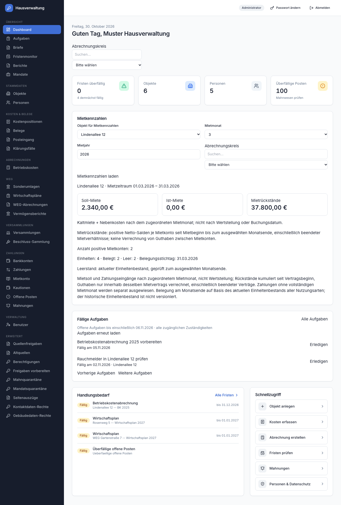
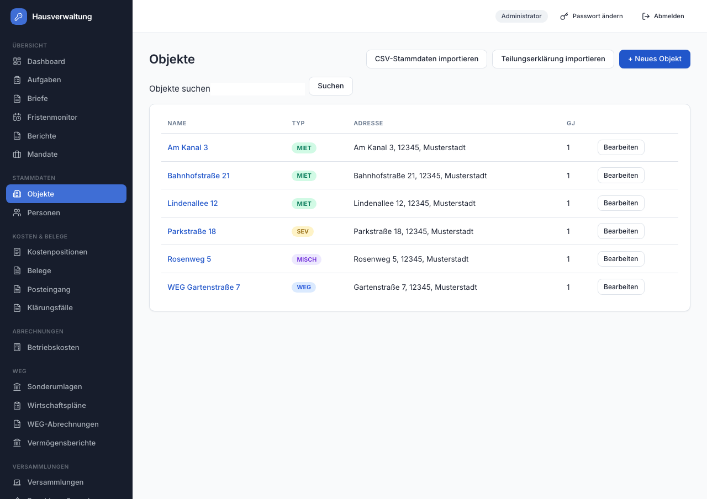
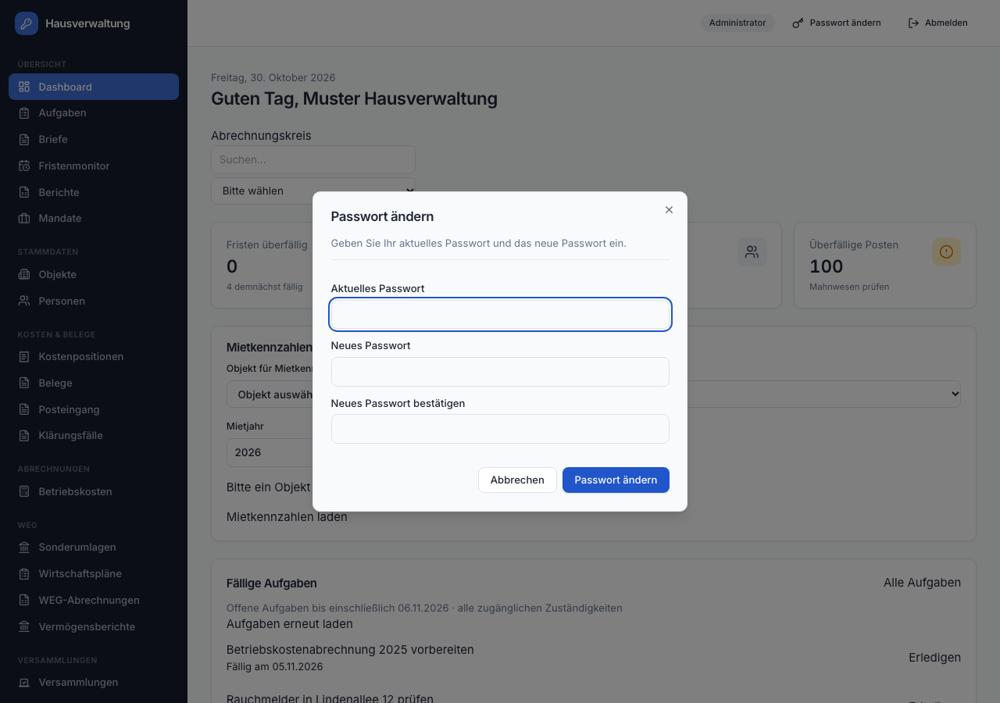

# Verwalino design contract

DESIGN.md is the authoritative frontend design contract for Verwalino: layout, tokens, UI kit
components and their behaviour, states, copy and formats. Define visual changes here before CSS
tweaks land. New screens follow this contract; changes to the look or copy update it in the same PR.
Named implementation deviations remain documented below as known debt tracked in #48, #49, #50
and #52. New work follows the contract.

Source files: `frontend/tailwind.config.cjs` (token mapping), `frontend/src/index.css` (tokens, global
classes), `frontend/src/components/ui/` (UI kit), `frontend/src/components/AppShell.tsx`,
`Sidebar.tsx`, `Topbar.tsx` (shell). Copy and format rules also appear in the
[frontend rule](.claude/rules/frontend-ui.md). The current theme is light; dark mode is outside this
contract.

## How to build a screen

Two styling layers coexist:

- **UI kit** (`frontend/src/components/ui/`, Tailwind utilities on the tokens below). The shell, the
  dashboard, mandates and the dialogs are written this way; their file headers call it "UI-Kit".
- **Global classes** in `index.css` (`.card`, `.btn`, `.badge`, `.data-table`, `.info-table`, `.form-grid`,
  `.error-text`, `.empty-hint`, ...). About 430 raw `<button class="btn">` and most list/detail pages use
  them. `index.css` says they were restyled to match the kit, so both layers look the same.

Follow [Components](#components) for the permitted styling layers and their source files, and
[Colour](#colour) for token use.

## Foundations

### Contract ownership and verification

- One fact has one visual place: show a status, result or action on the surface that owns it.
  An equivalent hidden accessible label may repeat it.
- Enforce the contract's behaviour and copy with interaction tests in the area's
  `frontend/src/**/*.test.tsx`; browser features in `features/` verify geometry that jsdom cannot check.
- When the look changes, update this contract and the screenshots in `docs/assets/design/`
  in the same PR.
- External software in [docs/domain-reference.md](docs/domain-reference.md) is a reference for scope
  and flows, not a design contract for Verwalino.

### Colour

Tokens are HSL channels on `:root` in `index.css`, exposed to Tailwind in `tailwind.config.cjs`
(`bg-primary`, `text-muted-foreground`, `border-border`, ...). Hex values are rounded renderings.

| Token (Tailwind) | HSL | Hex | Role |
|---|---|---|---|
| `background` | 210 20% 98% | `#f9fafb` | page background, inputs, dialog surface |
| `foreground` | 222 24% 17% | `#212736` | body text |
| `card` / `card-foreground` | 0 0% 100% / as foreground | `#ffffff` | cards, topbar, outline buttons |
| `primary` | 221 72% 46% | `#2156ca` | main action, links, focus ring, active hover border |
| `primary-foreground` | 0 0% 100% | `#ffffff` | text on primary |
| `secondary` | 214 24% 95% | `#eff2f5` | default badge, role chip, quiet panels (`bg-secondary/40`) |
| `muted` / `muted-foreground` | 214 24% 95% / 215 16% 47% | `#65758b` text | secondary text, hints, descriptions, table headers |
| `accent` | 214 30% 93% | `#e8ecf3` | hover on outline and ghost buttons, table row hover (50%) |
| `destructive` | 0 72% 50% | `#db2424` | error text, destructive button |
| `border` (`--ui-border`), `input` | 214 20% 89% | `#dde2e9` | all borders and input outlines |
| `ring` | 221 72% 46% | `#2156ca` | keyboard focus ring |
| `sidebar` / `sidebar-foreground` | 222 32% 13% / 214 22% 88% | `#171d2c` / `#dae0e7` | navigation rail |
| `sidebar-accent` | 221 64% 54% | `#3f6ed5` | active nav item, brand tile |

Semantic colours that are **not** tokens: `ui/badge.tsx` and `ui/stat-card.tsx` use the Tailwind palette
(blue = primary/type, emerald = success, amber = warning/attention, red = destructive, slate = info/neutral).
`success` and `warning` exist as tokens but no component uses them. Legacy `.badge--*` classes use fixed
hex pairs. `--border` (hex) and `--ui-border` (HSL) are different variables: the kit uses `--ui-border`.
Legacy variables `--color-primary` (`#2456c8`), `--bg-content`, `--text`, `--text-muted` remain for old
inline styles. Use token colours rather than hard-coded hex values: pick a role from the table;
for a new status colour reuse a `Badge` tone.

### Typography

- Family: Inter Variable, self-hosted through `@fontsource-variable/inter` (imported in `main.tsx`),
  fallback `system-ui`. In `index.css`, monospace (`--mono`) is used for `code`, declaration `pre`
  blocks (`.declaration-value-grid`, `.declaration-rule-details`) and `.candidate-decision textarea`.
  Inline styles also use it for amounts in `OpenItemsPage.tsx` and identifiers in `ResolutionRegisterPage.tsx`.
- The root font size is **15 px** (`:root`), so 1 rem = 15 px and all rem-based Tailwind sizes scale with it.
- Scale as used: page title `h1` 1.5rem / 600 / -0.01em (`index.css`; dashboard uses `text-2xl`);
  section title `h2` 1.05rem / 600; card title `text-base font-semibold`; body 15 px; form labels
  `text-sm` (kit) or 0.82rem / 500 (`.form-grid`); table header 0.72rem uppercase, tracking 0.05em;
  badges `text-xs`; nav group labels 0.68rem uppercase; stat values `text-2xl font-semibold`.
- Numbers in tables and tiles use `tabular-nums`. `-webkit-font-smoothing: antialiased` is global.

### Spacing, radius, elevation

- Spacing is the default Tailwind scale (on the 15 px rem). Page gutter `px-4 py-6`, from `md`
  `px-8 py-8`; content is centred at `max-w-6xl` (72 rem). Vertical rhythm between blocks: `space-y-5`
  or `space-y-6` (kit pages), `1.5rem` bottom margin per legacy card. Card padding `p-5` (kit) or
  `1.25rem 1.4rem` (`.card`). Grids: `gap-4` for stat tiles, `gap-6` for main panels, `.form-grid` gap
  `1rem 1.1rem`.
- Radius: `--radius` = 0.65 rem. `rounded-lg` = radius (cards, tiles), `rounded-md` = radius - 2 px
  (buttons, inputs, nav items), `rounded-sm` = radius - 4 px. Badges and the role chip are `rounded-full`.
- Elevation is flat: cards and primary buttons `shadow-sm` with a 1 px border; a linked `StatCard` gains
  `shadow-md` and `border-primary/40` on hover; dialogs `shadow-lg` over a `bg-black/50` overlay.
  Stacking: mobile nav overlay `z-30`, sidebar `z-40`, dialog and overlay `z-50`.

### Icons

`lucide-react` only; no custom SVG, no emoji. Icons accompany a text label, except the mobile menu
button (`aria-label="Navigation umschalten"`) and the topbar key button below `sm` (`title`). Sizes (rem,
so x 15 px): `h-4 w-4` inside buttons (`Button` forces `[&_svg]:h-4 [&_svg]:w-4`) and in the quick-action
tile, 1.05 rem in the nav, `h-5 w-5` in the `h-10 w-10` `StatCard` tile. Colour follows the text colour.

### Interaction

Every control has a label, and dialogs are keyboard-operable. Mark errors with `role="alert"` and
outcomes with `role="status"`.

Focus: kit controls show `ring-2 ring-ring ring-offset-2`; `.btn` shows a 3 px `ring/30` shadow; form-grid
fields a 3 px `ring/18` shadow with a primary border. Disabled controls use `opacity-50` and
`not-allowed`/`pointer-events-none`. Transitions are colour/shadow only and short (about 0.15 s). Note: `ui/dialog.tsx`
carries `animate-in`/`fade-in` classes, but the `tailwindcss-animate` plugin is not installed
(`plugins: []`), so dialogs do not animate.

## Layout

### App shell

`AppShell.tsx`: `flex h-screen overflow-hidden` = **Sidebar** (16 rem) + a column of **Topbar**
(`h-16`, `border-b bg-card`, `px-4 md:px-8`) and `main` (the scroll container; the window itself never
scrolls) with the centred `max-w-6xl` content. Topbar right side: role chip (from `sm`), "Passwort ändern"
(opens the password dialog; label hidden below `sm`), "Abmelden". Signed out, `LoginPage` renders alone
(own `LoginPage.css`, 380 px card); while the session is probed `App.tsx` shows a centred "Lade...".

Below `md` (768 px) the sidebar is off-canvas (`fixed`, slides in via the hamburger, `bg-black/40`
overlay, closes on link click or overlay click); from `md` it is static. `AppShell.css`, `Sidebar.css`
and `Topbar.css` exist but are imported nowhere; the shell is styled with utilities only.

### Sidebar groups

Source: `GROUPS` in `Sidebar.tsx`. Active item `bg-sidebar-accent text-sidebar-accent-foreground`,
idle `text-sidebar-foreground/75`, hover `bg-white/5`; group label 0.68 rem uppercase at 40 % opacity.
Detail pages (`/objekte/:id`, `/mandate/:id`, ...) have no nav entry; the parent stays highlighted.

| Group | Entries | Visible to |
|---|---|---|
| Übersicht | Dashboard, Aufgaben, Briefe, Fristenmonitor, Berichte, Mandate | all |
| Stammdaten | Objekte, Personen | all |
| Kosten & Belege | Kostenpositionen, Belege, Posteingang, Klärungsfälle | all |
| Abrechnungen | Betriebskosten | all |
| WEG | Sonderumlagen, Wirtschaftspläne, WEG-Abrechnungen, Vermögensberichte | all |
| Versammlungen | Versammlungen, Beschluss-Sammlung | all |
| Zahlungen | Bankkonten, Zahlungen, Mietkonto, Kautionen, Offene Posten, Mahnungen | all |
| Verwaltung | Benutzer | `OWNER_ADMIN` |
| Erweitert | Quellenfreigaben, Altquellen, Berechtigungen, Freigaben vorbereiten, Mahnquarantäne, Mandatsquarantäne, Seitenauszüge, Kontaktdaten-Rechte, Gebäudedaten-Rechte | `OWNER_ADMIN` |

Navigation entries are `NavItem`s in `GROUPS` (label = German noun, one lucide icon); their routes are in
`App.tsx`. Add a new top-level screen's nav entry to `GROUPS`; detail pages keep their parent's entry.
Several icons repeat (`FileText` x7, `KeyRound` x6).

### Page patterns

New screens follow these page structures and use a German noun as their `h1`.

- **Page header.** Either a date eyebrow plus greeting `h1` (dashboard: `text-sm muted` line, then
  `h1 text-2xl`), or `h1` left and actions right (`flex justify-between`, wraps): secondary actions
  first, the single primary action last, labelled "+ Neues Objekt" (legacy) or an icon `Button` "Neues Mandat".
- **List page** (`PropertiesPage.tsx`, `MandatePage.tsx`): header, optional import panel, `ListSearch`
  (explicit "Suchen" submit), error line, inline create/edit card, table card, "Weitere laden" for the
  next cursor page. Empty and loading text replace the table (see [States](#states)).
- **Detail page** (`PropertyDetailPage.tsx`, `MandateDetailPage.tsx`): back link ("← Alle Objekte";
  kit pages use an `ArrowLeft` icon link), `h1` (kit pages put a `Badge` beside it), action buttons, then
  stacked cards, each with an `h2` or `CardTitle`: key-value `info-table` first, then related lists and
  panels, each with its own "+ Neue ..." action. Loading, error and not-found replace the whole page
  (`if (loading) return 
Lade...
`, `Objekt nicht gefunden.`).
- **Form.** `.form-grid` (two columns, one below 768 px). A `<label>` wraps its control with the caption
  above it; required fields end in ` *` plus native `required`; `form-full-width` spans both columns.
  `.form-actions` at the end: submit first (`btn btn--primary`), then "Abbrechen". While saving, the form
  is wrapped in `<fieldset disabled>` and the button label changes ("Speichern..."). Create and edit forms
  open as a card above the list; small edits of master data open `MasterDataEditor` as a dialog.
  Selects, checkboxes and file inputs are the native elements.

### Responsive behaviour (down to 360 px)

Verify screens at 360 px with long German names, four-digit amounts and many rows. The page must not
scroll sideways; wide tables stay within their own horizontal scroll container.

| Width | Behaviour |
|---|---|
| < 640 (`sm`) | stat tiles 1 column; role chip and "Passwort ändern" label hidden; `DialogFooter` stacks (Cancel under primary) |
| < 768 (`md`) | sidebar off-canvas; page padding 1 rem; `.form-grid` 1 column; `.data-table` 0.82 rem |
| 640-1023 | stat tiles 2 columns |
| >= 1024 (`lg`) | stat tiles 4 columns; "Handlungsbedarf" and "Schnellzugriff" side by side (2:1) |

Wide tables use `overflow-x-auto` (`MandatePage.tsx`) or `.paged-list .paged-table` (`index.css`). Long
content uses `min-w-0` plus `truncate` (`DashboardPage.tsx`) or `overflow-wrap: anywhere`
(`.settlement-detail`). Deviation: in the 360 px detail screenshot the units table
and the document upload button extend beyond their card, so `main` scrolls sideways there.

## Components

New screens use the kit components and tokens. Reuse global classes only for what has no kit
counterpart yet (tables, key-value tables, form grid, error and empty text). Do not add new global
classes or inline `style={{}}`; the existing inline styles (about 470) are known debt.

### UI kit (`frontend/src/components/ui/`)

| File | Exports | Variants | Use when |
|---|---|---|---|
| `button.tsx` | `Button` (forwardRef) | variant `primary` (default), `secondary`, `outline`, `ghost`, `destructive`; size `sm` (h-8), `md` (h-9, default), `lg` (h-11), `icon` (h-9 w-9) | `primary`: the main action of a view or form (with the deviation below). `outline`: cancel and secondary actions. `ghost`: topbar and toolbars. `destructive`: confirm of an irreversible action. `secondary`, `lg`, `icon` and `destructive` have no call site yet. Legacy twin: `.btn`, `.btn--primary`, `.btn--danger`, `.btn--small`, `.btn--wrap` (wrapping label). |
| `badge.tsx` | `Badge`, `BadgeTone` | tone `default`, `primary`, `success`, `warning`, `destructive`, `info`, `outline` | A short status or type label. `primary` = category/type (WEG), `success` = done/confirmed, `warning` = needs attention/due, `destructive` = overdue/rejected, `info` = neutral note, `default` = neutral, `outline` = unmapped raw value. Legacy twin: `.badge` + modifier. |
| `card.tsx` | `Card`, `CardHeader`, `CardTitle`, `CardDescription`, `CardContent`, `CardFooter` | none; compose | Every panel. A table card uses `CardContent className="p-0"` with edge cells `pl-5`/`pr-5`. Legacy twin: `.card` with an `h2`. |
| `dialog.tsx` | `Dialog`, `DialogContent`, `DialogHeader`, `DialogTitle`, `DialogDescription`, `DialogFooter` (+ `DialogPortal`, `DialogOverlay`) | none | Short focused tasks and confirmations on Radix: focus trap, Esc, built-in close "Schließen". Max width 32 rem, full width on phones. |
| `input.tsx` | `Input` (forwardRef) | none; `h-10`, `text-sm`, ring on focus | Inside kit dialogs and cards, always with a `Label`. In `.form-grid` forms the native input is styled by the grid instead. |
| `label.tsx` | `Label` (forwardRef) | none; `text-sm font-medium` | `Label htmlFor` + `Input id` in a `grid gap-2`. |
| `stat-card.tsx` | `StatCard` | props `label`, `value`, `icon`, `tone` (`default`, `primary`, `success`, `warning`, `destructive`), `hint`, `to` | One headline number with an icon tile; with `to` the whole tile is a link. Value `…` while loading, `—` when unavailable (with hint "Nicht verfügbar"). |

Kit adoption today, counted as files that import the part: `Badge` 7, `Dialog` 9, `Card` 5, `Button` 3
(12 call sites), `Input` 2, `Label` 1, `StatCard` 1. The remaining UI uses the global classes below.

Deviation: the archive form's "Abbrechen" in `MandateDetailPage.tsx` uses the default `primary` variant.
The create form's "Abbrechen" in `MandatePage.tsx` explicitly uses `outline`.

### Global classes (`index.css`)

| Class | Purpose |
|---|---|
| `.card` | panel surface, `h2` heading |
| `.btn`, `.btn--primary`, `.btn--danger`, `.btn--small`, `.btn--wrap` | button, main action, destructive, compact (table rows), wrapping label |
| `.badge` + `--weg`/`--primary` (blue), `--miet`/`--confirmed`/`--finalized`/`--booked`/`--success` (green), `--sev`/`--review` (amber), `--misch`/`--superseded` (violet), `--draft` (grey), `--rejected`/`--storno`/`--danger` (red) | status pill |
| `.data-table`, `.info-table` | list table; key-value table (label column 180 px, muted) |
| `.form-grid`, `.form-full-width`, `.form-actions` | form layout |
| `.error-text`, `.empty-hint` | error line (destructive), empty-state line (muted) |
| `.link`, `.link-button` | text link; button that looks like a link |
| `.paged-list`, `.paged-list .paged-table` | list page wrapper; horizontally scrollable table wrapper only inside `.paged-list` |

Referenced in components but defined nowhere, so they do nothing: `muted` (5 files: `MasterImport.tsx`,
`DepositsPage.tsx`, `MietkontoPage.tsx`, `PropertiesPage.tsx`, `SpecialLeviesPage.tsx`), `btn-primary` (3,
typo of `btn--primary`), `badge--warning`, `form-hint`, `table-responsive`.

### Recurring composites

- **Tables.** Legacy: `
<table class="data-table">`. Kit:
  `Card > CardContent p-0 > div.overflow-x-auto > table.data-table` (`MandatePage.tsx`). First column is
  the `.link` to the detail page, last column holds row actions as `btn btn--small` ("Bearbeiten",
  "Öffnen"), numeric columns `tabular-nums`. Cursor paging through `hooks/usePagedList.ts` and
  `MoreResults` in `ListSearch.tsx`. Export previews (`DatevExport`, `SepaExport`, `ReportsPage`) use
  unclassed tables inside `overflow-x-auto`.
- **Status badges.** One label-and-tone map per domain next to the page, never the raw enum:
  `STATUS_META` in `DashboardPage.tsx` (OVERDUE "Überfällig" destructive, DUE "Fällig" warning, UPCOMING
  "Anstehend" primary, INFO "Info" info, OK "Erledigt" success); mandate types in `MandatePage.tsx`
  (WEG primary, MIET success, SEV warning); `components/SourceBadge.tsx` (E-Rechnung primary, PDF-Import
  info, Manuell default, unknown outline); legacy maps `STATUS_CSS` in `CostEntriesPage.tsx` and
  `SettlementsPage.tsx`. `InvoiceProcessingStatus.tsx` and the rule pill in `knowledge/RuleCard.tsx` are
  plain `role="status"` text/pills, not `Badge`. Management types are still shown as raw codes (MIET, WEG).
- **Stat cards.** `StatCard` grid `grid-cols-1 gap-4 sm:grid-cols-2 lg:grid-cols-4` (`DashboardPage.tsx`);
  "Fristen überfällig" uses `destructive` above 0, while "Überfällige Posten" uses `warning` above 0.
  Both use `success` at 0 and `default` when their data is unavailable. The three rent figures in
  `DashboardKpis.tsx` are bordered boxes, not `StatCard`.
- **Panels.** `<section class="card" aria-labelledby>` with an `h2`, a sentence saying what the action does
  and what it does not do, the form, then outcome lines: `role="status"` for the receipt, `role="alert"`
  for errors, `
` for history. Examples: `AttachmentsPanel.tsx`, `MeterPanel.tsx`, `DsgvoPanel.tsx`,
  and the `components/intake/*Panel.tsx` family.
  Additional panel files: `MailDispatch.tsx`, `FinancialCoverageReview.tsx`, `SourceSecurityPanel.tsx`,
  `FinancialCorrectionControls.tsx`; source links use `knowledge/KnowledgeSourceButton.tsx`.
- **Dialogs.** Default is `ui/dialog.tsx`: `MasterDataEditor.tsx` (edit fields), `MasterDataDelete.tsx`
  (confirm: title, description naming the consequence, "Löschen bestätigen", "Abbrechen"; Esc and outside
  click are blocked while the request runs), `AttachmentsPanel.tsx` (archive with reason), `Topbar.tsx`
  (password; the only dialog fully in kit components). Other mechanisms exist: native `<dialog>`
  (`declarations/ApprovalSummary.tsx`, knowledge viewer), inline `role="dialog"` cards (`PreviousPlan.tsx`,
  `DunningBatch.tsx`), and `window.confirm` (22 calls in 11 files) for one-line irreversible confirmations.
  New code uses `ui/dialog.tsx`.
- **Selectors.** `PropertySelector.tsx`, `SearchChoice.tsx` (generic, any paged endpoint),
  `AccountingScopeSelector.tsx` (wraps `SearchChoice`): `fieldset` + `legend`, a search input above a native
  `select` with an empty option ("Alle Objekte", "Bitte wählen"), the current selection survives new
  searches, errors as `role="alert"`, "Weitere laden" for more pages.
- **Upload.** Native `<input type="file">` (the browser's own button text is visible) in a `.form-grid`
  form: `AttachmentsPanel.tsx` (documents, 25 MiB limit stated in the copy), `MasterImport.tsx` (CSV with
  preview table and row errors), the mandate upload in `MandateDetailPage.tsx`. These forms have no drag
  and drop or progress bar; controls are disabled while requests run. CSV import and attachments report
  outcomes in `role="status"` lines. `DeclarationImportPage.tsx` renders a `<progress>` for processing,
  styled by `.declaration-import-section progress` in `index.css`.
- **Money and date fields.** Date: `<input type="date">` (63 uses), value ISO `YYYY-MM-DD`, the browser
  shows its locale format. Money: `<input type="text" inputMode="decimal">` (62 uses) with placeholder
  `0.00`; the user may type a comma, helpers turn it into a dot (`moneyInput` in `SpecialLeviesPage.tsx`,
  `decimal()` in `lib/heatingInputs.ts`, `normalizePlanAmount` in `api/previousPlan.ts`, `exactCents` in
  `api/allocationProposals.ts`). The API carries money as decimal strings: no floats.

## States

Every async region provides loading, empty, error and success copy using the patterns below.
Failed requests preserve the user's input.

Loading, error and success are inline text, there is no toast, spinner or skeleton component.

| State | Markup | Copy patterns (German text verbatim; `{...}` is a value) |
|---|---|---|
| Loading | `
`, often `role="status"`; page-level `if (loading) return` | "Lade...", "Lade…" (28 and 6 uses), "Aufgaben werden geladen…", "Mietkennzahlen werden geladen…". Buttons: "Laden..." / "Lade…". |
| Busy (saving) | button label swaps, form `fieldset disabled` | "Speichern..." (about 15), "Speichern…", "Löschung läuft…" |
| Empty | `
` or muted `
`; kit pages a `Card` with centred text | "Keine Objekte vorhanden.", "Keine Zahlungen vorhanden." (about 27 "Keine X vorhanden."); "Noch keine Mandate angelegt." (16 "Noch keine ..."); "Keine fälligen Aufgaben in diesem Zeitraum." Mostly a bare sentence; a next step only for admins ("Legen Sie oben mit der Schaltfläche Neues Mandat Ihren ersten Verwaltungsauftrag an."). An empty result is reported as empty, never as success. |
| Error | `
` (116 uses), sometimes a red bordered box; a retry button in the same line | "Die Eingänge konnten nicht geladen werden. Bitte erneut versuchen.", "Klärungsfälle derzeit nicht verfügbar. Bitte erneut laden.", "Nicht authentifiziert. Bitte erneut anmelden." (401), "Keine bestätigte Antwort erhalten. Wiederholen Sie denselben Auftrag; Ihre Angaben bleiben erhalten.", fallback "Eingaben unvollständig oder ungültig. Bitte die angegebenen Felder prüfen." (`api/client.ts`). Server `detail` strings are shown as they arrive. Failed requests keep the user's input ("bleiben erhalten"). |
| Success | `
` below the action (62 files), receipt style | "<Objekt> gespeichert." plus what it does not do: "Prüfvermerk gespeichert · <Zeitpunkt> · Offene Punkte bleiben bestehen."; "Dokument archiviert."; "{n} Mahnentwürfe angelegt."; "Passwort erfolgreich geändert. Sie werden abgemeldet." |
| Permission denied | hidden, not disabled: `{canWrite && ...}` (25 uses) | Role model `OWNER_ADMIN`, `CLERK` (write), `READ_ONLY` (`api/types.ts`); `canWrite` = admin or clerk. Page block: "Zugriff nur für Inhaber/Admin." (`error-text`); notices: "Hinweis: Sie sind im Nur-Lesen-Modus angemeldet.", "Nur Lesezugriff. Vorlagen und bereits erstellte Briefe können eingesehen werden."; 403 mapped to "Keine Berechtigung für diese Dokumentaktion."; 401/403/404 on detail pages: "Dieser Fall ist nicht mehr zugänglich."; the declaration-import routes redirect silently to `/objekte` for `READ_ONLY` (`App.tsx`). |
| Confirm | `ui/dialog.tsx` or `window.confirm` | Question plus consequence: "Dokument wirklich löschen?", "WEG-Jahresabrechnung finalisieren? Danach unveränderbar (GoBD).", "„{Name}“ unwiderruflich löschen? Bestehende Referenzen oder Quellschutz können das Löschen verhindern." |

Principle from [AGENTS.md](AGENTS.md#design-rules): report real outcomes only, no placeholder text and no
"everything OK" when there is nothing to report. Unavailable data shows `—` or "Nicht verfügbar", not zero.

Hide write actions for `READ_ONLY`. Admin-only pages say "Zugriff nur für Inhaber/Admin." or sit in an
admin-only nav group.

## Copy and formats

### Tone and wording

- Use German UI text with real umlauts and formal **Sie**: 47 files address the user as Sie/Ihr, none
  uses du ("Geben Sie Ihr aktuelles Passwort und das neue Passwort ein."). Instructions are otherwise
  impersonal ("Bitte erneut versuchen.", "Bitte ein Objekt auswählen.").
- Headings and nav entries are nouns ("Objekte", "Offene Posten"); buttons are verbs or verb phrases:
  "Speichern", "Abbrechen", "Bearbeiten", "Anlegen" (create: "Mandat anlegen", "Benutzer anlegen"),
  "Hochladen", "Löschen", "Schließen", "Erneut laden". Cancel is always "Abbrechen". "Archivieren" means
  keep-and-hide, "Löschen" means remove; copy says which.
- Separators and punctuation: middle dot ` · ` between facts in one line; German quotes „..."; "z. B." and
  "z.B." both occur; ellipsis `…` and `...` both occur. Technical labels may stay English-derived codes
  (MEA, GoBD, SEPA, DATEV).
- Page titles: each page renders its own `h1`; `document.title` is the static "Hausverwaltung".
- Deviation: about 60 strings are written without umlauts ("Strasse", "waehlen", "Ruecklage",
  "Mietvertraege", "FLAECHE").

### Number, money, date and size formats

Use the money and date contracts below; carry amounts as decimal strings.

`frontend/src/lib/` holds no formatting helper (`utils.ts` is only `cn`; `costVocabulary.ts`,
`heatingInputs.ts`, `settlementInputNeeds.ts` are domain helpers). Formatting uses file-local functions
or inline expressions, with the variants below. The inconsistencies are tracked in #48.

| What | Contract | Implemented by |
|---|---|---|
| Money | `1.234,56 €`: `.` thousands, `,` decimals, always two, sign first (`-1.234,56 €`), no float arithmetic | `euros()` in `components/DashboardKpis.tsx`, `money()` in `pages/BankTransactionsPage.tsx` (both `€`) |
| Money, deviating | same grouping but suffix ` EUR`; `OpenItemsPage.tsx` uses ungrouped `toFixed(2)` plus ` EUR` (`1234.56 EUR`) | `money()` in `pages/ReportsPage.tsx`, `formatCents()` in `pages/PaymentsPage.tsx` and `pages/CostEntriesPage.tsx`, `formatProposalMoney()` in `pages/SettlementDetailPage.tsx`; ` EUR` appears 93 times in 30 files, `€` in 2. `displayCents()` in `api/allocationProposals.ts` prints `1234,56` without grouping or suffix. |
| Date | `TT.MM.JJJJ`, e.g. `05.03.2026`, from the ISO API value | `formatDate()` in `pages/DashboardPage.tsx`, `FristenmonitorPage.tsx`, `MandatePage.tsx`; `date()` in `BankTransactionsPage.tsx`; `dateLabel()` in `DashboardKpis.tsx` |
| Date, deviating | `toLocaleDateString("de-DE")` or `Intl.DateTimeFormat("de-DE")` prints `5.3.2026` (no zero padding) | `MandateDetailPage.tsx`, `AttachmentsPanel.tsx`; `components/knowledge/PropertyDocuments.tsx` uses `Intl.DateTimeFormat` |
| Date and time | `new Date(x).toLocaleString("de-DE")` gives `5.3.2026, 15:03:09` (no zero padding, with seconds) | 45 `toLocaleString` calls, all `de-DE`; used for receipts and history |
| Long date | weekday and month in words ("Freitag, 30. Oktober 2026") | `dateLabel` in `DashboardPage.tsx` |
| Plain numbers | `Intl.NumberFormat("de-DE")` / `toLocaleString("de-DE")` (`1.234.567`) | `PropertyDetailPage.tsx`, `AttachmentsPanel.tsx`, `IntakeBatchPage.tsx` |
| File size | `1.5 KB` / `1.0 MB` with a dot (`toFixed(1)`); mandates use whole KB (`12 KB`, `toFixed(0)`). Attachments show `1.234 Bytes` (`Intl.NumberFormat("de-DE")`); intake shows `1,5 KiB` (`toLocaleString("de-DE")`) | `formatBytes()` in `InvoiceDocumentsPage.tsx`, `formatSize()` in `MandateDetailPage.tsx`, `AttachmentsPanel.tsx`, `IntakeBatchPage.tsx` |
| IBAN | shown as stored; SEPA confirmation input removes whitespace and upper-cases it | `normalizedIban` in `components/SepaExport.tsx`; `BankAccountsPage.tsx` prints `iban` raw. There is no IBAN display grouping in the frontend. |
| Empty value | `—` (kit, newer pages), `-` (older tables), `–` (`BankTransactionsPage.tsx`) | `MandatePage.tsx`, `InvoiceDocumentsPage.tsx`, `BankTransactionsPage.tsx`, respectively |
| Money input | accept `1234,56` and `1234.56`, send `1234.56` | `moneyInput`, `exactCents`, `normalizePlanAmount` (see above) |

## Screenshots

Taken from the running dev stack of `scripts/dev-local.sh` (backend `:18000`, Vite `127.0.0.1:13000`) against the
disposable test database with synthetic data (organisation "Muster Hausverwaltung", fictitious addresses, persons and
amounts). Desktop is 1280 px wide at 1x; the 360 px images are 2x. File names are fixed so the table
stays valid when they are retaken.

| Screen | Page | Desktop | 360 px |
|---|---|---|---|
| Dashboard | `/` | [`dashboard-desktop.png`](docs/assets/design/dashboard-desktop.png) | [`dashboard-360.png`](docs/assets/design/dashboard-360.png) |
| List | `/objekte` | [`list-objekte-desktop.png`](docs/assets/design/list-objekte-desktop.png) | [`list-objekte-360.png`](docs/assets/design/list-objekte-360.png) |
| Detail | `/objekte/:id` | [`detail-objekt-desktop.png`](docs/assets/design/detail-objekt-desktop.png) | [`detail-objekt-360.png`](docs/assets/design/detail-objekt-360.png) |
| Form | `/objekte`, "+ Neues Objekt" | [`form-objekt-desktop.png`](docs/assets/design/form-objekt-desktop.png) | [`form-objekt-360.png`](docs/assets/design/form-objekt-360.png) |
| Dialog | "Passwort ändern" in the topbar | [`dialog-password-desktop.png`](docs/assets/design/dialog-password-desktop.png) | [`dialog-password-360.png`](docs/assets/design/dialog-password-360.png) |

The screenshots show the app as it is, including the deviations named above (legacy table, native file
button, unstyled buttons on the dashboard task list, ASCII "Strasse").
