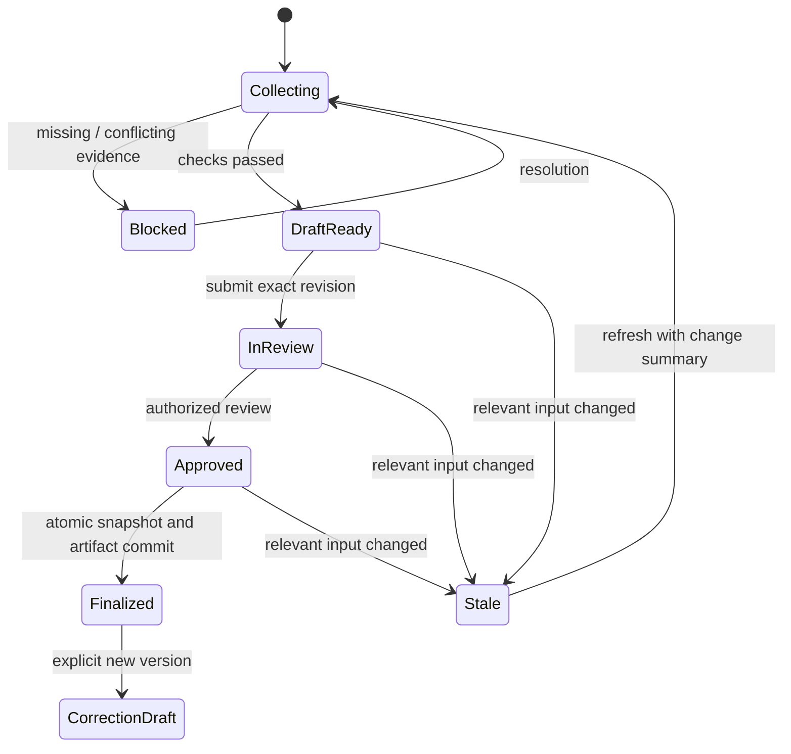
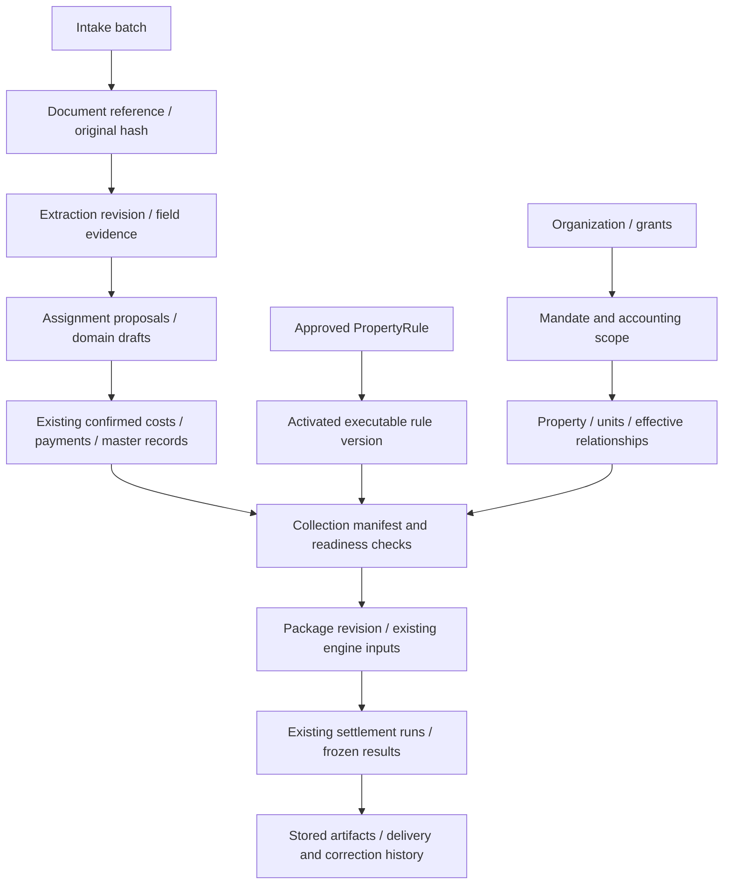
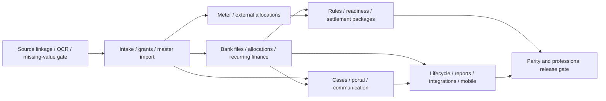

# Property management: product, UX and technical delivery design

Date: 2026-10-01. Status: implementation-ready design with explicit release gates;
product features described as **target behavior**, not delivered functionality.
Planning baseline: `57edaa7`; application baseline: `1d35f7d`. The working tree was
clean and no application changes occurred between those revisions and this design.

## 1. Product decision and evidence boundary

Build one property-management product with two presentation presets: a guided
landlord workspace and a professional portfolio workspace. Both use the same
records, calculation engines, permissions and approval safeguards. Meet the
provisional reference software feature baseline first; reduce data entry within every
parity milestone rather than deferring automation to a later product generation.

The primary journeys are **upload → linked, reviewable records** and **select
property/period → collected evidence → explainable accounts**. Users should enter
new facts or resolve uncertainty, never copy known facts between screens. The
system prepares work proactively; financial confirmation, rule activation and
external communication remain explicit authorized actions.

This document supplies interaction contracts, data contracts, delivery boundaries
and acceptance scenarios. The [audit](2026-10-01-product-audit-and-parity-plan.md)
remains the inventory of current gaps. The [roadmap](roadmap.md),
[architecture](architecture.md), [M2 evidence flow](m2-gobd-belegfluss.md),
[M3 engine](m3-abrechnungs-engine.md), [M4 WEG](m4-weg-abrechnung.md),
[M6 payments](m6-zahlungen-mietkonto.md) and existing ADRs remain reusable domain
context. This design supersedes historical exclusions of banking/portals and the
manual-first target UX; it does not declare historical legal questions resolved.

Evidence labels used below:

- **R**: reference capability documented in official reference software sources; not an
  authenticated screen-by-screen verification.
- **D**: our product/technical decision, including automation beyond the reference.
- **V**: behavior, provider contract or specialist interpretation still requiring
  validation before its corresponding release.

Official sources rechecked on 2026-10-01 confirm bank matching proposals,
adjustable partial/overpayment matching, a tenant portal and DATEV receipt export.
See bank matching,
portal
and DATEV.
The integration reference
documents bank, postal, listing and SEPA integrations, imports/exports and email
document intake. It explicitly describes manual incoming-document assignment.
Automatic document routing in this design is **D**, not proven reference behavior.
The earlier visit to the application reached only
login; no authenticated comparison is claimed. Remaining reference groups inherit
the audit's linked public-source baseline and require the parity gate in §13.

## 2. People, navigation and progressive disclosure

### 2.1 Personas and success measures

| Persona | Primary job | Default presentation | Success condition |
| --- | --- | --- | --- |
| Private landlord, 1–20 units | Keep documents, rent and annual accounts correct with little setup | Home with Upload and Prepare accounts; one-property context inferred when valid | A complete supported invoice needs no typed field; a complete property/year needs no repeated master/payment data |
| Professional clerk | Process daily intake, payments and cases across assigned mandates | Inbox with ownership, saved filters and bulk review | Work is grouped by shared cause; exceptions can be delegated without losing source context |
| Certified/professional manager | Review portfolio readiness, approve rules/accounts and supervise staff | Portfolio readiness, review queue, audit and performance views | Knows which property is blocked, why, who owns it and what changed since review |
| Tenant/owner | Read their records, submit issues/readings and exchange messages | Separate restricted portal | Cannot discover other households, owners' private records or internal notes |
| Accountant/auditor | Reconcile and inspect source-backed exports | Time-limited scoped read/export access | Can follow each amount to source, rule and revision without editing the ledger |

Presentation presets are user preferences, never security roles or separate data
models. Users may reveal advanced fields per screen. A single-property user still
sees the selected property and mandate before confirmation. An administrator's
portfolio permissions never turn a bulk action into a shared accounting sphere.

### 2.2 Information architecture

| Navigation | Shared content | Professional additions |
| --- | --- | --- |
| Home | Next actions, incomplete setup, rent/accounting status | Portfolio totals, assigned work, deadlines, operational exceptions |
| Inbox | All uploads and actionable processing issues | Saved queues by mandate, document class, blocker, assignee and age |
| Properties | Property → units → occupancy/ownership timeline → documents | Portfolio search, import reconciliation, readiness columns, bulk selection |
| Money | Transactions, costs, rent accounts, open items, accounts | Matching workspace, recurring rules, SEPA, cashflow, loans, export jobs |
| Accounts | Settlement periods, drafts, final results | Portfolio batches, reviewer assignment, rule versions and reconciliation |
| Cases & messages | Tasks, communication and deadlines | Team queues, delivery failures, meeting preparation, resolutions |
| Settings | Profile, organization, permissions, integrations, templates | Scoped grants, approval policies, import/export mappings and audit access |

People and documents are searchable collections and contextual tabs, not copies
per module. Global search searches only permitted records and returns type,
property, relationship period and source. Breadcrumbs retain active mandate and
property; changing filters never changes a record's ownership. Browser back,
deep links and drafts preserve context. Proposed routes are `/inbox`,
`/inbox/batches/:id`, `/exceptions/:id`, `/accounts/batches/:id` and existing
property/money routes; migrate navigation in place in `frontend/src/App.tsx`.

### 2.3 Interaction baseline

Use German product copy; wireframe labels here are English specifications.
Every suggestion has a provenance chip: Document, Existing record, Rule,
Imported, or Entered by person. Unknown values render as “Missing”, not `0`, an
empty currency amount or a green tick. Warnings explain consequence and next
action. Counts distinguish uploaded, processing, ready for review, confirmed and
failed; a green upload indicator never means a confirmed expense.

All tables support keyboard selection, accessible row actions and stable focus
after a change. Status is conveyed by text and icon as well as color. On narrow
screens source and form become tabs with preserved position; approval still shows
scope and totals. Processing announcements use a live region without repeatedly
stealing focus. Server validation points to the exact field; failed saves retain
the local edit and expose retry/conflict recovery.

## 3. Onboarding and migration

1. Ask whether the user manages their own property or works for others. This
   selects the presentation preset only. Reuse organization/profile data already
   known. Ask for the legal account/mandate holder only if absent.
2. Offer **Drop existing documents**, **Import spreadsheet**, or **Create first
   property**. All paths create a resumable setup session with candidate records.
   A lease, declaration or prior account can suggest address, units, people and
   periods. Source documents never silently establish ownership or management
   authority. Request the minimum missing mandate type and accounting sphere.
3. Show a proposed relationship map: mandate → property → units → owners/leases.
   Compare existing identities before creation; matching names alone cannot merge
   people. Resolve ambiguous address/unit/period once for all related candidates.
   Unit areas, MEA denominators and contract dates show source location.
4. Review and accept the imported structure in one transaction per property.
   Overlapping leases, ownership gaps and inconsistent unit totals remain explicit
   blockers. Known values are read-only summaries with Edit links, not empty forms.
5. Offer bank-file import, meter inventory and opening balances as next actions.
   A missing bank connection does not prevent using documents; settlement readiness
   records which years/accounts still lack coverage. Setup can resume later.

Spreadsheet migration uses a reusable column mapping, dry-run row validation,
external-ID mapping and a create/update/skip preview. Updates require an explicit
field diff and effective date. Accepted rows receive stable import keys. A repeated
file produces no duplicate units or people; failed rows can be corrected and
resubmitted. Rollback before canonical acceptance discards proposals; after
acceptance use audited corrections and dependency checks, not blanket deletion.
Imported opening balances need an as-of date, currency and evidence; they do not
prove prior transaction coverage.

For a landlord with no documents, the short manual path asks address, unit label,
area, lease dates and parties only when needed by the chosen next action. It does
not require a complete accounting setup to archive a file. For a large migration,
assign one case per shared mapping problem and report per-property readiness.

## 4. Universal intake and shared exception handling

### 4.1 Screen and processing contract

```text
INBOX                 [All mandates ▾] [Search]           [Upload files]
Batch: October intake      24 received · 3 processing · 4 need attention
Filter: [Needs attention] [Ready for review] [Confirmed] [Failures]

File / class           Context                    Result / next action
Water.pdf / invoice    Lindenstr. 8                Draft ready · source linked
Scan-2.pdf / invoice   2 matching properties       Choose property (3 files)
Meter.jpg / reading   Unit 04 · meter 3872        Reading date missing
Water-copy.pdf        Lindenstr. 8                Exact duplicate · open original

DETAIL / REVIEW
[Source page + highlight] | Property: Lindenstr. 8 [Existing record]
                         | Amount: 1,200.00 EUR [Document p.1]
                         | Period: Missing [Choose service period]
                         | Allocation: 2 lines [Show sum check]
                         | [Save draft] [Confirm reviewed expense]
```

Upload is available globally and in every property/unit/case. Context supplied by
the screen is a hint shown to the user, not permission to override contradictory
document identifiers. Multiple files, drag/drop and mobile image capture use the
same batch. Initial bounded limits: 100 files per batch, 25 MiB per file, 200 PDF
pages; configurable server-side and displayed before selection. Unsupported,
encrypted, corrupt or oversized items fail individually; siblings continue.
These limits are design defaults to tune against §12 targets.

Persist each completed file before expensive extraction; progress survives a tab
close. Upload retries identify the same batch item. Show a per-file retry for
transfer failure, processing retry for transient failure, and password/replacement
action for unreadable files. Do not ask users to re-upload successful siblings.
Scanners/images use the invoice OCR path as well as declarations where appropriate.

```mermaid
flowchart LR
  A[Batch / email / camera] --> B[Validate and store original]
  B --> C[Hash and business duplicate checks]
  C --> D[Classify and select bounded parser]
  D --> E[Extract fields and source evidence]
  E --> F[Resolve permitted context]
  F --> G[Prepare linked domain drafts]
  F --> H[Shared exception queue]
  H --> G
  G --> I[Authorized domain confirmation]
  I --> J[Immutable records / source release]
```



Document classes: invoice/credit note → cost drafts; lease → contract candidates;
declaration/amendment → existing declaration pipeline; meter evidence → reading
candidates; external heating/accounting statement → reconciled allocation batch;
bank statement/file → transaction import; correspondence → document and optional
case suggestion; unknown → classified archive pending review. One container PDF
may contain multiple logical documents. Store original bytes once, preserve page
ranges and attachments, and create child logical items. Never treat an arbitrary
page as a complete invoice or lose embedded structured invoice evidence.

### 4.2 Assignment and duplicate decisions

Resolve organization from authenticated intake credentials. Never infer it from
file text. Inside that organization, filter by granted mandate/property scope
before generating candidates. Match stable contract/unit/meter/customer IDs,
account scope and approved aliases; normalized addresses and supplier histories
are supporting evidence. Ambiguous identity, conflicting period or conflicting
context stops automatic assignment. An invoice supplier address is not a property
address. A supplier serving many buildings is not a unique match.

Automatic draft attachment is allowed only with one consistent candidate, a
validated stable identifier or previously approved scoped mapping, no duplicate
conflict and validated required extraction fields. A numerical model confidence
alone never qualifies. Fuzzy names/addresses produce ranked suggestions with
evidence, alternatives and the specific unresolved field. New people/properties
remain candidates until accepted. Show exclusions such as “contract inactive in
service period”; do not expose names or counts of inaccessible candidates.

| Situation | Product action | Accounting effect |
| --- | --- | --- |
| Same bytes, same permitted sphere | Mark duplicate and link accessible original; retain intake receipt | No second cost/payment; allow deliberate new contextual link after review |
| Same supplier + invoice number + amount/period, different bytes | Hold as probable business duplicate; compare side by side | User chooses duplicate, replacement or genuinely distinct invoice with reason |
| Credit note referencing an invoice | Suggest correction/credit relationship | Separate signed amount and approval; never discard as duplicate |
| One invoice covering multiple objects/units | Prepare balanced line/scope allocations | User reviews split; total allocated equals document amount exactly |
| Revised source for confirmed cost | Start new source/cost revision chain | Old released bytes and entries remain unchanged; affected accounts become review tasks |
| Conflicting context or insufficient evidence | One exception with affected candidates | No confirmed booking; source remains safely stored |

Business deduplication is scoped by organization and accounting sphere, with
explicit invoice identity and credit-note type. Blob hash reuse must not reveal
cross-organization existence. Cross-mandate invoices require an authorized reviewer
with access to every destination, explicit allocations and separate costs per
sphere. Never expose the whole multi-mandate original to a limited portal/staff
audience; publish reviewed scoped extracts if disclosure is necessary.

Accept a balanced document allocation set before confirming any of its split
costs. Confirmation locks that allocation revision and confirms its reviewed
costs atomically, with one source release and one idempotent effect per allocation.
Later split changes require a correction set; they cannot attach an additional
full invoice amount to an already allocated source. A reviewer lacking access to
every destination cannot approve the set.

### 4.3 Corrections, teamwork and learned mappings

An exception contains cause, affected records, blocking consequence, evidence,
suggested resolution, owner, due date and status. Deduplicate on scope + cause +
source revision. Examples: one missing supplier mapping for six invoices; one
missing meter reading blocking nine draft lines. The accounting screen and inbox
link to the same exception, avoiding repeated requests.

Queue actions are Claim, Assign, Resolve, Request information, Snooze with reason,
and Reopen. Snooze does not clear a settlement blocker. Claiming is advisory;
version-based writes prevent a second clerk overwriting the first. In a conflict,
show the current server value and retain the user's proposal for comparison.
Resolution previews affected records before applying a bulk change. Each outcome
is recorded separately; a changed/ineligible item is skipped with its reason.

Editing a draft field records previous proposal, new value, actor, reason and
source. Offer “Use this mapping for future items in this property” only for stable
identifiers; save a versioned, revocable mapping after explicit acceptance. No
cross-customer learning, silent global rule update or silent model retraining.
Changing a confirmed record invokes a correction workflow. A downstream-impact
panel lists drafts to refresh and finalized accounts needing separate correction.

## 5. Automation policy and completeness semantics

| Action | Automatic behavior | Required human decision |
| --- | --- | --- |
| Parse and classify | Local text/XML first; bounded OCR; schema and evidence validation | Unreadable, conflicting or unsupported class |
| Assign context | Attach reversible draft with unique validated scoped match | Ambiguity, new identity, cross-sphere split |
| Prepare expense/payment | Populate fields, line splits and matching proposals | Financial confirmation; mixed cost/tax treatment; unresolved duplicate |
| Use prior knowledge | Reuse effective approved facts/mappings with source/version | Changing canonical historical facts or mapping scope |
| Apply distribution rules | Resolve activated executable rules deterministically | New/changed legal interpretation; conflicting or unsupported rule |
| Collect settlement inputs | Pull permitted costs, coverage, contracts, readings, payments | Missing evidence, classification/scope conflict, exceptional calculation method |
| Produce accounts | Recompute draft and explain differences automatically | Approval and finalization of exact revision |
| Send/export/publish | Prepare recipient list and immutable payload | Explicit send/publish/export-release capability; separate from finalization |

Knowledge values carry `state = observed | derived | confirmed | unknown |
conflicting | not_applicable`, typed value, source/version and effective period.
A zero is a value requiring evidence/confirmation, not a state. Derived sums also
carry coverage; summing an empty set over an unverified account is **unknown**.
There is no generic “ignore all blockers” function.

Readiness is computed for a property + accounting sphere + period + input revision:

| Check group | Collection and verification | Blocking rule / resolution |
| --- | --- | --- |
| Scope/master data | Mandate validity, unit population, areas/MEA, ownership/leases over full period | Gaps/overlaps or invalid denominator block affected calculations; explicit vacancy closes a rental gap |
| Costs | Confirmed active costs, unconfirmed/unassigned intake, service-period coverage | Relevant unresolved candidates block; unsupported cost method blocks affected category |
| Expected documents | Prior-year categories, contracts, recurring costs, meter/provider schedules | Expectations are suggestions, not proof; confirm applicability and completeness once per property/period |
| Advances | Booked, unreversed allocations and full account/manual coverage | Unknown coverage or unsplit mixed payment blocks finalization; documented zero or evidenced manual total allowed |
| Consumption | Meter topology, dates, units, readings/replacements and external allocations | Missing endpoints, negative unexplained consumption or overlapping sources block |
| Rules | Effective activated rule versions and special-treatment evidence | Conflicts, unresolved applicable clauses or absent required parameters block |
| Reconciliation | Category totals, tenant/owner/vacancy totals, bank/ledger and reserves | Cent differences or unexplained opening/closing balance differences block relevant output |
| Anomalies | Prior-period variance and unit-price/consumption plausibility | Initially warnings; reviewer records disposition; structural inconsistencies remain blockers |

Every check returns `code, severity, scope, period, source_refs, affected_outputs,
resolution_action, input_revision`. Warnings require acknowledgment on the reviewed
revision. Hard blocks cannot be waived. A missing fact may be replaced by approved
alternative evidence, including a manual statement, but cannot become zero by
waiver. A professional reviewer can record a supported exceptional method with
reason and evidence; it becomes an explicit input, not a hidden bypass.

Completeness cannot be proven from uploaded documents alone. First-run setup
requires an attestation of applicable cost categories/accounts and the source
coverage interval; subsequent periods reuse that checklist and show changes.
“Ready for review” means all defined checks pass, not a guarantee that no external
invoice exists. Present that boundary with the completeness declaration itself.

## 6. Settlement workspace and end-to-end behavior

### 6.1 Selection, collection and review

1. **Select scope and period.** From a property, infer it; from portfolio, select
   a saved filter or specific properties. Default to the next unclosed configured
   period, visibly editable. Resolve rental/WEG/SEV outputs from mandates and
   ownership/lease histories; ask only about genuinely undecided scope. Show counts
   of properties, accounting spheres and recipients before preparation.
2. **Collect.** Create a batch with independent property/sphere packages. Load all
   relevant data and an input revision manifest. Costs must be confirmed active
   revisions. Prepare applicable outputs and completeness checks; list missing
   data without requiring the user to choose each lease or re-enter payments.
3. **Resolve gaps.** Readiness board groups blockers by shared cause. One corrected
   reading refreshes all dependent drafts. Progress displays Ready / Blocked /
   Processing / Failed / Stale. Complete properties can proceed independently;
   one property's blocker never contaminates another's calculations.
4. **Review draft.** Summary → category → unit/recipient → source + formula.
   Show gross cost, exclusions, distribution basis, period weight, rounding,
   individual share, advances and result. Provide prior-period comparison and
   evidence coverage. Draft PDFs are watermarked and cannot be mistaken for final
   notices. Explain each difference since the last reviewed revision.
5. **Approve and finalize.** A review declaration names exact package revision,
   totals, outputs, acknowledged warnings and signatories. Landlord default: one
   explicit combined Review and finalize action. Team default: preparer submits,
   different authorized reviewer approves; configuration is per mandate, never
   bypassed by batch controls. Revalidate readiness and revision at commit.
6. **Deliver and correct.** Frozen PDFs/data are downloadable. Delivery is a
   separate reviewed action with audience and channel. Corrections create a new
   draft referencing the original, display monetary differences and require new
   approval. Original delivery history remains available.

```text
ACCOUNTS     [2025 ▾] [Portfolio: Assigned to me ▾]        [Prepare accounts]
Property        Collected data       Blockers              Review / result
Lindenstr. 8    Current               0                     Ready · 12 outputs
Markt 2        Current               Heating allocation    Open shared issue
Parkweg 4      Changed after review  1 new confirmed cost   Refresh and compare

LINDENSTR. 8 / 2025 / RENTAL
[Readiness] [Cost breakdown] [Recipients] [Sources & rules] [History]
Costs 12,000.00   Tenant shares 10,900.00   Owner/vacancy 1,100.00
Advances: verified coverage 01 Jan–31 Dec   12/12 recipients complete
Water → Unit 04 → 50 / 500 m² × 1,200.00 = 120.00 [Source p.1] [Rule v3]
Warnings: 1 acknowledged     Input revision: 17     Reviewer: …
[Preview draft] [Submit for review]                      [Finalize revision 17]
```

### 6.2 Calculation boundaries

Keep the deterministic engines pure. Collection, evidence checks and rule
resolution happen before engine invocation. Adapters produce existing typed
engine inputs; optional extensions are separately tested. Use Decimal money,
day-based occupancy and deterministic largest-remainder rounding from ADR-0004/5.
Preserve ADR-0006: UI/API end dates inclusive, storage ranges exclusive, conversion
once at the boundary. Leap years and boundary-day tests are mandatory.

| Case | Preparation and calculation contract | Review/output consequence |
| --- | --- | --- |
| Rental | Per lease/occupancy period, eligible tenant costs only; actual confirmed NK advances, excluding base rent/deposits | One recipient account per lease; co-tenants share the contract account, no duplicate charge per person |
| WEG | One property-level WEG run with owner lines, linked finalized economic plan, actual costs, separate reserve development | Preserve current cost-minus-plan-Soll accounting difference; paid Hausgeld and arrears are separate, never substituted for plan Soll |
| Economic plan | Prior actuals and recurring contracts propose next-period budget; selected rule set computes advances | Explicit reviewed budget assumptions and approved plan version; no automatic replacement of existing plan |
| Asset report | Opening balances, complete bank movements, closing evidence, reserves, receivables/liabilities and other evidenced assets | Balance reconciliation and as-of date per component; missing assets/coverage prevent a “complete” report |
| SEV | Link managed unit/owner to its WEG evidence and separate rental mandate; import external WEG statement if common-property management is external | Trace eligible unit costs once into tenant account; distinguish owner reporting, distributions, rent and WEG obligations; never rebook WEG cash as rental cash |
| Mixed property | One physical property; explicit WEG and rental/SEV accounting scopes over authorized units | Shared source may inform both independent accounts; no sum across spheres presented as one payable amount |
| Vacancy | Explicit unoccupied intervals, retained in denominator under approved method | Allocate residual cost to owner/vacancy, not remaining tenants; do not invent a tenant |
| Tenant/owner change | Slice effective histories and payment attribution; user-change readings where needed | Reuse existing day-based internal allocation; separately validate contractual/legal addressee and liability on WEG transfers |
| Consumption | Persist readings, units, multipliers, topology and interval method; reject duplicate meter/source coverage | No negative usage without approved replacement/rollover explanation; estimates carry method, reason and approval |
| Heating/water provider | Import period + unit/customer IDs + component totals + tenant/owner/CO2 components; reconcile to bill | Mutually exclusive source mode per cost component: external final allocation OR supported internal calculation, never both |
| Special rules | Versioned group scopes, exclusions, denominators, mixed/commercial costs, split apportionability | Unsupported VAT/commercial treatment or legal interpretation blocks affected output; never flatten into residential defaults |
| Late/revised evidence | Find all dependent draft/final outputs by source manifest | Drafts become stale; finals get a correction case, never silent recomputation |

SEV requires an explicit `accounting_scope` link, not a duplicate property or an
assumption that access to WEG records grants access to the rental mandate. Imported
external WEG totals are evidence; only reviewed eligible components become rental
inputs. Link by source component key to prevent also including the underlying
invoice. If a partially managed WEG has insufficient information for a full WEG
run, offer the managed-unit SEV workflow and keep full WEG finalization blocked.

Advance selection uses effective allocation periods, not simply payment date or
the current year-only filter. Store booking/value date separately from credited
obligation period. A payment covering multiple months/types is split into conserved
allocations; an unresolved split blocks the relevant output. Legacy year-only
payments work for a verified full-year period; do not prorate them into arbitrary
subperiods. Request allocation or evidenced manual totals instead. Manual totals
replace, never add to, derived totals and record their coverage and reason.

Heating rules require purpose-built supported methods and specialist fixtures.
Do not apply general day prorating to every heating user-change case. The official
[Heating Costs Ordinance index](https://www.gesetze-im-internet.de/heizkostenv/)
identifies separate provisions for distribution, exceptions and user changes; this
design treats those as validation work, not interchangeable generic weights.
Initial delivery accepts reconciled provider allocations and evidenced CO2 splits.
A complete internal CO2/heating calculator is a separately gated P3 extension; no
claim of its existence follows from an engine field or label.

### 6.3 State and finalization contract



These are orchestration states on a new package/revision aggregate. Existing
`settlement_run` draft/finalized states and immutable triggers remain intact.
CorrectionDraft creates new runs; Finalized is not mutated back into a draft.
Financial finalization is atomic per property/sphere package, including recipient
runs and evidence manifest. A portfolio batch may finish partially and reports
each package outcome. Never partially release recipients within an inconsistent
property allocation just to make progress.

Render candidate PDFs from the reviewed snapshot before final commit. Verify file
hashes and readiness, then commit frozen inputs, outputs, artifact references,
approval and audit event together. If rendering fails, no finalization occurs.
If object storage succeeds but DB commit fails, artifacts remain inaccessible
staging objects until a bounded cleanup/retry. A relevant write serializes on the
same property/sphere revision counter as finalization; a stale `If-Match` returns
409. An amendment after that transaction creates a correction task. Final files
are served by stored hash/version, never regenerated from current master data.

## 7. Domain model and provenance

Keep FastAPI, PostgreSQL/RLS, React/TypeScript, existing services, document stores,
PDF renderers and pure engines. Add a modular workflow layer inside this system;
no microservice split or replacement accounting engine is needed for parity.
All names below are proposed additions unless explicitly described as existing.



| Aggregate | Minimum fields and invariants |
| --- | --- |
| `accounting_scope` | Org, mandate, property, type, effective unit/owner scope; money/account references are coherent within this sphere; migrate simple existing property scopes without changing balances |
| `intake_batch`, `intake_item` | Org, uploader, channel, optional permitted context, client item key, document ref, transfer/processing state, error code; unique `(org, batch, client_item_key)` |
| `document_ref` | Org, immutable blob hash, media type, size, original/container/page references and adapter link to existing invoice/property/mandate documents; no polymorphic dangling FK |
| `extraction_revision`, `field_evidence` | Source hash/version, processor/schema versions, attempts, typed fields, page/bbox or XML path, exact quotation where applicable, validation results; append revisions, preserve human overrides |
| `assignment_proposal`, `mapping_version` | Candidate entity IDs, accounting scope, reasons/exclusions, effective period, state, mapping version and approver; revalidate permissions at acceptance |
| `exception_case` | Stable cause key, dependencies, severity, assignee, state, resolution evidence/version; one shared issue with multiple affected records |
| `document_cost_link` / cost allocations | Same-org and sphere-consistent document/cost relationships, source line, allocation amount and role; canonical primary receipt plus supporting evidence; sum checks for split invoices |
| `coverage_declaration`, `expected_item` | Scope, category/account, interval, known/unknown/not-applicable state, evidence and attestor; expectations separated from evidence of coverage |
| Meter extensions | Existing meter/readings plus physical unit, multiplier, validity/replacement relationship, reading source, measured/estimated method and approval; history preserved |
| `external_allocation_batch` | Provider, period, scope, original, component/unit allocations, import keys, totals, reconciliation and accepted revision; no double use with internal consumption |
| `executable_rule_version` | Source PropertyRule IDs and immutable source content hashes, effective dates, typed operation/parameters, target scope/category, priority decision, approver, test fixtures, engine compatibility |
| `settlement_batch`, `settlement_package_revision` | Selection manifest; property/sphere/period; input revision, check results, existing run IDs, review state, approval policy/version, engine/rule version and output hashes |
| `source_dependency` | Output revision → source kind/ID/version/field or interval; enables drill-down and invalidation, with indexed reverse lookup |
| `bank_import`, `bank_transaction`, `transaction_allocation` | Account, provider IDs/file hash/row, immutable raw facts, dates, signed decimal amount, currency, allocated obligation/component/period and existing payment IDs; remaining unallocated amount explicit |
| `outbox_event`, `job_attempt`, `delivery` | Org/scope, logical operation key, payload revision, lease/fencing token, retry budget, result; delivery stores recipient grant, channel, artifact hash and provider outcome |
| `lease_party`, `rent_schedule_version`, `obligation` | Co-tenants and effective relationships; component amounts/effective dates and approved rent-change source; stable obligation keys prevent monthly duplicates |

Implement document references through a registry with unique typed adapter FKs to
existing source tables. Backfill references without copying bytes or changing
released-document columns. Source locations distinguish PDF index from printed
page. For OCR, retain original, derived text and processor version. A human-entered
correction remains distinguishable from extracted content even when it replaces
the displayed value. Original evidence access follows the source's authorization,
not merely possession of an output link.

A frozen calculation manifest contains normalized inputs, selected record versions,
source hashes, coverage assertions, excluded items and reasons, rules/engine/schema
versions, per-line derivation, rounding adjustments, approvals and artifacts. It
must be sufficient to explain the result without live mutable queries. Retain the
matching calculation version for replay; old snapshots stay readable after schema
updates. Rollback of a rule deployment affects future drafts only.

### 7.1 Executable rules: separate knowledge from calculation authority

Existing `PropertyRule` knowledge approval is not accounting activation. Add a
reviewed compiler from a bounded typed vocabulary to engine inputs: group scope,
distribution key, denominator, exclusion, eligible amount split and effective
interval. No arbitrary Python, model-generated formula or free-text execution.

Compiler output includes unsupported clauses and conflicts. Mandatory supported
constraints are checked first; approved applicable specific rules then override
category defaults only where permitted. Competing rules with equal scope or
unclear precedence block; timestamps alone do not settle legal priority. Activation
requires effective dates, applicable sphere, expected before/after example and
specialist approval where interpretation is involved. Mid-period changes split
input intervals. Existing approved rules initially receive “not yet evaluated for
calculation”; a completeness review must resolve applicable rules before release.

## 8. APIs and asynchronous execution

Evolve existing endpoints additively. Contracts below are proposed, not currently
available. Version request/response schemas explicitly; OpenAPI and TypeScript
types are generated/checked together. Money is a decimal string with currency;
dates have one documented convention. Org is derived from authentication.

| Interface | Contract / failure behavior |
| --- | --- |
| `POST /api/intake-batches` | Context hints, channel, file manifest; returns batch ID and bounded upload instructions; `Idempotency-Key` required |
| `POST /api/intake-batches/{id}/items` | Multipart file + client item key; persists item, returns 202 and job/status link; checksum/size failures local to item |
| `GET /api/intake-batches/{id}` | Cursor-paged items, aggregate counts and changed-since cursor; status can be polled after reconnect |
| `POST /api/intake-items/{id}/resolve` | Accepted proposal revision, field/context decisions, mapping opt-in; `If-Match`; returns affected drafts/exceptions |
| `POST /api/cost-entries` extension | Source document ID(s), source line/allocation, draft fields; atomic source linkage and creation; repeated key returns same cost |
| `GET /api/exceptions` / `POST /api/exceptions/{id}/resolve` | Scoped filters, stable pagination; resolution changes source once, returns affected outputs; stale edit 409 |
| `POST /api/settlement-batches` | Explicit selection or server-frozen permitted filter result, period and output kinds; 202 + per-package job IDs |
| `GET /api/settlement-packages/{id}` | Current revision, readiness, sources, output totals, approvals and changes |
| `POST /api/settlement-packages/{id}/{refresh,submit,approve,finalize,correct}` | Specific transition endpoints, expected revision, idempotency key and reason where required; finalization rejects missing checks/permissions |
| `POST /api/bank-imports` / `POST /api/transaction-allocations/confirm` | File/provider import followed by distinct reviewed allocation command; preserve raw transaction and conserve amount |
| `GET/POST /api/meters`, `/api/meter-readings` | Scoped search/create and reviewed reading revisions; conflicts in same interval return actionable validation |
| `POST /api/exports`, `/api/deliveries` | Explicit scope, recipients/config, source revision; asynchronous immutable artifact and delivery status, no hidden sends from GET |

Idempotency records are scoped to org, actor capability and operation; store request
digest, in-progress marker and stable result. Reusing a key with different payload
returns 409. Business uniqueness constraints survive expiration of HTTP keys.
Authorization is rechecked on replay; an old key cannot restore revoked access.
Existing direct compute/finalize routes must call the same readiness/revision
policy so the new UI cannot be bypassed through a legacy endpoint. Legacy drafts
with unknown advances return an actionable completeness error, not implicit zero.

Use PostgreSQL-backed job/outbox infrastructure, extracting reusable mechanics
from the declaration worker without changing its fixed pipeline or current model
policy. Jobs: validate → extract → resolve → prepare → validate readiness → render.
Commit domain changes and outbox events in one transaction. Workers use short
transactions, scoped claims with `SKIP LOCKED`, lease expiry, attempt budgets and
fencing tokens. Never hold a DB transaction open during provider/OCR/render work.
One stage result is keyed by source revision + processor version + parameters.

Delivery is at least once; effects are idempotent. Unique effect keys and DB
constraints prevent duplicate costs, allocations, runs and messages. Retry only
transient errors with bounded backoff; schema conflicts/user decisions go to the
queue. A worker crash after persisting a stage resumes at the next stage. Persist
budget reservations and terminal failure reason; an admin Retry creates a linked
attempt and cannot bypass validation. Cancellation stops future stages and leaves
completed effects visible; it does not undo finalized finance records or sent mail.

Outward adapters need provider idempotency or a status lookup before retrying an
unknown result. If neither is available, hold as `delivery_unknown` for reconciliation
instead of resending. Webhooks require signature verification, replay deduplication
and routing through the stored provider-account mapping. Their supplied org/scope
is never trusted. Provider outage and consent expiry create actionable cases.

## 9. Permissions, isolation and retention

Preserve organization RLS, tenant repository filters, immutable triggers, audit
chains and the payment/account coherence constraints. Extend composite FKs to new
org/scope relationships; never depend on a front-end selector to enforce scope.
Every new tenant table is included in RLS coverage tests. Global catalogs contain
only non-customer versioned definitions. Workers use tenant-scoped runtime roles,
not migration credentials or unrestricted service access.

| Capability | Landlord default | Professional default |
| --- | --- | --- |
| Intake/master drafts | Own permitted properties | Clerk with explicit mandate/property grants |
| Confirm expenses/allocations | Authorized owner/operator | Scoped finance capability; reviewable bulk action |
| Activate accounting rules | Explicit permitted operator after supported review | Designated rule approver; interpretation gate where required |
| Review/finalize accounts | Same user allowed with explicit revision acknowledgment | Different preparer/reviewer by default; organization admin configures policy with audit |
| Send/publish/export | Explicit authorized action | Separate capability and scoped audience |
| Portal access | Separate invited identity | Relation-bound tenant/owner grant, no staff-role inheritance |
| Configure roles/integrations | Organization admin | Organization admin; integration authority is not accounting approval |

Map existing admin/clerk/read-only roles to capabilities and scoped grants;
read-only never gains mutation rights through batch endpoints. Grant checks apply
in repositories/services to list, detail, search, source retrieval, exports and
jobs. Organization RLS alone does not implement intra-organization staff grants;
this is a new policy layer with exhaustive negative tests, and DB financial-scope
coherence remains independent. A queued command stores initiator and selected
scope, and rechecks current grants before applying an effect. Revocation pauses
unexecuted work for reassignment.

Upload quarantine checks MIME/signature, file/page/expansion limits and malware
before preview or extraction. Document text is untrusted data: parsers/models may
propose facts but cannot trigger tools, fetch embedded URLs or determine access.
Retain existing declaration evidence gates, provider egress limits and versioned
eval promotion rules. Generalize infrastructure, not an autonomous legal agent.

Raw bank payloads, documents and detailed evidence stay out of generic logs and
analytics. Access/download events record IDs and outcomes. Delivery uses scoped
recipient grants; arbitrary attachments require a disclosure preview. Apply
document-class retention, legal holds, restricted processing and deletion policies
separately to originals, derived data, prompts, staging objects and portal copies.
Exact durations/bases remain specialist release decisions; do not copy a single
historical retention assumption to every new data class. Existing finalized
records are corrected by append-only versions or reversal, never overwritten to
satisfy a display or deletion shortcut.

## 10. Parity work packages and interaction specifications

The audit's P0–P5 sequence is retained. Each row is a deliverable with a user journey,
data boundary and decisive acceptance. R marks reference scope; workflow detail
is D unless stated otherwise. V items must be resolved at that package's gate.
Backend anchors are under `backend/app/`; frontend anchors under
`frontend/src/pages/`. Proposed files/modules are marked **new**.

### P0–P3: reliable capture, money and accounts

| ID / dependencies | User journey and implementation boundary | Acceptance / unresolved boundary |
| --- | --- | --- |
| P0.1 Source integrity; first | Upload invoice → edit suggested cost → confirm → open original from account. Extend `api/cost_entries.py`, cost/document services and `InvoiceDocumentDetailPage.tsx`; atomic create/link, idempotency, confirm checks | A01: upload-first and cost-first both preserve/release the correct source; double click produces one cost; foreign-org source rejected |
| P0.2 OCR and truthful completeness; P0.1 | Scan routes through bounded OCR in ordinary invoice extraction; missing extraction/advances visible in existing screens and finalize service | A02/A06: scan works on fixture, OCR failure remains actionable, missing advances cannot finalize as zero; no need to wait for redesigned UI |
| P1.1 Shared intake and exceptions; P0 | Implement §3–4; **new** intake/assignment/exception services/API/pages; reuse declaration review and evidence infrastructure through adapters | A03/A04: mixed batch, ambiguous scope, split/credit/duplicate, retry and teammate conflict; measure manual fields |
| P1.2 Master import and portfolio; P1.1 | Spreadsheet/document setup → relationship diff → accept; searchable property/person/unit selectors and effective history | A05: repeat migration creates no duplicates; master update invalidates affected drafts; large lists never fetch all records |
| P2.1 Bank file import and matching; P0.1, scope/grants | Import CSV mapping and supported CAMT profile → preview account/date/currency/totals → transaction queue → reviewed allocations. **New** bank import/transaction services; extend existing payments/mietkonto | A07: overlapping imports, partial/overpayment, combined flat+garage rent, refund/reversal and mixed base rent/NK; exact conservation and separate unapplied credit |
| P2.2 Bank connection (R); P2.1 | Select provider → authorized consent → select account → confirm mandate → initial coverage import → continuous status. Adapter interface isolates provider IDs, pending/booked changes and consent | Sandbox reconnection and webhook replay A08; V: provider, supported institutions, consent terms and live permission. Uncertain pending/booked identity is reviewed, not fuzzy-deduplicated silently |
| P2.3 Recurring finance, cashflow and loans (R); P2.1 | Repeat transaction suggests approved recurring template; recurring obligations/cost drafts generated by stable period key. Loan schedule separates principal, interest and fees; cashflow distinguishes forecast from actual | A09: rerun schedule no duplicates; forecast never books expense; principal/reserve transfers not tenant operating cost; verify loan adjustments with source schedule |
| P2.4 SEPA (R); P2.1, rent schedules | Select due eligible obligations → validate mandate/creditor/IBAN/sequence → preview totals → release XML → download → reconcile result | A10: repeated export no duplicate collection instruction; amendments/returns linked. Export does not mark paid. V: bank-supported schema and mandate/pre-notification requirements |
| P3.1 Meter and external allocations (R); P1 | Property meter inventory → mobile/photo/import reading → review chronology/units → period coverage; provider allocation preview and sum reconciliation | A11: rollover/replacement, tenant change, estimated reading, duplicate import and external/internal overlap; connect existing `models/meter.py` through **new** API/services/UI |
| P3.2 Readiness and executable rules; P1, P2.1, P3.1 | Activate supported rule interpretation → collect manifest → resolve shared blockers. **New** readiness/rule compiler/scope services; extend settlement loaders | A12: approved knowledge alone has no calculation effect; activated rule does, with source/version; conflict and missing period coverage block |
| P3.3 Settlement packages; P3.2 | §6 property/portfolio journey; **new** orchestration around `settlement_service.py`, `weg_settlement_service.py`, `economic_plan_service.py` and PDF services; adapt existing settlement pages | A06/A13–A16: rental, WEG, SEV, mixed scope, vacancy, changes, plan/reserves, correction and concurrent edit; no copying known inputs |
| P3.4 Supported internal heating/CO2; P3.1–3.3, specialist fixtures | Where selected instead of provider results, guided method/required-input review → deterministic component calculation → explained split | A17: approved jurisdiction/date-specific gold cases and exceptions; remains disabled for unsupported cases. External reconciled input is initial supported fallback |

### P4: daily work, communication and governance

| ID / dependencies | User journey and implementation boundary | Acceptance / unresolved boundary |
| --- | --- | --- |
| P4.1 Cases/tasks/deadlines (R); P1 exceptions/grants | Inbox item, resident report or manual case → property/unit, category, owner, due date → work log/attachments/checklist → resolution. **New** case UI/service; existing `fristen_service.py` feeds task suggestions | A18: one source deadline produces one task, reassignment keeps history; completion requires outcome; snoozing never clears accounting blocks |
| P4.2 Dunning/reminders (R); P2.1, P4.1 | Open items propose eligible recipients → show reconciled balances, disputes and prior notices → reviewer selects stage/template → frozen notice → send queue. Reuse dunning service/PDF | A19: new payment before release changes revision and stops stale notice; dispute pauses automated suggestion; fees/dates V from approved policy, no invented statutory defaults |
| P4.3 Tenant/owner portal (R for tenant portal; D/V for owner scope); P1 grants, P4.1 | Invite named person/relationship → verify account → grant document/message/reading access → resident request becomes case. **New** portal identity/grant/publishing layer | A20: household A cannot enumerate B; former occupant access follows explicit retained-document policy; owner cannot see unrelated tenant records; withdrawal removes future access |
| P4.4 Messages/announcements/email/post (R); P4.3, outbox | Select authorized audience → template/letterhead → preview per recipient + attachment visibility → approve send → track accepted/delivered/failed/unknown | A21: fake provider timeout/replay never produces blind duplicate sends; failure actionable; “accepted” distinct from delivery/read proof. V: provider, channels and delivery evidence |
| P4.5 Meetings/resolutions; existing modules, P4.4 | Meeting → agenda/docs → reviewed invitation → attendance/proxies/vote record → minutes → immutable resolution register → explicit actions/rule interpretation proposal | A22: supported voting/representation case reconciles and amendment preserves register; reuse meeting/resolution services; V: full voting models, circular resolutions and authenticated reference coverage |

### P5: remaining parity, delivered as bounded modules

| ID / dependencies | User journey and implementation boundary | Acceptance / unresolved boundary |
| --- | --- | --- |
| P5.1 Rental lifecycle, deposits, co-tenants (R); P1/P2 | Unit → proposed lease from source/template → parties and payment components → reviewed activation → deposit ledger → notice/renewal → move-out/handover → deposit disposition | A23: co-tenants have one obligation; flat+garage grouping explicit; deposit stays separate from rent/costs; changeover preserves historical parties and balances |
| P5.2 Rent adjustment/index/steps (R); P5.1 | Contract clause → scheduled step or official index input → proposed amount/effective date + explanation → legal/template review → required notice/consent evidence → activate new rent schedule | A24: future obligations change only after activation; old ones immutable; rejected/late notice does not silently raise rent. V: clause validity, index series/base and jurisdiction-specific process |
| P5.3 Document folders, email intake, stationery (R); P1, P4.4 | Virtual folders/tags over shared documents; per-scope intake address with controlled token → quarantined item; letterhead/template version → preview generated document | A25: resend same email attachment no duplicate accounting; spoofed sender cannot establish mandate; folder move leaves source links intact; stationery version frozen |
| P5.4 Contracts/templates/signing/handover (R provisional); P5.1, P4.4 | Choose versioned template → merge known facts → resolve required clauses → preview → send for signature → verified status/archive; handover records condition, keys, photos and readings | A26: changed terms invalidate signature request; callback replay idempotent; partial signers visible; signed copy hashes retained. V: exact reference signing scope, provider and required signature level |
| P5.5 DATEV, EÜR, Anlage V, financial exports (R); P2, source links | Configure adviser/client/chart mappings by sphere → period preview with unmapped lines/receipt gaps → reconcile totals → freeze export ZIP/PDF/XLSX → download receipt | A27: target importer accepts supported DATEV profile and receipt links, totals reconcile, repeat export stable, corrections explicit; tax reports preserve basis and mappings. V: format versions, tax policy and adviser acceptance |
| P5.6 General migration/export and account/security settings (R); P1 grants | Export permitted records with ID relationships and document manifest; import row diff; manage members, security settings, notification preferences and integration revocation | A28: authorized export restores a synthetic dataset's links; scoped user cannot export hidden mandates; session/grant revocation works on jobs and downloads. V: authenticated settings parity details |
| P5.7 Listing integration (R); P5.1 | Vacant unit → draft listing from approved property data/photos → disclosure preview → explicitly publish/update/withdraw → status tracking | A29: only approved fields/media leave system, provider retry reconciled, withdrawn listing visible; V: provider account/API/license and reference publishing details |
| P5.8 Mobile companion/push (R); shared API/grants | Mobile upload/reading/case/message journeys first in responsive web; companion client and push added to close reference mobile scope | A30: small-screen keyboard/camera flow, revoked user push suppressed, lock-screen payload contains no sensitive finance/document data; V: authenticated mobile feature matrix, native vs PWA requirement |

Finance workspaces use transaction → allocation → existing booked payment as the
authoritative cash path. Cost invoices express expense evidence, not a second cash
movement. Reconciliation matches bank totals to allocated + unapplied balances.
Returns reverse affected allocations/payments and reopen obligations; they do not
edit original booked money. Adapter-specific external IDs outrank heuristic
fingerprints. Identical legitimate same-day transfers must remain distinguishable.
If an import lacks reliable identifiers, potential repeats are reviewed with row
occurrence and statement balance evidence, never discarded solely by amount/date.

When imported bank movements correspond to existing manually booked payments,
propose linking the verified payment(s) rather than booking them again. Acceptance
checks account, currency, direction, total and component/period attribution and
creates immutable reconciliation links without changing the old payment. A payment
cannot be claimed twice; ambiguous or partially matching groups stay unresolved.
Extend A07 with manual-payment → later bank-import and concurrent adoption cases.
P2.1 establishes stable obligations from existing lease components and economic
plans; P2.4 can use those schedules. P5.1/P5.2 extend lifecycle and rent-change
behavior later, so basic bank matching/SEPA do not depend on the full P5 lifecycle.

Tax reports and DATEV exports are versioned projections, not a second ledger.
Mappings include accounting basis, account codes, tax codes and effective dates.
No automatic certification or tax-filing claim follows from producing a file.
Exports across mandates produce separate accounting datasets and clearly labeled
aggregate reports; they never consolidate client money into one ledger.

## 11. Delivery sequence, migration and release control



| Milestone | Coherent release | Exit evidence |
| --- | --- | --- |
| M-A: repaired baseline | P0 plus regression API/browser journey | A01/A02/A06; source linkage and unknown advances fixed before redesign |
| M-B: assisted intake | P1, scoped grants, first paged core lists | A03–A05, A31 security, automation quality on labeled fixtures |
| M-C: reconciled money | P2.1/P2.3, then provider/SEPA under separate gates | A07–A10; complete synthetic year's bank/ledger reconciliation |
| M-D: property accounts | P3 with provider allocations first | A11–A17, specialist rental/WEG/SEV reference acceptance, immutable correction/replay |
| M-E: daily collaboration | P4 and required P5 document/template foundations | A18–A22/A25, audience and delivery failure scenarios |
| M-F: remaining parity | P5 lifecycle, exports, providers and mobile scope | A23–A30 plus row-by-row reference traceability |
| M-G: professional capacity | Cross-cutting scale/operations work verified at full fixture | A31–A33; restore drill, access review, independent accounting review and parity sign-off |

This is dependency order, not a calendar commitment or staffing estimate. P4
preparation can overlap P3; broad parity is not declared before M-F/M-G. Bank
connection and external delivery can remain disabled while file/manual workflows
ship. Unsupported accounting methods remain blocked, not marked feature-complete.
Further autonomous payments, public ecosystem APIs and optimization beyond these
journeys belong after parity acceptance.

Each implementation package begins with its named fixture and contract, then
schema/service changes, UI, representative failure path and focused integration
checks. Modify existing modules through adapters; do not fork a parallel upload or
calculation system. Pagination and source/permission checks are part of each
package, not end-of-project cleanup.

Migrations follow expand → backfill → reconcile → enforce → switch reads. Source
link backfill attaches only provable links; ambiguous legacy costs get an exception.
Historical unknown values stay unknown. Add scope references without reparenting
released records; quarantine inconsistent rows. Migrate year-only allocations only
when period attribution is supported. Backfill manifests for new drafts, not by
rewriting finalized snapshot contents. Add new RLS/FK/immutability checks before
enabling new writers. Rehearse on a sanitized production-shaped copy; record row
counts, unlinked records and monetary control totals before/after.

Roll out per organization/mandate and document class behind explicit feature flags:
shadow proposals → assisted review → eligible automatic draft assignment. Reverting
a feature flag stops new work but leaves existing records readable and jobs
reconcilable. Never downgrade a migration by dropping financial evidence. Provider
or prompt changes require a pinned labeled evaluation; preserve the existing
declaration model/policy unless separately scoped and validated.

## 12. Capacity, observability and measurable low-input behavior

Targets below are proposed acceptance budgets, not measured current capabilities.
Fixture: 500 properties, 10,000 units, five years, 1 million documents and 2 million
bank transactions; 20 active staff users plus background jobs. Record hardware,
dataset distribution, cache state and provider latency in the load report. Start
with one organization plus two adversarial isolation tenants.

| Area | Target / implementation consequence |
| --- | --- |
| Core lists/search | p95 API response <500 ms for indexed scoped page/search, excluding file transfer; cursor page default 50, maximum 200; deterministic `(sort_key,id)` ordering |
| Interactive review | p95 usable screen <2 s on declared broadband test profile; targeted selectors, no whole-portfolio hydration; preserve filters/selection by IDs |
| Intake | 100-file batch transfer with per-item recovery; locally process 100 representative text invoices within 2 min and 100 five-page scans within 10 min on recorded worker profile; provider work reported separately |
| Accounts | 500-property/10,000-unit reference collection + calculation within 15 min; full PDF rendering within 30 min on recorded worker pool; interactive traffic remains within list budget |
| Fairness | Per-org worker quotas, separate OCR/render/interactive queues, bounded memory/page counts; one large customer cannot exhaust all slots |
| Recovery | Worker kill at every stage, restart without duplicate effect; backup restore proves DB/blob/hash consistency and replays outbox safely; propose RPO ≤15 min and RTO ≤4 h, validate before production commitment |

Add indexes on org/scope/status/due date, effective periods, source hashes, provider
transaction IDs and reverse dependencies. Use server filtering and keyset paging;
aggregate readiness asynchronously with revision timestamps. Bulk “select all
matching” freezes a server-side ID manifest after authorization, not just loaded
rows. Large exports stream to bounded background artifacts. Lazy-load heavyweight
pages/PDF viewers to address the existing ~560 kB bundle warning during UI work.

Track stage latency, queue age, attempt/error codes, stale drafts, unresolved
coverage, source-link gaps and reconciliation failures using non-content IDs.
Distinguish processing failure, business uncertainty and provider delay. Financial
invariant violations alert immediately; normal user exceptions appear in work
queues. Metrics are scoped and do not contain document text or account numbers.

For a labeled, sanitized evaluation set of at least 200 mixed items (text/scanned/
structured invoices, contracts, readings, declarations, duplicates and adversarial
ambiguity), measure separately by class and first-run/known-property scenario:

- **Known supported invoice:** median zero manually typed fields; single explicit
  financial review action. At least 80% of eligible items prepared without field
  correction; report eligibility denominator and exclusions, not only successes.
- **Assignment precision:** zero wrong cross-scope automatic assignments in the
  release set; target ≥99.5% precision on a larger labeled production-like set
  before enabling that class broadly. A 200-item pass alone cannot establish this
  precision; report sample size and uncertainty and remain assistive if insufficient.
- **Exceptions:** one resolution per shared missing fact; no repeated prompt in
  dependent screens. Measure time and correction count rather than optimizing for
  a high auto-confirmation rate.
- **Complete settlement fixture:** property/period selection and review/finalization
  only; no repeated amounts, readings or master data. Incomplete fixtures must show
  every seeded blocker with a direct resolution route.
- **Usability gate:** observed sessions with at least five landlords and five
  professional operators on sanitized tasks; record completion, wrong decisions,
  typed fields and median handling time against the current flow. Proposed target:
  ≥50% fewer typed fields for supported intake/account preparation without losing
  detection of seeded errors. Small samples are directional, not population claims.

## 13. Acceptance scenarios and evidence ledger

Use synthetic or authorized sanitized fixtures. No real customer documents or live
external mutations are needed to implement the plan. Unit checks prove arithmetic;
API/database tests prove authorization/integrity; browser scenarios prove journeys;
specialist/provider/load checks are separate release evidence.

| IDs | Decisive scenario and expected result |
| --- | --- |
| A01–A02 | Upload text PDF, image-only scan, XML and embedded XML invoice; create cost from upload, confirm, then access original from draft account. Repeated request yields one linked cost. OCR timeout/rejected file does not create a false complete draft |
| A03–A05 | Batch contains exact duplicate, altered invoice with same business identity, credit note, multi-object invoice, unknown unit and conflicting address. Eligible items become drafts, conflicts group once, split totals conserve cents. Two clerks race; second sees conflict. Reimport spreadsheet preserves identities/history |
| A06 | Known NK advances 1,200.00 versus missing account coverage versus explicitly evidenced zero. Only complete alternatives finalize; each manifest states coverage/source. Legacy finalize endpoint also rejects unknown data |
| A07–A10 | Rent due 600 base +100 NK; incoming 650 allocated 600 base +50 NK leaves 50 NK open. Separate overpayment 750 leaves 50 unapplied until reviewed; a combined transfer across periods preserves the total. Repeat overlapping statements, legitimate identical transfers, reversed payment and SEPA retry never duplicate money. Bank balance equals allocated plus unapplied movements plus opening balance |
| A11–A12 | Meter 100→160, replacement boundary, rollover and missing user-change reading. Exact source/method produces traceable usage; ambiguity blocks. Provider allocations 60+40 against 100 reconcile; 60+50 block. Knowledge rule approved but not activated has no silent effect; activated supported rule changes only applicable period/category |
| A13 | Rental 2025: 1,200 water by area, units 50/50 m², first unit occupied all year, second vacant Jan–Jun and occupied Jul–Dec. Shares: 600.00, tenant 302.47, vacancy 297.53; sum 1,200.00. With first tenant advances 500.00, result 100.00. Explain 184/365 occupancy and rounding; add leap-year boundary fixture |
| A14 | WEG costs 2,400.00 split equally; plan Soll 1,000.00 each; paid 1,000.00 and 800.00. Accounting difference remains 200.00 each, second owner's arrears 200.00 separately. Reserve contribution is not tenant operating cost. Test co-ownership/change of owner and link legal addressee decision to specialist fixture |
| A15 | SEV unit in external WEG: imported statement contains eligible and non-eligible components and reserve contribution. Only accepted eligible components reach rental account once; direct duplicate invoice is excluded with explanation. Mixed-scope access and money remain separate |
| A16 | Edit confirmed input after review while finalization is attempted. Exactly one revision commits or 409 is returned, no mixed snapshot. Correct finalized amount: old hash/PDF unchanged, new version and delta linked, old recipients/delivery retained. Kill renderer/worker at commit boundaries and retry |
| A17 | Heating/CO2: specialist-labeled applicable building, user change, missing consumption and exception cases; supported calculator equals reference. Unsupported cases block or require approved external allocation; no generic day-weight substitute |
| A18–A22 | Case from resident upload creates one assigned task. Dunning balance changes before send and invalidates draft. Forbidden portal document returns no content. Delivery timeout becomes unknown until reconciled, not “sent twice”. Meeting/vote/minutes correction retains original register history |
| A23–A26 | Co-tenant lease activation → step/index proposal → reviewed notice/activation → termination → signed handover with readings → deposit disposition. No duplicate obligations, retroactive overwrite or silent rent change; draft/signature revision mismatch blocks completion |
| A27–A30 | Export fixture with mapped/unmapped tax codes and missing receipt; blocked lines explicit. Supported DATEV export accepted by target validation/import, EÜR/Anlage V totals reviewed by adviser. Listing/push adapters expose only selected public fields; revocation prevents pending disclosure |
| A31 | Two organizations and two separately granted mandates in one org: list/search/detail/content/jobs/export/portal/bulk and forged IDs cannot disclose or mutate inaccessible data. Cross-account/mandate allocation fails at service and DB layers |
| A32 | Migration/backfill on representative sanitized data preserves hashes, financial totals, active version uniqueness and old finalized PDFs; ambiguous source/year-only payment becomes an exception; feature rollback preserves readability |
| A33 | Full §12 load/recovery fixture: measure latency/throughput/fairness, kill/restart worker and restore DB plus blobs. Publish actual hardware, failures and remaining limits; tests alone cannot establish the capacity claim |

Maintain a parity register per P-row: official source/access date, R/D/V status,
supported behavior and exclusions, authenticated comparison result when available,
fixture IDs, implementation commit, checks/environment and approver. Delivery
requires an executable journey and edge-case ownership, not merely a model, API,
navigation entry or “AI” label. If reference access remains unavailable, call the
result **publicly documented functional coverage**, not verified full parity.

Verification reused for unchanged baseline application code from the audit:
1,256 backend tests passed, two optional smoke tests skipped; 56 frontend tests,
lint and build passed; ~560 kB build warning. These were run on the audit's local
Python 3.13.13 / Node 26 / disposable PostgreSQL 16 environment. This planning task
does not rerun them or treat them as proof of the proposed features. Live providers,
complete browser E2E, load/restore, legal/accounting and authenticated competitor
acceptance are still absent. Document review and link/format checks are the checks
appropriate to this design-only change.

## 14. Open decisions, owners and bounded defaults

No immediate user answer is needed to finish this design. The following decisions
belong to explicit implementation/release gates; defaults allow independent work
to proceed without silently resolving material uncertainty.

| ID | Decision / owner | Default until resolved | Must resolve before |
| --- | --- | --- | --- |
| V01 | Accounting/legal specialist: cost eligibility, WEG ownership-change liability/addressee, commercial/VAT allocation, rounding exceptions | Preserve current engine invariants; unsupported interpretation blocks; no software-certification claim | Relevant P3 reference-case release |
| V02 | Specialist + product: complete internal heating/CO2 methods and exceptions | Reconciled external allocations with explicit evidence; no advertised internal calculator | P3.4 enablement |
| V03 | Accountant: date/period attribution, legacy payment coverage, chart/tax mapping and DATEV format | Exact obligation allocation; unknown subperiod data blocks; file exports gated | P2/P3 period handling and P5.5 release |
| V04 | Product + integration owner: bank, signing, postal, listing and push providers/credentials/contracts | Adapter interfaces, fake providers, file workflows; no live connection or outbound action | Each live integration gate |
| V05 | Organization admin: review segregation per mandate | Landlord self-review; team preparer/reviewer separation | First team financial finalization |
| V06 | Privacy/security owner + specialist: retention bases, former-resident access, processor regions and deletion | Restricted evidence access; preserve existing retention obligations; no new provider disclosure | Portal/provider production use |
| V07 | Product: authenticated reference software settings/mobile/signing/meeting details | Public-source baseline; register unverified behavior; responsive mobile first | Claiming full parity or selecting companion-client architecture |
| V08 | Operations/product: SLO hardware, concurrency, RPO/RTO and provider budgets | §12 provisional fixture/targets and bounded per-org jobs | Professional-capacity launch |
| V09 | Specialist + product: meeting voting/proxy/circular-resolution scope and rent-change processes | Supported reviewed methods only; proposals do not establish legal effect | P4.5/P5.2 scope release |

Implementation starts with M-A: repair source linkage, enable bounded invoice OCR
and reject unknown financial inputs on all finalization paths. Subsequent packages
build on that foundation and their named acceptance scenarios. This document
authorizes no push, deployment, external account change or customer-data transfer;
implementation of product features is a separate task.
