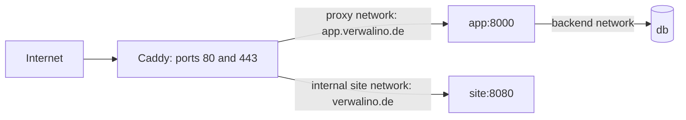

# Website hosting

The website deployment configured for issue #24 uses the existing hosted server and forced-command key.
This runbook describes operator setup after merge; it does not authorize a rollout. Legal review remains
with #26. Registration stays closed. See [DEPLOY.md](../../DEPLOY.md#website-container) for the workflow
and accepted SSH command grammar, and [website/README.md](../../website/README.md) for the static build.

## Image and isolation

`website/Dockerfile` runs `npm ci`, i18n, lint, build and link checks under digest-pinned Node 22.
Only `dist/` reaches the runtime. We use Caddy 2.10.2 from its pinned official Alpine image because it
already implements file serving, directory redirects and localized error pages. Its static binary is copied
onto pinned Alpine 3.22, avoiding the upstream runtime's curl/libcap packages and a duplicate binary layer.
BusyBox already supplies `wget` for the image healthcheck; no probe package is installed. The upstream
low-port file capability is removed before copying, so the binary runs with all capabilities dropped.
The runtime contains neither Node/npm nor project sources. The local amd64 image was about 76 MB
(uncompressed Docker image size); content and upstream updates can change this.

The service runs as uid/gid 10001 on port 8080, with a read-only root, all capabilities dropped and
`no-new-privileges`. No ports, host paths, secrets or credential environment are supplied to `site`.
TLS, the Caddy admin API and config persistence are disabled inside that container. Caddy still performs
storage housekeeping, so only `/data` is writable: an ephemeral, 1 MiB, uid-owned tmpfs with
`noexec,nosuid,nodev`. Logs go to stdout/stderr with bounded Docker local-log rotation. Limits are
128 MiB RAM, half a CPU and 64 PIDs.



Only Caddy and `site` join `verwalino_site`, an internal Docker network without outbound internet routing.
The app uses `proxy` and `backend`; db uses `backend`. The site cannot address app/db directly or read
host files, documents or credentials. Caddy remains a shared trust boundary: a compromised site can reach
Caddy, whose public app routes still require app authentication and organization isolation.

The operator imports `infra/Caddyfile.site` into the public Caddy configuration. Automatic HTTPS uses
the same certificate volumes as the app. Both site hosts receive the app's HSTS, nosniff, frame denial,
referrer policy, CSP and removal of the Server header, plus a restrictive Permissions-Policy.
`www.verwalino.de` redirects to `https://verwalino.de{uri}` with status 308. Scripts and fonts are local;
the CSP permits no inline scripts. Inline styles remain allowed for Astro's built CSS. Missing paths
return HTTP 404 with German or English error content; there is no SPA fallback.

## Enable the hosted extension once

Prerequisites: the server checkout must contain the reviewed deploy script, image/compose extension and
Caddy snippet from this change, normally through the first app release containing #24. A site deployment
never updates that checkout. If the first main-push deploy runs before setup, it fails closed; rerun the
workflow after setup. The GHCR site package must be publicly readable (or use the operator's existing
registry credential store). No new key or user is needed.

DNS for `verwalino.de` and `www.verwalino.de` must point to the existing Caddy listener. The existing
private installer config must use `VERWALINO_MODE=https` and `VERWALINO_DOMAIN=app.verwalino.de`.
Never add site settings to that strict installer config. Keep the tracked generic Caddyfile unchanged:

```sh
cd /srv/verwalino/app
cp infra/Caddyfile /srv/verwalino/config/Caddyfile.hosted
printf '\nimport /etc/caddy/Caddyfile.site\n' >> /srv/verwalino/config/Caddyfile.hosted
chmod 640 /srv/verwalino/config/Caddyfile.hosted
```

Select a full published commit SHA from the successful Website build/sign job. Pull and pin it before the
first start, preserving the tag in the image reference so subsequent deployments can report its SHA:

```sh
SITE_SHA=<40-character-published-commit-sha>
site_tag="ghcr.io/itskeks/verwalino-site:$SITE_SHA"
docker pull "$site_tag"
site_digest=$(docker image inspect --format '{{range .RepoDigests}}{{println .}}{{end}}' "$site_tag" |
  grep -m1 -E '^ghcr\.io/itskeks/verwalino-site@sha256:[a-f0-9]{64}$')
test -n "$site_digest"
export VERWALINO_SITE_IMAGE="$site_tag@${site_digest#*@}"
export VERWALINO_CONFIG=/srv/verwalino/config/.env.selfhost
export VERWALINO_COOKIE_SECURE=true VERWALINO_COOKIE_NAME=__Host-hv_session
export VERWALINO_ALLOWED_HOSTS=app.verwalino.de,localhost,127.0.0.1
docker compose --project-name verwalino --env-file "$VERWALINO_CONFIG" \
  -f infra/docker-compose.yml -f infra/docker-compose.site.yml --profile https \
  up -d --no-deps site caddy
```

The override replaces Caddy's config mount with the operator-owned file and mounts the reviewed snippet
read-only. Neither mount is given to `site`. `--no-deps` leaves app/db alone; the first enable recreates
Caddy to attach its additional network. Check HTTPS, the 308 redirect and the app after this operator step.
An omitted `VERWALINO_SITE_IMAGE` defaults to the published `main` tag for compose rendering, but use the
SHA plus digest pin for actual starts. The forced deploy always supplies that pin itself.

The portable installer deliberately uses only the base compose file. An app release through
`deploy-server.sh vX.Y.Z` detects the enabled extension before starting the installer and reapplies the
Caddy override afterward, without recreating site. After a **manual** `self-host.sh start`, reapply the same
override with `up -d --no-deps caddy` before a site deploy. Reuse the installed app block when updating
`Caddyfile.hosted` after an upstream Caddy configuration change.

## Deployment and rollback

Main-push publication signs the image index after both platforms and their provenance/SBOMs are pushed.
Deployment uses only `DEPLOY_HOST`, `DEPLOY_USER`, `DEPLOY_SSH_KEY` and `DEPLOY_KNOWN_HOSTS`, with strict
host-key checking. The server accepts exactly `vX.Y.Z` or `site <40-lowercase-hex-sha>`; malformed commands
exit 2 before side effects. A missing operator file, HTTPS configuration or running Caddy on the site
network refuses site deployment before pulling. Pull/digest/recreation/health failures exit nonzero.

The site path pulls only its own repository, requires a matching registry RepoDigest, and recreates only
the site service with `--no-deps --force-recreate --pull never`. Docker validates pulled content against
the registry digest. Server-side cosign verification is absent, matching the existing app deploy; the
workflow signs keylessly. Do not describe the deploy key as cryptographically restricted to main commits:
its grammar limits repository/tag shape, while image publication permissions remain a trust boundary.

Read `previous site sha: ...` in the deployment log. Roll back explicitly through the same forced command:

```sh
ssh -T -i <existing-deploy-key> -o IdentitiesOnly=yes -o BatchMode=yes \
  -o StrictHostKeyChecking=yes <admin>@<host> "site <previous-sha>"
# Or on the server:
/srv/verwalino/app/scripts/deploy-server.sh site <previous-sha>
```

The previous SHA is recovered from the existing container's image reference, even if it is stopped.
It is printed before pulling/recreating, so preserve the log if a deploy fails. No known prior SHA means
the log says `unknown` and does not invent a rollback command. Retain SHA tags in GHCR; restarting an older
static site has no database implications. There is no automatic rollback. The site uses the same server
deploy lock/log directory as the app; check that no operation runs before removing a stale `.deploy.lock`.

## Troubleshooting and verification

Use the compose prefix from setup (same explicit project, env file and both `-f` files) with `ps site caddy`
or `logs --tail 100 site caddy`. The site has no host listener. The deploy health probe runs the existing
Caddy image's BusyBox `wget -S -O /dev/null -T 2 http://site:8080/` through `docker exec` and requires the
first HTTP status to be 200, retrying up to 24 times with three-second pauses. This covers Docker DNS,
the shared network and the site listener, but not public DNS, certificate issuance or the public redirect.
Check those externally after rollout. The image's own healthcheck probes loopback port 8080.

If the site is refused as disabled, check `Caddyfile.hosted`, its import and Caddy's `verwalino_site`
membership. If digest resolution fails, verify the package/tag is published and readable; app/db and the
private config are untouched. If the site cannot start, check uid 10001 ownership of `/data` tmpfs and
that the image binary has no low-port capability. If public HTTPS fails while internal HTTP succeeds,
check Caddy's logs, DNS and certificates. A stale operator-owned app block must be reconciled manually.

Local contracts (`make test-installer`) fake Docker and never access a database. Build with
`docker buildx build --platform linux/amd64 -t verwalino-site:check website/`, then smoke-test that image
with a read-only root, all caps dropped, `no-new-privileges`, the `/data` tmpfs above and only the loopback
mapping `127.0.0.1:18089:8080`; remove the container afterward. Verify `/` and `/en/` return 200, and unknown
German/English paths return 404. Also test traversal/source-file requests, attempted writes/privilege gain,
app/db network isolation, malformed deploy commands, bad digest metadata and HTTP redirects/errors in
the readiness probe. Compose configuration and network-none Caddy validation do not prove live isolation.
