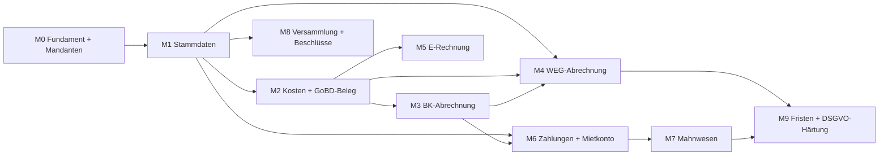

# Roadmap: Hausverwaltungssoftware MVP

Stand: 2026-06-02 · Bezug: [sdd-property-management-mvp.md](sdd-property-management-mvp.md) v0.2

Diese Roadmap sequenziert den in der SDD beschriebenen Funktionsumfang. Sie ist ein Planungsdokument und ändert nicht den fachlichen Anspruch der SDD — sie legt fest, **in welcher Reihenfolge** gebaut wird und **wann es einen vorzeigbaren Stand** gibt.

## Umsetzungsstand (2026-06-02)

**Alle Milestones M0–M9 sind implementiert (Backend + Frontend) und committet** — Releases A, B und C feature-komplett. Stand der Backend-Testsuite: **462 Tests grün** (reine Engine-Golden-/Invarianten-Tests + DB-Integration: RLS-Mandantentrennung, GoBD-Unveränderbarkeit, RBAC). Architekturentscheidungen in ADR-0001…0012.

**Offen (kein Code mehr, sondern Abnahme):**
- **Fachliche/rechtliche Abnahme** aller mit **[§18/fachlich]** markierten Annahmen durch Steuerberater:in / Fachanwalt:anwältin / DSB (u. a. Aufbewahrungs-Startdatum/-dauer, WEG-Fristen, Anonymisierungstiefe, Verteilungs-Detailfragen, Mahngebühren).
- **Zurückgestellter Feinschliff** (dokumentiert, nicht kritisch): Snapshot-Namens-Einfrieren, E-Rechnung-Quelle/Badge im UI, Bankkontostände im Vermögensbericht, DSGVO-Create-Pfad-Sperre (ADR-0012 §8).

## Leitprinzipien der Reihenfolge

1. **Abhängigkeiten zuerst.** Mandantentrennung und Stammdaten tragen alles Weitere und lassen sich kaum nachrüsten.
2. **Wert zuerst.** So schnell wie möglich eine korrekte Betriebskosten- und Hausgeldabrechnung erzeugen — das ist der Kern des Produkts.
3. **Compliance früh mitdenken, spät härten.** GoBD-Unveränderbarkeit, Mandantentrennung und DSGVO sind Invarianten: im Datenmodell ab M0 verankert, voll ausgehärtet am Ende.
4. **Schwere, eigenständige Module nach hinten.** Versammlungsverwaltung und vollwertiges Mietkonto/Mahnwesen sind je eigene Bausteine und kommen, wenn der Kern steht.

## Releases auf einen Blick

| Release | Ziel | Milestones | Ergebnis |
| --- | --- | --- | --- |
| **A — Abrechnung lauffähig** (internes Alpha) | Korrekte Abrechnungen aus manuell erfassten Daten | M0–M4 | BK- + WEG-Abrechnung + Vermögensbericht als PDF, GoBD-Belegablage |
| **B — Geld & Eingang** (Beta) | Geldfluss end-to-end + strukturierter Rechnungseingang | M5–M7 | E-Rechnung-Empfang, Mietkonto, offene Posten, Mahnwesen |
| **C — Governance & Härtung** (1.0) | WEG-Governance + Compliance-Finish | M8–M9 | Versammlung/Beschluss-Sammlung, Fristen, DSGVO-Härtung |

## Abhängigkeitskette

Textuell: M0 → M1 → M2 → M3 → M4. M5 hängt an M2. M6 an M1+M3, M7 an M6. M8 nur an M1. M9 schließt ab. **Kritischer Pfad: M0 → M1 → M2 → M3 → M4.**

## Modell-Zuordnung (Opus 4.6 / 4.8)

Umgesetzt über zwei gepinnte Subagenten: `.claude/agents/bulk-impl.md` (Opus 4.6, Bulk-Engineering) und `.claude/agents/engine-correctness.md` (Opus 4.8, Korrektheit & Architektur). Bei der Arbeit die jeweilige Aufgabe an den passenden Agenten delegieren.

| Milestone / Arbeit | Modell | Subagent |
| --- | --- | --- |
| M0 Architektur-/Datenmodell-Design (Mandanten-Invariante, GoBD-Konzept) | Opus 4.8 | `engine-correctness` |
| M0 Implementierung (Shell, Auth, Scaffolding) | Opus 4.6 | `bulk-impl` |
| M1 Stammdaten | Opus 4.6 | `bulk-impl` |
| M2 GoBD-Belegspeicher-Design | Opus 4.8 | `engine-correctness` |
| M2 Kostenerfassung, Beleg-CRUD, PDF-Import | Opus 4.6 | `bulk-impl` |
| M3 Verteilungs-Engine | Opus 4.8 | `engine-correctness` |
| M4 WEG-Abrechnung, Abrechnungsspitze, Vermögensbericht | Opus 4.8 | `engine-correctness` |
| M5 E-Rechnung-Parser | Opus 4.6 | `bulk-impl` |
| M6 Zahlungen & Mietkonto | Opus 4.6 | `bulk-impl` |
| M7 Mahnwesen | Opus 4.6 | `bulk-impl` |
| M8 Versammlung & Beschluss-Sammlung | Opus 4.6 | `bulk-impl` |
| M9 Fristen-Implementierung | Opus 4.6 | `bulk-impl` |
| M9 GoBD-/DSGVO-Review | Opus 4.8 | `engine-correctness` |
| Festgefahrenes Korrektheits-Debugging (überall) | Opus 4.8 | `engine-correctness` |

Modell-IDs ggf. an die im `/model`-Picker verfügbaren Versionen anpassen.

---

## Release A — Abrechnung lauffähig

### M0 · Fundament & Mandantenfähigkeit — *Aufwand: L*
**Ziel:** Tragfähiges Skelett mit harter Datentrennung.
- Responsive Web-App-Shell (React/TS), Navigations- und Layout-Grundgerüst (Desktop + mobil).
- Auth/Login mit Organization-Bindung; feste Rollen (Inhaber/Admin, Sachbearbeiter, Nur-Lesen).
- `Organization`-Scoping als Invariante in jeder Datenzugriffsschicht; `ManagementMandate`-Grundgerüst.
- PostgreSQL-Schema-Fundament, Server-Setup, PDF-Rendering-Pipeline (HTML→PDF) als Infrastruktur.
- **Exit:** Zwei Organizations können angelegt werden und sehen garantiert keine Daten der jeweils anderen; Rollen greifen.
- SDD: §4, §13, §16.

### M1 · Stammdaten — *Aufwand: M–L*
**Ziel:** Objekte, Einheiten und Personen mit korrekter Historie.
- `Property`, `Unit` (inkl. MEA, Fläche, beheizte Fläche, Nutzungsart), `Person`, `OwnerProfile`, `TenantProfile`, `Vendor`.
- `OwnershipHistory` und `LeaseAgreement` mit Start/Ende — Grundlage für anteilige Zeiträume.
- Verwaltungsarten Mietobjekt / WEG / SEV / Misch.
- **Exit:** Ein Mischobjekt mit Eigentümer- und Mieterwechsel innerhalb eines Jahres lässt sich lückenlos und überschneidungsfrei abbilden.
- SDD: §5, §6.1, §6.2.

### M2 · Kosten & GoBD-Belegfluss — *Aufwand: L*
**Ziel:** Kosten erfassen und Belege revisionssicher ablegen.
- `CostCategory` (fester Standardkontenplan mit Defaults), manuelle `CostEntry`.
- `InvoiceDocument` mit Prüfsumme (SHA-256), Versionierung, Unveränderbarkeit nach Freigabe, Änderungs-/Freigabe-Historie.
- Assistierter **PDF-Import** (OCR/Parsing) mit Statusmodell `draft_extracted` → `confirmed`.
- **Exit:** Eine hochgeladene PDF-Rechnung wird als Vorschlag erkannt, bestätigt, unveränderbar archiviert und ist abrechnungsrelevant.
- SDD: §6.4, §6.6, §7, §9. *(Querschnitt GoBD wird hier real.)*

### M3 · Betriebskostenabrechnung (Miete) — *Aufwand: XL*
**Ziel:** Der Abrechnungskern — die schwierigste Korrektheitsarbeit.
- Verteilungs-Engine für alle Schlüssel (MEA, Fläche, beheizte Fläche, Einheit, Personen, Verbrauch, extern, manuell).
- Anteilige Zeiträume bei unterjährigem Wechsel; Leerstandslogik; CO2-Aufteilung (10-Stufen, Mieteranteil); Heizkosten als externe Werte.
- Mieter-getrennte Umlagefähigkeit; Soll-Anteil minus Vorauszahlungen (Vorauszahlungssumme zunächst manuell).
- `SettlementRun`/`SettlementLine` als unveränderbare Snapshots; **BK-Abrechnungs-PDF** mit allen formellen BGH-Pflichtangaben.
- **Exit:** Eine BK-Abrechnung für ein Mischobjekt mit Mieterwechsel ist nachrechenbar korrekt und formell vollständig.
- SDD: §6.9, §8, §11.

### M4 · WEG-Abrechnung & Vermögensbericht — *Aufwand: L*
**Ziel:** WEG-Outputs auf Basis derselben Engine.
- `EconomicPlan` (Wirtschaftsplan) mit Hausgeldvorschlägen, Rücklagenzuführung.
- Hausgeld-/Jahresabrechnung mit **Abrechnungsspitze (WEMoG)**, Trennung umlagefähig/nicht umlagefähig/Rücklage.
- **Vermögensbericht (§ 28 IV WEG)**: Rücklagenstand + wesentliches Gemeinschaftsvermögen.
- **Exit:** Wirtschaftsplan, Jahresabrechnung und Vermögensbericht für eine WEG sind als PDF erzeugbar; Beträge sind konsistent.
- SDD: §6.9, §10, §11.

> **Ende Release A:** Das Produkt erzeugt aus manuell erfassten Daten alle Kernabrechnungen — der erste echte, vorzeigbare Wert.

---

## Release B — Geld & Eingang

### M5 · E-Rechnung-Empfang — *Aufwand: M*
**Ziel:** Strukturierter Rechnungseingang (gesetzliche Empfangspflicht seit 2025).
- Parser/Validator für **XRechnung (XML)** und **ZUGFeRD (EN-16931)**.
- Mapping der strukturierten Felder auf `CostEntry`/`InvoiceDocument`, dann derselbe Freigabe-Flow wie M2.
- **Exit:** Eine XRechnung und eine ZUGFeRD-Datei werden eingelesen, korrekt gemappt und revisionssicher abgelegt.
- SDD: §6.5, §9.

### M6 · Zahlungen, Mietkonto & offene Posten — *Aufwand: M–L*
**Ziel:** Geldfluss vollständig abbilden (manuell, kein Bankimport).
- `BankAccount` je Mandat/WEG (Vermögenstrennung), Kaltmiete + NK-Vorauszahlung im Mietkonto.
- `Payment`-Erfassung und Zuordnung; `OpenItem`-Liste je Person; Verknüpfung in die Abrechnung (echte Nachzahlung/Guthaben statt manueller Vorauszahlungssumme).
- **Exit:** Soll-Ist je Person stimmt; eine Abrechnung zieht erfasste Zahlungen automatisch.
- SDD: §6.3, §6.7.

### M7 · Mahnwesen — *Aufwand: S–M*
**Ziel:** Überfällige Posten bearbeiten.
- Erkennung überfälliger Soll-Stellungen, Mahnstufen, `DunningNotice` als PDF, Mahnhistorie.
- **Exit:** Aus offenen Posten lässt sich ein mehrstufiger Mahnlauf erzeugen und dokumentieren.
- SDD: §6.8.

---

## Release C — Governance & Härtung

### M8 · Eigentümerversammlung & Beschluss-Sammlung — *Aufwand: M*
**Ziel:** WEG-Governance dokumentieren.
- `OwnersMeeting` (Einladung, TOP, Teilnehmer/Stimmrechte, Protokoll), `Resolution` mit Abstimmungsergebnis.
- `ResolutionRegister` (Beschluss-Sammlung, § 24 VII): fortlaufend nummeriert, datiert, Anfechtungsvermerk.
- **Exit:** Ein Beschluss aus einer Versammlung landet korrekt nummeriert in der Beschluss-Sammlung.
- SDD: §6.10.

### M9 · Fristenüberwachung & DSGVO-Härtung — *Aufwand: M*
**Ziel:** Compliance-Finish über alle Module.
- Fristen: 12-Monats-Frist BK (§ 556 III), WEG-Jahresabrechnung/Vermögensbericht, fällige Wirtschaftspläne, überfällige Posten.
- DSGVO: Lösch-/Anonymisierungskonzept im Einklang mit 8-Jahres-Belegaufbewahrung, Auskunfts-/Export-Funktion, EU-Hosting/AV-Vertrag final.
- **Exit:** Fristen werden aktiv gemeldet; eine Löschanfrage ist bedienbar, ohne die revisionssichere Ablage zu verletzen.
- SDD: §12, §15.

---

## Querschnittsthemen (über alle Milestones)

Diese werden **ab M0 im Datenmodell verankert** und in M9 final gehärtet — nicht erst am Ende „angebaut":

- **Mandantentrennung** (Invariante jeder Query)
- **GoBD-Unveränderbarkeit** (ab M2 real)
- **DSGVO** (Datenminimierung/Zugriff von Anfang an, Löschkonzept in M9)
- **Snapshots** für jede finalisierte Abrechnung

## Aufwandsgrößen & Zeitplan

Die Größen (S/M/L/XL) sind **relativer Aufwand**, keine Kalenderzusage. M3 (Verteilungs-Engine mit anteiligen Zeiträumen) ist der größte und risikoreichste Brocken — hier zuerst die Engine, dann das PDF.

> Für einen echten Zeitplan brauche ich Teamgröße und ungefähre Velocity. Sag mir, mit wie vielen Entwickler:innen ihr rechnet, dann übersetze ich die Größen in Kalenderwochen und schlage parallelisierbare Stränge vor (z. B. M5 E-Rechnung parallel zu M4, M8 Versammlung parallel zu Release B).

## Offene Roadmap-Entscheidungen

- Ob die gesetzliche E-Rechnung-Empfangspflicht ein **Vorziehen von M5 in Release A** rechtfertigt (rechtlich relevant, technisch unabhängig vom Abrechnungskern).
- Ob ein noch kleineres „Walking Skeleton" (M0 + M1 + nur BK für ein reines Mietobjekt) als allererster Meilenstein sinnvoll ist, um früh Feedback zu bekommen.
- Priorisierung der offenen Detailfragen aus SDD §18, die einzelne Milestones blockieren könnten (z. B. genaue Mietkonto-Tiefe für M6).
